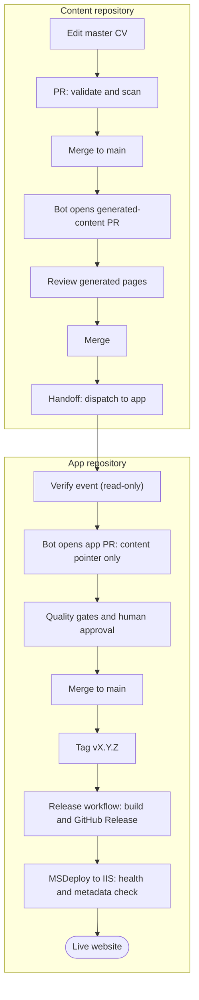

# CV Online Presenter

A .NET modular monolith and TypeScript client build for a content-driven consultant portfolio. Content is maintained in the [`cv-online-presenter-content`](https://github.com/fredrik-hellmangroup/cv-online-presenter-content) repository and pinned here as a Git submodule revision. The template publishes no personal profile facts.

## Requirements

- .NET SDK 10.0.401 (pinned in `global.json`)
- Node.js 24 and npm

Clone with the pinned content revision:

```powershell
git clone --recurse-submodules https://github.com/fredrik-hellmangroup/cv-online-presenter.git
```

For an existing checkout, run `git submodule update --init --recursive` before building.

## Build

```powershell
dotnet restore CvOnlinePresenter.sln
npm ci --prefix client
npm run build
npm run build:dotnet
```

Run the web host with `dotnet run --project src/Portfolio.Web`.

Run accessibility and responsive checks with `npm ci --prefix tools/a11y` followed by `npm run test:a11y`. The command also builds the client bundle. See [docs/accessibility.md](docs/accessibility.md) for the manual release checklist and security checks.

## Modules

See [docs/architecture.md](docs/architecture.md) for project responsibilities and the allowed dependency direction. Architecture decisions available to this baseline are recorded in [docs/adr](docs/adr/README.md).

## How content reaches the website



- Edit content in the content repository only. Generated pages are never edited by hand.
- The app pins one content commit. An app PR moves that pointer, and a person reviews and merges it.
- Nothing is released or deployed automatically. A release is a manual `vMAJOR.MINOR.PATCH` tag on `main`.

## Documentation

| Read | To learn |
| --- | --- |
| [repositories.md](docs/repositories.md) | How the two repositories connect, and the one-time setup |
| [iis-release.md](docs/iis-release.md) | How a release reaches the IIS site |
| [rollback-runbook.md](docs/rollback-runbook.md) | How to roll back to an earlier release |
| [quality-gates.md](docs/quality-gates.md) | Which checks run before merge and release |
| [content.md](docs/content.md) | Markdown format for content pages |
| [cv-structure.md](docs/cv-structure.md) | How the CV page is structured |
| [content-releases.md](docs/content-releases.md) | Runtime content snapshots and activation |
| [contact-form.md](docs/contact-form.md) | Contact form setup and privacy |
| [accessibility.md](docs/accessibility.md) | Accessibility and responsive checks |
| [architecture.md](docs/architecture.md) | Module layout and dependency rules |
| [decision-register.md](docs/decision-register.md) | Open owner decisions |
| [adr](docs/adr/README.md) | Architecture decision records |

Both repositories are MIT licensed.
