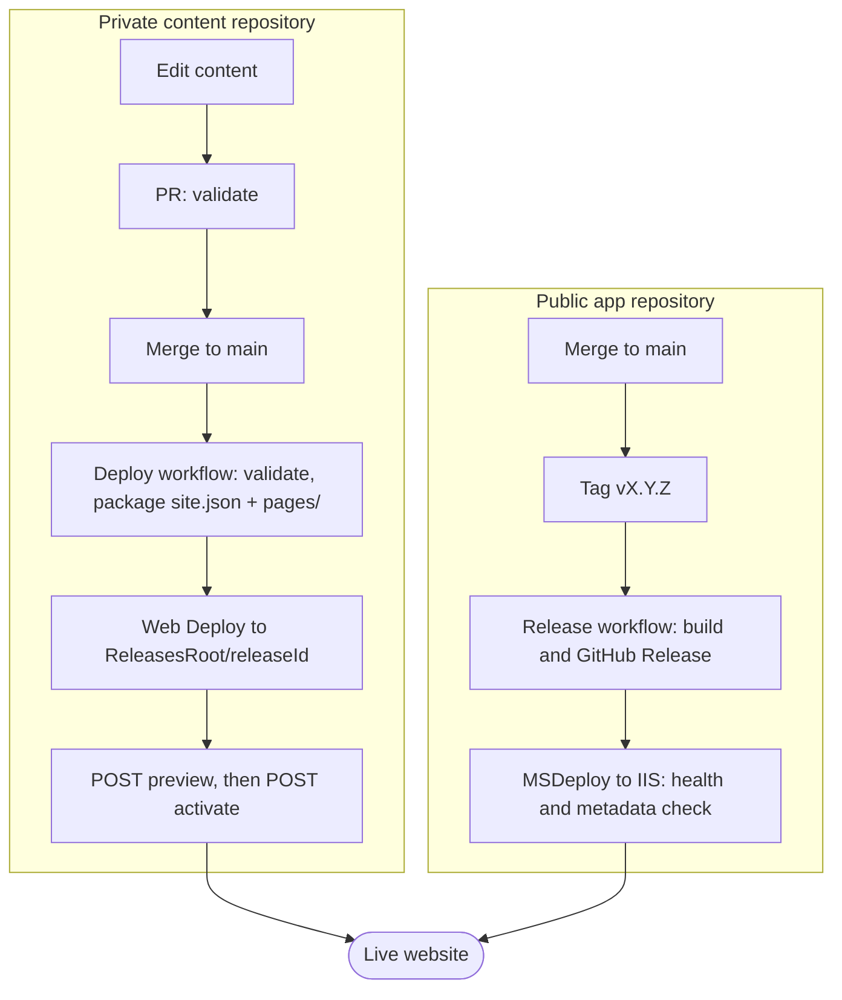

# CV Online Presenter

A .NET modular monolith and TypeScript client build for a content-driven consultant portfolio. The public [`content/`](content/README.md) folder is a template with synthetic demo data that shows the structure, schema and page types. The real CV content lives in a separate **private** content repository and is deployed to the live site as a content release, without an app release. This repository publishes no personal profile facts.

## Requirements

- .NET SDK 10.0.401 (pinned in `global.json`)
- Node.js 24 and npm

Clone and build; no submodule step is needed:

```powershell
git clone https://github.com/fredrik-hellmangroup/cv-online-presenter.git
```

## Build

```powershell
dotnet restore CvOnlinePresenter.sln
npm ci --prefix client
npm run build
npm run build:dotnet
```

Run the web host with `dotnet run --project src/Portfolio.Web`.

Run accessibility and responsive checks with `npm ci --prefix tools/a11y` followed by `npm run test:a11y`. The command also builds the client bundle. See [docs/accessibility.md](docs/accessibility.md) for the manual release checklist and security checks.

## Modules

See [docs/architecture.md](docs/architecture.md) for project responsibilities and the allowed dependency direction. Architecture decisions available to this baseline are recorded in [docs/adr](docs/adr/README.md).

## How content reaches the website



- Real content is edited in the private content repository only. The public `content/` folder is a demo template.
- A content push to `main` deploys a new immutable release folder and activates it. The active release is persisted in `active-release.txt` and survives app restarts and app releases.
- Rollback is re-activating an earlier release id. See [docs/content-releases.md](docs/content-releases.md).
- App releases stay a manual `vMAJOR.MINOR.PATCH` tag on `main`. The bundled demo content is only a fallback when no content release is active.

## Documentation

| Read | To learn |
| --- | --- |
| [content/README.md](content/README.md) | The public content template and how to create your own |
| [repositories.md](docs/repositories.md) | How the two repositories connect, and the one-time setup |
| [iis-release.md](docs/iis-release.md) | How a release reaches the IIS site |
| [rollback-runbook.md](docs/rollback-runbook.md) | How to roll back to an earlier release |
| [quality-gates.md](docs/quality-gates.md) | Which checks run before merge and release |
| [content.md](docs/content.md) | Markdown format for content pages |
| [cv-structure.md](docs/cv-structure.md) | How the CV page is structured |
| [content-releases.md](docs/content-releases.md) | Runtime content snapshots and activation |
| [contact-form.md](docs/contact-form.md) | Contact form setup and privacy |
| [accessibility.md](docs/accessibility.md) | Accessibility and responsive checks |
| [architecture.md](docs/architecture.md) | Module layout and dependency rules |
| [decision-register.md](docs/decision-register.md) | Open owner decisions |
| [adr](docs/adr/README.md) | Architecture decision records |

This repository is MIT licensed. The private content repository holds personal data and is not published.
