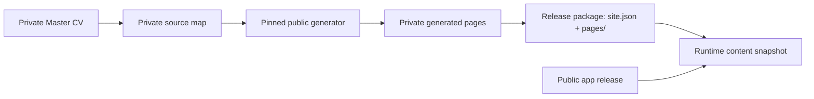

# CV Online Presenter

Last updated: 2026-11-06

A .NET modular monolith and TypeScript client for a content-driven consultant
portfolio. This **public** repository contains application code and synthetic
content only. Real CV source and generated pages belong in a separate **private**
content repository. See [repository boundaries](docs/repositories.md) before
making changes.



The source map maps visible source evidence to an allowlisted set of generated
pages; the release package contains only site settings and those pages. The app
and content release independently. See the [source-map quick-start](docs/source-map.md)
and [content release contract](docs/content-releases.md).

## Requirements and build

- .NET SDK 10.0.401 (pinned in `global.json`)
- Node.js 24 and npm

```powershell
git clone https://github.com/fredrik-hellmangroup/cv-online-presenter.git
Set-Location cv-online-presenter
dotnet restore CvOnlinePresenter.sln
npm ci --prefix client
npm run build
npm run build:dotnet
```

Run the web host with `dotnet run --project src/Portfolio.Web`. The public
content-tooling tests use synthetic fixtures (`npm run test:content`); normal
app CI does not check out private CV material. Accessibility and responsive
checks: `npm ci --prefix tools/a11y`, then `npm run test:a11y`. See
[accessibility checks](docs/accessibility.md).

## Separate app and content releases

The current private caller validates on pull requests and pushes to `main`;
it deploys on `main` changes to `content/pages/**` or `content/site.json`.
Its reusable-workflow references must stay pinned to an exact release tag of the
public app, the same release used for generation and recorded in provenance. The public
workflows verify source identity before checkout and fail closed if the
repository or release tag does not match. This responsibility belongs to the caller;
the public repository contains no real content or private caller files.

Content-only changes do not require an app deployment. Validated content
releases package only `site.json` and `pages/`, upload to a new release folder,
preview, and activate a runtime snapshot. The app is released separately from
a `vMAJOR.MINOR.PATCH` tag on `main`; content rollback reactivates an existing
release, while app rollback redeploys an immutable package. The reusable
workflows require GitHub.com because their workflow-source identity contexts
are unavailable on GHES. See [repositories](docs/repositories.md),
[content releases](docs/content-releases.md), [IIS release](docs/iis-release.md),
and [rollback runbook](docs/rollback-runbook.md).

Generated pages can be tested without copying them into this checkout: set
`EDITORIAL_CONTENT_PAGES` to the private `content/pages` directory and run the
editorial test class. Browser tests use the same path through
`Content__PagesRoot`; exact commands are in
[generated-content validation](docs/repositories.md#generated-content-validation).

## Modules and documentation

See [architecture](docs/architecture.md) for project responsibilities and
dependency direction; decisions are in [ADRs](docs/adr/README.md).

| Read | To learn |
|---|---|
| [content/README.md](content/README.md) | Synthetic template layout and private-content boundary |
| [fork guide](docs/fork-guide.md) | Safe app fork and private-content setup |
| [repositories](docs/repositories.md) | Repository responsibilities, CI/release boundary, generated-content tests |
| [quality gates](docs/quality-gates.md) | App and private caller CI lanes |
| [content format](docs/content.md) | Markdown page format |
| [source map](docs/source-map.md) | Master CV mapping, generation, and provenance |
| [content releases](docs/content-releases.md) | Runtime snapshots, activation, and workflow operations |
| [accessibility](docs/accessibility.md) | Accessibility and responsive checks |
| [architecture](docs/architecture.md) | Module layout and dependency rules |

This repository is MIT licensed. The private content repository holds personal
data and is not published.
