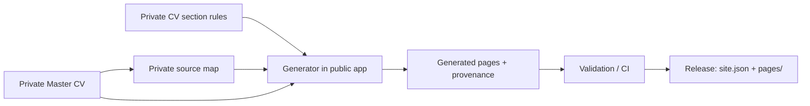

# Public content template

Last updated: 2026-11-06

This public folder contains **synthetic content only**. All people, organizations,
projects, and contact values in the template are fictional. Keep real CV facts,
contact details, canonical source material, and source maps in a separate
**private** content repository; never put them in this public app repository,
its issues, or its pull requests.

## From source to release



| Public app repository | Private content repository |
|---|---|
| App, generator, schemas, validators, reusable workflows, synthetic fixtures | Master CV, real source map, section rules, generated pages, provenance, caller workflows |

The public template documents the structure; it is not the starting place for
real CV facts. See the [fork guide](../docs/fork-guide.md) for private setup,
and [source-map.md](../docs/source-map.md) for how source sections map to pages.

```text
content/
  cv-sections.json                 CV section publication rules
  generated-provenance.json        generated hashes and output manifest
  pages/                           generated Markdown and synthetic demo pages
  schema/                          front-matter and generator schemas
  site.json                        locale and site settings
  source-map.json                  synthetic mapping input
  sources/master-cv.md             synthetic canonical source
```

`content/source-map.json` is the generator input. The safe, invented example
is [`docs/source-map.example.json`](../docs/source-map.example.json); it is not
loaded by the runtime. Its zero-valued bootstrap hashes are placeholders, not
usable seed hashes. `content/generated-provenance.json` is generator output,
not an editorial input to hand-edit. See [docs/source-map.md](../docs/source-map.md)
for the exact field and bootstrap contracts.

## Keep real content private

Create a separate private content repository for your own material. Its
`content/` tree follows the same shape, but it must be populated and validated
privately. The content-release workflow packages only `content/site.json` and
`content/pages/`; source documents, the source map, CV section rules, and
generation provenance are not part of the production package. See
[docs/content-releases.md](../docs/content-releases.md) and
[docs/repositories.md](../docs/repositories.md).

## Validate and generate a private content tree

Run this from the **public app repository root**, with the private content root
kept outside the public checkout and this checkout at the release tag the content
is pinned to (`git checkout --detach v1.0.15`). In CI, the reusable workflow
requires the caller to reference an exact release tag, derives the commit from
`job.workflow_sha` and the version from `job.workflow_ref`, and verifies both
before checkout; missing or mismatched contexts fail closed. The content checks
also verify that generated provenance carries the same `appVersion` and
`appCommitSha`. These contexts are GitHub.com-only, so the workflows fail
closed on GHES.

```powershell
.\scripts\validate-content.ps1 -ContentRoot 'D:\work\private-portfolio-content'
```

`-AppVersion` defaults to the exact release tag at `HEAD`. Add `-Generate` to
regenerate mapped pages and provenance first, and `-TestTooling` to also run
the tooling tests.

Do not use `-Generate` until every mapped seed output exists and
`bootstrapOutputSha256` contains the matching normalized SHA-256 for each path.
When provenance is already pinned to an app release, later checks and writes
must use the same version (the script does this for you). The generator and
content-format references are in
[docs/source-map.md](../docs/source-map.md), [docs/content.md](../docs/content.md),
and the [fork guide](../docs/fork-guide.md).
