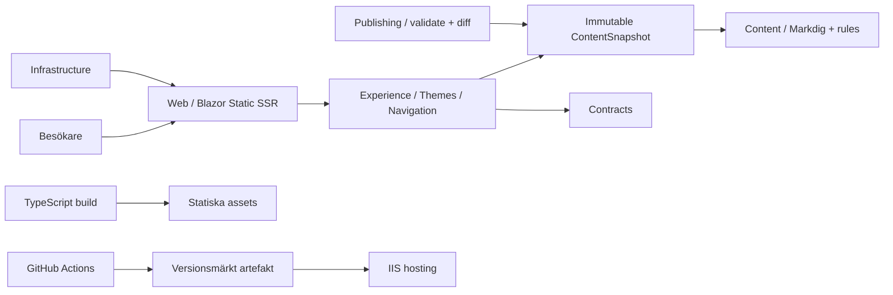
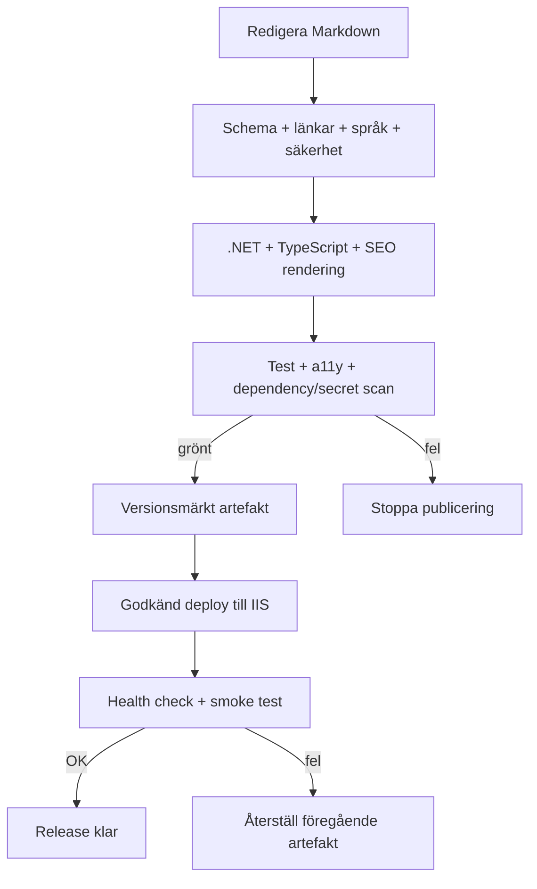

**PRODUKTKRAVSPECIFIKATION**
# Konsultportfolio
Personlig webbplats och öppen källkodsprodukt
Ett genomförbart kravunderlag för en tillgänglig, innehållsdriven konsultportfolio och återanvändbar open source-referensimplementation.
Version 1.1  |  28 oktober 2026  |  Svenska
Status: baslinje för planering och implementation
## Dokumentöversikt
| Fält | Värde |
| --- | --- |
| Syfte | Definiera mål, omfattning, krav, arkitektur, drift och release. |
| Läsare | Solo-maintainer, utvecklare som fork:ar projektet och tekniska granskare. |
| Beslutsgrund | ADR-001–018 enligt återfunnen beslutssammanställning; senare owner-bekräftelser för OQ-02–10 framgår av beslutsspåret. |
| Spårbarhet | Samtliga ADR-texter är införda i Bilaga B. Konflikter med senare owner-beslut är markerade uttryckligen i avsnitt 4. |
| Prioritet | P0 = första release; P1 = hög prioritet efter baslinje; P2 = valfri förbättring. |
## Innehåll
- 1. Sammanfattning och mål
- 2. Målgrupper och användarfall
- 3. Omfattning
- 4. ADR och spårbarhet
- 5. Funktionella krav
- 6. Icke-funktionella krav
- 7. Innehåll
- 8. Arkitektur
- 9. CI/CD och IIS
- 10. Säkerhet, SEO, tillgänglighet och analys
- 11. Teman och easter eggs
- 12. Risker, antaganden och frågor
- 13. Releaseplan
- Bilaga A. Kravspårning
## 1. Sammanfattning och produktmål
Produkten är en personlig konsultportfolio och samtidigt en developer-first open source-referensimplementation. Besökaren ska förstå erbjudandet, granska verifierad erfarenhet och ta kontakt. Utvecklare ska kunna klona/forka, konfigurera eget innehåll och bygga med reproducerbar setup.
Arkitekturen är en .NET Modular Monolith med separata projekt för Web, Content, Experience, Publishing, Infrastructure och Contracts samt separat TypeScript-build. Leverans sker som vertikala slices. Ingen AI-integration; endast faktiskt tillgängliga språk visas; solo-maintainer ska kunna driva tjänsten.
### Mål
- Göra profil, erbjudande, verifierade exempel och kontakt begripliga.
- Ge innehållsägaren kontroll; inga obekräftade CV-fakta publiceras.
- Visa en konkret open source-implementation med repo, setup, exempeldata och oberoende CI.
- Leverera snabb, tillgänglig, indexerbar webbplats med publicering till IIS.
- Hålla driftbördan låg med automatiserade kontroller och rollback.
### Mätbara utfall
| Mått | Verifiering |
| --- | --- |
| Kontakt | Primär kontaktlänk på startsidan fungerar på mobil och tangentbord. |
| Innehåll | Meriter har godkänd källa; demo-data är tydligt märkt. |
| Tillgänglighet | Inga kritiska automatiska a11y-fel; manuell kontroll dokumenterad. |
| Leverans | Båda repon har grönt CI; IIS health check och rollback demonstrerade. |
| Underhåll | Maintainer kan uppdatera, bygga, publicera och återställa enligt runbook. |
## 2. Målgrupper och användarfall
- Potentiell kund/rekryterare bedömer kompetens och trovärdighet.
- Teknisk granskare granskar kod, beslut, kvalitet och drift.
- Utvecklare använder projektet som startpunkt via fork/template.
- Solo-maintainer uppdaterar innehåll och sköter release/säkerhet.
| ID | Användarfall |
| --- | --- |
| UC-01 | Besökare förstår roll, erbjudande och nästa steg från startsidan. |
| UC-02 | Besökare granskar kompetens och går till verifierade projekt. |
| UC-03 | Besökare använder fungerande e-post eller professionell profil. |
| UC-04 | Besökare byter endast till språkversion som finns publicerad. |
| UC-05 | Utvecklare forkar, följer README, redigerar innehåll och bygger lokalt. |
| UC-06 | Maintainer ändrar Markdown, granskar diff, kör CI och publicerar till IIS. |
| UC-07 | Maintainer återställer senast fungerande artefakt efter fel. |
| UC-08 | Besökare kan upptäcka frivillig easter egg utan att kärnflöde påverkas. |
## 3. Omfattning och principer
### Ingår
- Responsiv portfolio med profil, erbjudande, tjänster/kompetens, projekt och kontakt.
- Markdown med validerad front matter; publicera endast tillgängliga språk.
- Teman och diskreta easter eggs som inte hindrar läsbarhet/navigation.
- Två GitHub-repon, reproducerbar fork/template, skript, ADR-dokumentation och oberoende CI.
- IIS-hosting med versionsmärkt release, health check, loggning och rollback.
- Exempel-CV utan påhittade personuppgifter eller verkliga meriter.
### Ingår inte
- AI-generering, chat, rekommendationer eller profilmatchning.
- Automatisk översättning eller språkval till saknade översättningar.
- CMS-konton, flerredaktörsflöde eller generell databasadmin.
- Fabricerade meriter/arbetsgivare/resultat.
- Marknadsföringsautomation eller onödig persondatainsamling.
## 4. ADR-beslut och spårbarhet

Originaltexten för samtliga beslut återfanns i `ADR-001-018_Sammanstallning.md` och återges ordagrant i Bilaga B. Tabellen nedan sammanfattar beslut och kopplar dem till verifierbara krav. Där en senare owner-bekräftelse preciserar eller ändrar ett ursprungligt beslut är det uttryckligen markerat; den senare bekräftelsen styr aktuell implementation.

| ADR | Fastställt beslut | Kravspårning |
| --- | --- | --- |
| 001 B | Portfolio-first startsida med fullständig, trogen dokumentvy. | FR-001, FR-002, FR-023 |
| 002 C | Markdig AST och deterministiska C#-regler klassificerar innehåll; valfri metadata och generisk fallback. Ingen runtime-AI. | FR-007, FR-024 |
| 003 B | Blazor Web App med Static SSR som grund; TypeScript för klientinteraktioner; selektiv Blazor-interaktivitet. | FR-001, FR-023, NFR-012 |
| 004 B | Modulär Theme Engine och Easter Egg Engine med manifest, kalenderregler och felisolering. | FR-009, FR-010, NFR-002 |
| 005 B | App och CV har separata versioner/releases; runtime-content på IIS valideras, cachas och kan återställas. | FR-017, FR-018, FR-024 |
| 006 B | Tailwind, egna Blazor-komponenter, semantiska tokens och Scandinavian Editorial. | FR-001, FR-009, NFR-002/003 |
| 007 C | Editorial-start, detaljrutter, full CV-vy, Command Palette, sökning och stabila deep links. | FR-023 |
| 008 C | Identitetsmanifest äger stabil identitet/kontakt/profilbild; Markdown äger erfarenhet/kompetens; SEO byggs från versionerad modell. | FR-011–013, FR-025 |
| 009 B | Strukturerad loggning, health checks, OpenTelemetry och integritetsvänlig aggregerad analys. | FR-019, NFR-007/011 |
| 010 B | Riskbaserade kvalitetsgrindar: Application CI, Content CI och Deployment Verification; unit-, browser-, content-, security-, a11y- och visual tests. | FR-016–018, NFR-002/004/012 |
| 011 B | Defense in Depth för publik/forkbar kod med solo-maintainer; privat content och produktions-CD isoleras. | NFR-004/007/011, FR-016–018 |
| 012 B | Immutable ContentSnapshot, atomärt byte, flernivåcache, versionsbaserade assets och lazy loading. | FR-024, NFR-001/007 |
| 013 B | Deterministisk content-validering, AST-/textdiff och privat preview; manuell publicering av verifierad release; ingen AI i app/CI/publishing. | FR-007/008/017, NFR-004 |
| 014 B | Svenska och engelska stöds; endast språk med publicerad CV-fil visas; WCAG 2.2 AA är mål. | FR-006, NFR-002/010 |
| 015 B | Modular Monolith med Web, Content, Experience, Publishing, Infrastructure och Contracts samt separat TypeScript-build. | NFR-008/012, avsnitt 8 |
| 016 B | Developer-first open source med reproducerbar setup, demo-CV, scripts, ADRs och oberoende CI. | FR-014–016, NFR-012 |
| 017 A | Personlig Open Source Showcase, inte ett generellt portfolio-framework. | FR-004/014/015, omfattning |
| 018 B | Vertical Slice Delivery; production baseline omfattar portfolio, full Markdown/Mermaid, klassificering, dokument-/uppdrags-/kompetensvyer, sökning, teman, easter egg, tillgängliga språk och separat releaseflöde. | FR-001–025, NFR-001–012, avsnitt 13 |

### Senare owner-bekräftelser och avstämning

- ADR-005 och ADR-011 beskriver ursprungligen ett privat CV-repo. De senare OQ-02/OQ-04-bekräftelserna valde det publika `cv-online-presenter-content`-repot, med content commit pinnad som app-submodule, och godkände nuvarande CV-innehåll för publicering. Den bekräftade repo- och publiceringslösningen styr implementationen; håll produktions-CD/secrets separerade. App- och content-versioner/releaser ska fortfarande kunna hanteras separat.
- ADR-014 gör lösningen flerspråksredo för svenska och engelska, men den senare OQ-03-bekräftelsen begränsar första releasen till svenska eftersom ingen engelsk CV-fil är godkänd.
- ADR-017 lämnade licensen öppen i originaltexten. OQ-06 fastställde senare MIT för båda repona.
- OQ-05 fastställer `https://hellmangroup.se`, HTTPS samt att hostingprovidern hanterar IIS och TLS. Den valfria app-side IIS-pipelinen förblir separat och inaktiv tills staging har konfigurerats.
- OQ-07 håller analys avstängd tills en separat leverantörs-/samtyckes-/retentionsbeslut fattas; ADR-009:s drifttelemetri och besöksanalys förblir separerade.

Bilaga B innehåller den återfunna beslutstexten. Krav-ID:n som tillkommit i denna avstämning är FR-023 (document view, navigation/discovery), FR-024 (content classification/runtime snapshot) och FR-025 (identity/SEO consistency).
## 5. Funktionella krav
Kriterier verifieras manuellt, automatiserat eller i CI. P0 ingår i första publika release. ID:n används i issues och ändringsförslag.
| ID | Krav | P | Verifierbart acceptanskriterium |
| --- | --- | --- | --- |
| FR-001 | Startsida | P0 | Visar introduktion, erbjudande och primär kontakt; vid 360 px inget horisontellt sidscroll; länken fungerar. |
| FR-002 | Profil och CV-dokument | P0 | Endast godkänt innehåll; varje merit har spårbar källa; okända uppgifter visas inte som fakta; full dokumentvy får inte utelämna publicerade uppgifter. |
| FR-003 | Tjänster/kompetens | P0 | Redigerbara poster visas; tomma/opublicerade poster saknas i produktion. |
| FR-004 | Showcase | P0 | Projekt visar titel, sammanfattning och relevanta länkar med meningsfull text. |
| FR-005 | Kontakt | P0 | E-post/extern länk är semantisk och fungerar via tangentbord. |
| FR-006 | Språk | P0 | Meny listar endast publicerad språkversion för sidan; saknat språk döljs. |
| FR-007 | Markdown och Mermaid | P0 | Full Markdown-rendering enligt vald kompatibilitetsspecifikation, inklusive kodblock och Mermaid; front matter valideras och fel stoppar publicering med begriplig förklaring. |
| FR-008 | Säker rendering | P0 | Script, event handlers och osäker HTML körs inte; URL-scheman whitelist-testas. |
| FR-009 | Teman | P0 | Modulär Theme Engine med deklarativa manifest/tokens, ljust/mörkt samt jul- och nyårslager i första produktionsversionen; kontrast och läsbarhet bibehålls, även vid klientfel. |
| FR-010 | Easter eggs | P0 | Minst ett permanent, frivilligt och kosmetiskt easter egg som är dolt som standard och aktiveras via dolda utlösare (logotypklick, tangentföljd); tangentbordstillgängligt, reducerat vid prefers-reduced-motion och utan navigationhinder. |
| FR-011 | Metadata | P0 | Unik titel, beskrivning, canonical och social metadata per publik sida. |
| FR-012 | Sitemap/robots | P0 | Sitemap innehåller enbart publicerade canonical URL:er; staging indexeras inte. |
| FR-013 | Strukturerad data | P1 | Endast godkända fält; valideras i releasepipeline. |
| FR-014 | README | P0 | Beskriver krav, setup, config, innehåll, bygg/test, drift, fork/template och licens. |
| FR-015 | Exempeldata | P0 | CV-exempel märks tydligt; fiktiva uppgifter presenteras inte som användarens fakta. |
| FR-016 | Oberoende CI | P0 | Application CI och Content CI kör separat; ingen är beroende av att det andra repots CI körs först. |
| FR-017 | App/content release | P0 | App- och content-releaser har separata versionsidentifierare och verifiering; runtime-content publiceras på IIS efter validering; health check körs efter release. |
| FR-018 | Rollback | P0 | Runbook återställer tidigare artefakt utan ny kompilering; health check godkänns. |
| FR-019 | Analys | P1 | Minimalt dokumenterat event-schema; avstängt läge gör inga tredjepartsanrop. |
| FR-020 | 404/fel | P1 | Okänd URL visar användbar 404; stack trace/hemligheter exponeras inte. |
| FR-021 | Vertikal slice | P0 | Varje slice innehåller fungerande UI, innehåll, validering, relevanta kvalitetsgrindar och publiceringsväg. |
| FR-022 | Ändringslogg | P1 | Release notes anger ändringar, innehållsmigrering och rollback-referens. |
| FR-023 | Navigation och discovery | P0 | Editorial-start, serverrenderade detaljrutter, full CV-vy med scroll-följande innehållsförteckning, flytande CV-sökning (ingen separat söksida; /search omdirigeras till /cv) och stabila deep links fungerar med vanliga länkar och browser history. |
| FR-024 | Content Intelligence och runtime snapshot | P0 | Deterministiska regler klassificerar Markdig AST; metadata är valfri och okänt innehåll får generisk fallback. ContentSnapshot byggs/valideras före atomärt aktiveringsbyte; varje request använder en konsekvent snapshot och verserade asset-URL:er. |
| FR-025 | Identitet och dynamisk SEO | P0 | Identitetsmanifest och Markdown-innehåll renderas samstämmigt; titlar, JSON-LD, sitemap, social metadata och canonical URL byggs från samma versionssatta snapshot; SEO skapar inga CV-fakta. |
## 6. Icke-funktionella krav
| ID | Område | P | Verifierbart acceptanskriterium |
| --- | --- | --- | --- |
| NFR-001 | Prestanda | P0 | 75:e percentilsmål: LCP ≤ 2,5 s, CLS ≤ 0,1, INP ≤ 200 ms när fältdata finns; immutable ContentSnapshot, selektiv cache och lazy loading; labbtest per release. |
| NFR-002 | Tillgänglighet | P0 | WCAG 2.2 AA som mål; inga kritiska/allvarliga automatiska fel på centrala mallar; manuell tangentbords-/skärmläsarkontroll. |
| NFR-003 | Responsivitet | P0 | Fungerar vid 320, 360, 768, 1440 CSS px; innehåll bevaras vid 200 % förstoring. |
| NFR-004 | Säkerhet | P0 | TLS, säkra headers, minsta privilegium, inga secrets i repo/artefakt; scanning i CI. |
| NFR-005 | Integritet | P0 | Ingen besöksdata utan ändamål; samtycke vid behov; retention och leverantör dokumenteras. |
| NFR-006 | SEO | P0 | Semantiska rubriker/länkar; canonical, sitemap och robots kontrolleras automatiskt. |
| NFR-007 | Tillförlitlighet | P0 | Health endpoint visar drift utan intern diagnostik; deploy kontrollerar status. |
| NFR-008 | Underhåll | P0 | Modulansvar/beroenden dokumenterade; format, lint och build reproducerbara. |
| NFR-009 | Kompatibilitet | P0 | Senaste stabila Chromium, Firefox, Safari, Edge samt mobil Safari/Chrome testas. |
| NFR-010 | Språk | P0 | lang-attribut matchar innehåll; saknad översättning presenteras inte som lokaliserad. |
| NFR-011 | Observability | P1 | Strukturerade .NET-loggar, health checks och OpenTelemetry metrics/traces via utbytbar backend, utan persondata/hemligheter; fel kan kopplas till release-ID. Besöksanalys är separat och privacy-first. |
| NFR-012 | Byggbarhet | P0 | Ren checkout bygger med låsta verktyg; lokalt och CI ger samma validering. |
## 7. Innehållsmodell
Markdown är mänskligt redigerbar källa. Validerare ansvarar för schema, språk, status, länkar och metadata; rendering escape:ar osäkert innehåll. Sektioner kan ordnas utan hårdkodade CV-fakta.
| Typ | Exempelfält | Regel |
| --- | --- | --- |
| Site settings | siteName, baseUrl, locales, theme | Per miljö; inga hemligheter publikt. |
| Profile | displayName, headline, summary, links | Platshållare i template; publicera efter redigering. |
| Experience | role, organization, dates, highlights | Fakta kräver underlag; demo märks tydligt. |
| Project | title, summary, technologies, links, alt | Verifierade projekt/länkar; alt beskriver funktion. |
| Service/skill | label, description, category, order | Frivilligt; inga automatiska kompetenspåståenden. |
| Page locale | locale, translationOf, status | Endast publicerad locale; sidor valideras. |
- Ingen CV-data skapas av PRD eller starter template.
- Exempel använder platshållare eller tydligt syntetisk data utan verklig identitet.
- Bygg stoppar brutna interna länkar, saknade obligatoriska fält och okända språk.
- Innehållsägaren godkänner kontaktuppgifter, bilder och externa länkar.
## 8. Arkitektur och teknisk design
Web är HTTP-/kompositionslager i en Blazor Web App med Static SSR som huvudmodell. Content äger Markdown, Markdig AST, deterministisk klassificering och validering; Experience äger presentation, navigering och flöden; Publishing äger validerade content releases; Infrastructure äger adaptrar; Contracts äger stabila gränssnitt. TypeScript byggs separat för interaktioner, animationer, Mermaid och Experience Engine. Blazor-interaktivitet aktiveras selektivt när den behövs.

CV-dokument, portfolio, sökindex och SEO byggs till en immutable ContentSnapshot. En request läser en och samma snapshot; nya versioner valideras och aktiveras atomärt. Cachelagring är flernivå och selektiv utan externa cacheberoenden i MVP. App och content versionssätts separat; runtime-content ligger utanför webbroten och dess tillgångar använder versionsbaserade URL:er.

Beroenden går mot kontrakt och kärnmoduler, utan cirklar. Infrastruktur ligger bakom adaptrar. Portfolio och innehåll är serverrenderade och läsbara utan JavaScript; browser interactions får progressiv enhancement.
### Föreslagen repostruktur
```
/src: Portfolio.Web, Content, Experience, Publishing, Infrastructure, Contracts
/client: separat TypeScript-build
/content: Markdown, språkmappar, schema
/docs/adr: ADR-001 ... ADR-018
/scripts: setup, validate, build, release
/tests: modul- och integrationstester
/.github/workflows: CI och release automation
```
### Markdown och publicering

## 9. Publicering och CI/CD
ADR-016 anger en forkbar open-source-applikation med oberoende CI. Senare owner-beslut OQ-02 fastställer de publika repona `cv-online-presenter` och `cv-online-presenter-content`; content commit pinnas som app-submodule. App och content har separata versioner/releases. Se avsnitt 4 för avstämningen mot ADR-005/011:s ursprungliga avsikt att hålla CV-data privat.
| Repo | Ansvar | CI-minimikrav |
| --- | --- | --- |
| `cv-online-presenter` | Publik app: moduler, TypeScript, tester, skript, ADR, deploymentdefinition och pinnad content-submodule | Application CI: restore/build, format/lint, unit-/integration-/browser tests, säkerhetsscanning och paketering. |
| `cv-online-presenter-content` | Publikt innehållsrepo enligt senare OQ-02-beslut; CV-filer, språkversioner, schema och godkänt innehåll | Content CI: schema/länkar, klassificering, språkstatus, metadata, AST-/textdiff och sekretesskontroll. |
- PR kräver gröna checks; publicera från skyddad branch/tagg.
- Deployment Verification validerar privat preview, explicit releaseval, health check och rollback; app/content-versioner spåras separat.
- Artefakt/release registrerar app commit, content commit, build-ID och icke-hemlig config.
- GitHub Actions har minsta deploymenträttighet; föredra kortlivade credentials.
- IIS-release använder atomiskt versionsbyte eller motsvarande; kör health/smoke check.
- Content kan uppdateras utan att bygga om eller starta om appen; aktivering sker efter validering och atomärt snapshot-byte. Rollback återställer föregående app artefakt och content-version separat.
- Staging är separerad och blockeras från indexering.
## 10. Säkerhet, SEO, tillgänglighet och analys
### Säkerhet
- Tvinga HTTPS; konfigurera HSTS efter verifierad TLS samt CSP, X-Content-Type-Options, Referrer-Policy och Permissions-Policy.
- Markdown får inte exekvera godtycklig HTML/JS; sanera länkar och URL-scheman.
- Inga secrets i klientbundle, repo, logg eller artefakt; dependency/secret scanning i CI.
- IIS får inte exponera stack traces, kataloglistning, .git eller miljövariabler.
- Kontaktformulär/backend kräver separat hotmodell och integritetsbeslut.
### SEO
- Unik title/description, canonical och social metadata per publik sida.
- Semantisk HTML, tydlig H1, crawlbara länkar, sitemap och robots per miljö.
- Staging noindex och helst autentiserat; sitemap listar endast publik URL.
- Strukturerad data använder endast bekräftade uppgifter.
### Tillgänglighet
- WCAG 2.2 AA som mål; landmarks, skip link, synligt fokus och logisk tabbordning.
- Kontrast i alla teman; färg används inte ensam för status.
- Respektera prefers-reduced-motion; inga blinkningar eller okontrollerad rörelse.
- Alt-text för relevanta bilder, tom alt för dekorativa; ikonknappar har namn.
- Språkbyte uppdaterar lang och visar bara tillgängliga versioner.
### Analys och integritet
Analys är P1 och kan utelämnas; standard avstängt/minimalt. Vid aktivering: dokumenterat verktyg, begränsat schema (sidvisning, kontakt- och projektlänk), inga formulärvärden, fingeravtryckning eller onödig identifiering. Beslut om samtycke, retention och leverantör krävs först.
## 11. Teman och easter eggs
Visuell riktning är Immersive Dark (ersätter tidigare Scandinavian Editorial, se ADR-006): mörk bas med en konstellation av CV:ts nyckelteknologier, stor kondenserad typografi samt stark orange accent. Ljust tema finns kvar som alternativ. Använd Tailwind CSS, semantiska design tokens, egna Razor-komponenter och komponentnära CSS; inget tungt generellt Blazor UI-bibliotek är bas.
| Del | Krav |
| --- | --- |
| Theme Engine | Separat modul med deklarativa manifest, kalenderregler och lager; mörk (standard) och ljus samt jul- och nyårsteman i första produktionsversionen. |
| Ljust/mörkt | Mörkt är standard; valbar kontroll byter till ljust och valet sparas lokalt; verifiera kontrast i båda. |
| Rörelse | Konstellation (canvas) i full rörelse som standard, med begränsad upplösning, pausad när fliken är dold och placerad inom en säker yta som undviker sticky header, sidkanter och sökknappen. Vid prefers-reduced-motion ritas en enda statisk bild. Tema-/easter-egg-/bakgrundsfel isoleras från kärninnehåll. |
| Konstellation | Noderna är teknologierna i CV:ts Nyckelteknik. Teknologier som använts tillsammans i minst två uppdrag länkas; de som hör till uppdraget som läses, hovras eller söks tänds, och datapaket färdas längs länkarna. Datat härleds ur CV-innehållet; inget hittas på. |
| CV-presentation | Hero med kicker, namn, roller och sammanfattning, nyckeltal (räknas upp), kompetenschips, uppdrag som kort med teknik-taggar och en tidslinje i stil med `git log --graph`. Allt är serverrenderat och fungerar utan JavaScript. Valfri porträttbild läggs i `wwwroot/img/profile.webp`. Se docs/cv-structure.md. |
| Sök och innehållsförteckning | Sökning ligger som flytande panel på CV-sidan (Ctrl+K eller /) och det finns ingen separat söksida. CV-sidan har en scroll-följande innehållsförteckning byggd från rubrikernas ankare. |
| Easter Egg Engine | Separat modul; easter egget är dolt som standard och visas endast via dolda utlösare: fem klick på logotypens ljusprick inom två sekunder, eller tangentföljden K-O-D utanför textfält. Escape eller Stäng döljer det igen. Alla alternativ dokumenteras i docs/easter-eggs.md. |
| Integritet | Ingen dold spårning, extern begäran eller persondata. |
| Verifiering | Kärninnehåll/navigation fungerar även utan aktivering. |
| Integritet | Ingen dold spårning, extern begäran eller persondata. |
| Verifiering | Kärninnehåll/navigation fungerar även utan aktivering. |
## 12. Risker, antaganden och öppna frågor
### Risker
| Risk | Påverkan | Motåtgärd |
| --- | --- | --- |
| Ursprungliga ADR och senare owner-beslut skiljer sig åt på vissa punkter. | Hög | Bevara original i Bilaga B; markera senare bekräftade implementation-beslut i avsnitt 4 och beslutsspåret. |
| Solo-maintainer blir flaskhals. | Hög | Automatisera, skriv runbook, prova rollback. |
| Två repo ger versionsglapp. | Medel | Lås revisioner i artefakt; dokumentera kompatibilitet. |
| Fel/känsliga profiluppgifter publiceras. | Hög | Manuell faktagranskning; inga syntetiska meriter. |
| Tema/JS försämrar tillgänglighet/prestanda. | Medel | Progressive enhancement, releasegrind, begränsad JS. |
| IIS/credentials okända. | Hög | Bekräfta krav; testa staging och rollback tidigt. |
| Analys ger integritetsproblem. | Medel | Håll avstängd tills ändamål och samtycke beslutats. |
### Antaganden
- Publik webbplats för en konsult; ägaren tillhandahåller identitet och verifierad CV-data.
- .NET/TypeScript-version väljs och låses under implementation; PRD antar inte versionsnummer.
- GitHub används för källkod/CI; IIS är vald hosting.
- Ingen CMS/databas initialt; Markdown är källa.
- Domän, språk, kontaktuppgifter, varumärke och analysleverantör saknas ännu.
### Öppna frågor
| ID | Fråga |
| --- | --- |
| OQ-01 | **Löst:** originaltext för ADR-001–018 återfunnen i `ADR-001-018_Sammanstallning.md`, införd i Bilaga B och mappad till krav i avsnitt 4/Bilaga A. |
| OQ-02 | **Löst:** publika repon `cv-online-presenter` och `cv-online-presenter-content`; content commit pinnas som app submodule och versioneras separat. |
| OQ-03 | **Löst för första release:** svenska (`sv-SE`) endast; arkitekturen är redo att visa engelska när en godkänd CV-fil finns. |
| OQ-04 | **Löst för nuvarande CV:** ägaren har godkänt att nuvarande CV-innehåll visas publikt. Nya uppgifter, kontaktadresser och externa länkar kräver separat godkännande; demo-CV förblir syntetiskt och draft-only. |
| OQ-05 | Beslut: `https://hellmangroup.se` är standarddomän och hostingprovidern ansvarar för IIS samt TLS/certifikat; webbplatsen ska använda HTTPS. Staging-URL, nätverksåtkomst och runner-konfiguration behövs endast om app-repots valfria IIS-pipeline aktiveras. |
| OQ-06 | **Löst:** MIT för båda repona; demo-CV är tydligt syntetisk och skild från godkänt innehåll. |
| OQ-07 | **Avstängd som säkert standardläge:** ingen analytics-vendor eller tracking är konfigurerad. Aktivering kräver leverantör, ändamål, events, samtycke och retention. |
| OQ-08 | **Delvis löst:** ägaren tillhandahåller `logo.svg` före deployment. System-font stack används; nuvarande palett är designutkast. Extra fotografier/illustrationer ingår inte utan rättighetsgodkännande. |
| OQ-09 | **Löst:** kontakt sker via e-postlänk; formulär ingår inte. `contactEmail` är satt till `fredrik@hellmangroup.se` i `content/content/site.json` efter ägarens godkännande. |
| OQ-10 | **Defererat/out of scope:** produktions-SLO, backup/retention och incidentansvar fastställs innan produktionstjänst med dessa driftkrav tas i scope. |
## 13. Releaseplan och definition av klart
Releaseplanen består av vertikala slices med fungerande flöde från innehåll till sida. Estimat lämnas öppna tills kapacitet och hosting är kända.
| Release | Slice | Exit-kriterier |
| --- | --- | --- |
| R0 Grund | Repo-template, setup, README/ADR, exempeldata, två oberoende CI. | Ren checkout bygger; exempel märkt; fel stoppas; scanning grön. |
| R1 Kärna | Static SSR-startsida, profil och full CV-dokumentvy, erbjudande, kontakt, Markdown/Mermaid, Content Intelligence och språkval. | FR-001–008, FR-024, NFR-002/003/010/012; innehåll godkänt; inga påhittade fakta. |
| R2 Showcase | Projekt-/uppdrags-/kompetensvyer, sökning, Command Palette, detaljrutter/deep links, tema/easter-egg-motor och SEO-bas. | FR-004, FR-009–015, FR-023, FR-025; metadata/sitemap och tangentbord verifierade. |
| R3 Drift | IIS staging/prod, separat app/content releases, health, OpenTelemetry/logging, release notes, rollback. | FR-016–018, NFR-004/007/011/012; deploy och rollback visade. |
| R4 Förbättring | Analys vid behov och prestandaförfining. | FR-019–022 prioriterade; analys först efter beslut; prestanda rapporterad. |
### Definition av klart för publik release
- Alla P0-krav verifierade.
- Profiluppgifter faktagranskade och godkända.
- Inga kritiska säkerhets-/a11y-fel kvar; avvikelser dokumenterade/tidsatta.
- Båda CI är gröna; artefakt anger app- och content-revisioner.
- Staging smoke test, IIS health check, SEO och rollback verifierade.
- README, driftguide, release notes och licens klara; staging indexeras inte.
## Bilaga A. Kravspårning
| Beslut | Kravreferenser |
| --- | --- |
| ADR-001 B Portfolio-first | FR-001/002/023; fullständig dokumentvy utan informationsförlust. |
| ADR-002 C Content Intelligence | FR-007/024; Markdig AST, deterministisk klassificering, metadata och fallback. |
| ADR-003 B Balanced Hybrid | FR-001/023, NFR-012; Static SSR med selektiv interaktivitet och TypeScript. |
| ADR-004 B Theme & Easter Egg Engine | FR-009/010, NFR-002; deklarativa teman, kalenderregler, reducerad rörelse och felisolering. |
| ADR-005 B Runtime Content | FR-017/018/024; separat app/content-versionering, validering, runtime-aktivering och rollback; repo-avstämning i avsnitt 4. |
| ADR-006 B Design System | FR-001/009, NFR-002/003; Tailwind, egna komponenter, tokens och Immersive Dark. |
| ADR-007 C Navigation & Discovery | FR-023; Command Palette, sökning, detaljrutter och deep links. |
| ADR-008 C Hybrid Identity | FR-011–013/025; identitetsmanifest och versionssatt SEO-snapshot. |
| ADR-009 B Observability & Privacy | FR-019, NFR-007/011; OpenTelemetry och separat integritetsvänlig analys. |
| ADR-010 B Risk-Based Quality Gates | FR-016–018, NFR-002/004/012; Application CI, Content CI och Deployment Verification. |
| ADR-011 B Defense in Depth | NFR-004/007/011, FR-016–018; säkerhetsgränser och minsta privilegium. |
| ADR-012 B Immutable ContentSnapshot | FR-024, NFR-001/007; atomärt byte, flernivåcache och versionsbaserade tillgångar. |
| ADR-013 B Automated Validation / Manual Publishing | FR-007/008/017, NFR-004; deterministisk validering, diff, privat preview och manuell release. |
| ADR-014 B Multilingual-ready / Accessibility | FR-006, NFR-002/010, innehållsmodell och releasekontroller. |
| ADR-015 B Modular Monolith | Diagram, projektlayout och modulansvar. |
| ADR-016 B Developer-first repository | FR-014–016, setup, exempel-CV, två repo och CI. |
| ADR-017 A Personal Open Source Showcase | Mål, showcase-användarfall och FR-004. |
| ADR-018 B Vertical Slice Delivery | FR-021/023/024/025 och R0–R4-plan. |
| ADR-001–018 originaltext | Bilaga B återger källan ordagrant; avsnitt 4 noterar senare avstämningar; denna bilaga mappar samtliga ADR till krav. |

## Bilaga B. Original ADR-001–018 decision text

Source: ADR-001-018_Sammanstallning.md (owner-provided, 28 October 2026). This text is reproduced verbatim. Reconciliation with later owner-confirmed choices is recorded in section 4.

---

# Arkitekturbeslut – ADR-001 till ADR-018

**Projekt:** Konsultportfolio<br>
**Dokumenttyp:** Beslutssammanställning<br>
**Datum:** 28 oktober 2026

Sammanställning av fastställda arkitekturbeslut för en publik, IIS-hostad .NET-konsultportfolio med privat Markdown-CV, dynamisk presentation och modulära upplevelser.

## Översikt

| ADR | Område | Valt alternativ |
|---|---|---|
| ADR-001 | Portfolio-first | B – Portfolio-first med dokumentvy |
| ADR-002 | Content Intelligence | C – Automatisk klassificering med valfria metadata |
| ADR-003 | Frontend och rendering | B – Balanced Hybrid |
| ADR-004 | Theme & Easter Egg Engine | B – Modulär Experience Architecture |
| ADR-005 | Content Delivery & Deployment | B – Runtime Content |
| ADR-006 | Design System & Visual Architecture | B – Tailwind + egna Blazor-komponenter; Immersive Dark |
| ADR-007 | Navigation & Discovery | C – Hybrid Navigation + Command Palette |
| ADR-008 | Professional Identity & Dynamic SEO | C – Hybrid Identity |
| ADR-009 | Observability, Analytics & Privacy | B – OpenTelemetry + Privacy-first Analytics |
| ADR-010 | Testing & Quality Gates | B – Risk-Based Quality Gates |
| ADR-011 | Security Architecture | B – Defense in Depth, Solo Maintainer |
| ADR-012 | Performance, Caching & Scalability | B – Immutable ContentSnapshot + Multi-Level Caching |
| ADR-013 | Content Validation & Publishing | B – Automated Validation + Manual Publishing (utan AI) |
| ADR-014 | Internationalization & Accessibility | B – Multilingual-ready med tillgängliga språk |
| ADR-015 | Solution Architecture | B – Modular Monolith |
| ADR-016 | Developer Experience & Repo Standards | B – Developer-first Open Source Repository |
| ADR-017 | Licensing, Branding & Reusability | A – Personal Open Source Showcase |
| ADR-018 | Requirements Baseline & Delivery | B – Vertical Slice Delivery |

## Beslut i detalj

### ADR-001: Portfolio-first

**Valt alternativ:** B – Portfolio-first med dokumentvy

**Beslut**

Startsidan är en visuellt tydlig konsultportfolio. Komplett och trogen Markdown-dokumentvy finns som alternativ.

**Tekniska konsekvenser och avgränsningar**

Besökaren får en effektiv introduktion och kan fördjupa sig i fullständigt CV. Inget innehåll får utelämnas i dokumentvyn.

### ADR-002: Content Intelligence

**Valt alternativ:** C – Automatisk klassificering med valfria metadata

**Beslut**

Markdig AST och deterministiska C#-regler identifierar sektioner och presentationsmönster. Valfri metadata kan styra mappning; okända sektioner får generisk fallback.

**Tekniska konsekvenser och avgränsningar**

Markdown-strukturen får variera. Ingen runtime-AI, inga obligatoriska hårdkodade CV-rubriker. Specialiserad layout kräver tillräckligt säker klassificering.

### ADR-003: Frontend och rendering

**Valt alternativ:** B – Balanced Hybrid

**Beslut**

Blazor Web App med Static SSR som huvudmodell. TypeScript driver webbläsarinteraktioner, animationer, Mermaid och Experience Engine. Selektiv Blazor-interaktivitet endast när motiverad.

**Tekniska konsekvenser och avgränsningar**

Innehåll ska vara läsbart utan JavaScript. Undvik permanent SignalR-förbindelse eller full WASM för trivial interaktion.

### ADR-004: Theme & Easter Egg Engine

**Valt alternativ:** B – Modulär Experience Architecture

**Beslut**

Separata Theme Engine och Easter Egg Engine, gemensam orkestrering, deklarativa manifest, kalenderregler, temalager och tydliga modulkontrakt.

**Tekniska konsekvenser och avgränsningar**

Easter eggs är dolda som standard och finns året runt bakom dolda utlösare. Högtider och födelsedag styr visuella lager. Respektera reduced motion, prestandabudget och felisolering.

### ADR-005: Content Delivery & Deployment

**Valt alternativ:** B – Runtime Content

**Beslut**

Publikt applikationsrepo och privat CV-repo. Versionssatta app- och CV-releaser med separat CI/CD, filbaserat runtime-content på IIS, validering, caching och rollback.

**Tekniska konsekvenser och avgränsningar**

CV kan uppdateras utan ombyggnad och omstart av appen. Privat innehåll utanför webbroot. Skyddad deployment utan produktionshemligheter i publika CI-jobb.

### ADR-006: Design System & Visual Architecture

**Valt alternativ:** B – Tailwind + egna Blazor-komponenter; Immersive Dark (ersätter Scandinavian Editorial)

**Beslut**

Tailwind CSS, semantiska design tokens, egen Razor-komponentuppsättning, komponentnära CSS och separat Markdown-typografi. Mörk, immersiv identitet med en konstellation av CV:ts nyckelteknologier som bakgrund, stor kondenserad typografi och orange accent som huvudidentitet; ljust tema finns som alternativ. Beslutet ändrades efter ägarens önskan om en mer upplevelsedriven och mindre enterprise-lik design.

**Tekniska konsekvenser och avgränsningar**

Inget tungt generellt Blazor UI-bibliotek som bas. Högtidsteman får ändra tokens/effekter utan att bryta struktur eller tillgänglighet.

### ADR-007: Navigation & Discovery

**Valt alternativ:** C – Hybrid Navigation + Command Palette

**Beslut**

Scrollbaserad editorial-startsida och serverrenderade detaljroutes, fullständig CV-vy, global Command Palette, CV-sökning och stabila deep links.

**Tekniska konsekvenser och avgränsningar**

Innehållsbaserade routes får endast skapas när det finns tillräcklig struktur och stabil identitet. Vanliga länkar och browser history måste fungera.

### ADR-008: Professional Identity & Dynamic SEO

**Valt alternativ:** C – Hybrid Identity

**Beslut**

Privat identitetsmanifest äger stabil identitet, kontakt och profilbild; Markdown äger erfarenhet och kompetens. SEO, JSON-LD, sitemap och sociala previews skapas från versionerad innehållsmodell.

**Tekniska konsekvenser och avgränsningar**

En sammanhängande snapshot ger konsekventa sidtitlar, metadata och innehåll. SEO får inte hitta på meritinformation.

### ADR-009: Observability, Analytics & Privacy

**Valt alternativ:** B – OpenTelemetry + Privacy-first Analytics

**Beslut**

Strukturerad .NET-loggning, health checks, OpenTelemetry metrics/traces, utbytbar backend och separat, integritetsvänlig aggregerad besöksanalys.

**Tekniska konsekvenser och avgränsningar**

Ingen tung observability-stack som krav i MVP. Separera drifttelemetri och analys; analysera integritet, samtycke och retention för vald lösning.

### ADR-010: Testing & Quality Gates

**Valt alternativ:** B – Risk-Based Quality Gates

**Beslut**

Separata Application CI, Content CI och Deployment Verification; xUnit, Vitest, Playwright, Markdown-fixtures, Mermaid-, säkerhets-, tillgänglighets- och visuella regressionstester.

**Tekniska konsekvenser och avgränsningar**

Blockera säkerhetskritiska och funktionellt kritiska fel; hantera mindre avvikelser som varningar. CV-ändring kräver inte generell ombyggnad av applikation.

### ADR-011: Security Architecture

**Valt alternativ:** B – Defense in Depth, Solo Maintainer

**Beslut**

Publikt och forkbart kodrepo med ensam maintainer. Separera CI från privat content och produktions-CD. Sanera Markdown, säkra Mermaid, implementera CSP, begränsa IIS-rättigheter och verifiera artifacts.

**Tekniska konsekvenser och avgränsningar**

Avancerad extern bidragsgivarprocess behövs inte; publicering är inte liktydigt med skrivrätt. Opålitliga fork-PR-workflows begränsas. Ingen publik adminyta.

### ADR-012: Performance, Caching & Scalability

**Valt alternativ:** B – Immutable ContentSnapshot + Multi-Level Caching

**Beslut**

Förberäknad immutable modell för portfolio, dokument, sökindex och SEO. Atomärt snapshot-byte; versionsbaserade assets, selektiv Output Cache och lazy loading.

**Tekniska konsekvenser och avgränsningar**

Varje request använder en och samma snapshot. Inga externa cacheberoenden i MVP. Äldre versionsresurser hålls åtkomliga vid övergång.

### ADR-013: Content Validation & Publishing

**Valt alternativ:** B – Automated Validation + Manual Publishing (utan AI)

**Beslut**

AI skapar Markdown utanför systemet. Privat Content CI gör deterministisk validering, AST-/textdiff och privat preview; publicering sker manuellt via vald verifierad release.

**Tekniska konsekvenser och avgränsningar**

Ingen LLM eller AI-assisterad review i app, CI eller publiceringsflöde. Manuell godkännandeåtgärd skiljs från commit.

### ADR-014: Internationalization & Accessibility

**Valt alternativ:** B – Multilingual-ready med tillgängliga språk

**Beslut**

Stöd för svenska och engelska via separata Markdown-filer och lokaliserade resurser. Endast språk med publicerad CV-fil exponeras. WCAG 2.2 AA som mål.

**Tekniska konsekvenser och avgränsningar**

Enbart svenskt CV ger bara svenska; enbart engelskt ger bara engelska. Språkväljare döljs vid ett språk. Ingen automatisk översättning eller tomma språk-URL:er.

### ADR-015: Solution Architecture

**Valt alternativ:** B – Modular Monolith

**Beslut**

Separata .NET-projekt: Web, Content, Experience, Publishing, Infrastructure och Contracts; separat TypeScript-build. En IIS-hostad applikation.

**Tekniska konsekvenser och avgränsningar**

Kärnlogiken är oberoende av Blazor/IIS. Kontrakt och dependency injection vid verkliga gränser. Ingen CQRS/microservices som standard.

### ADR-016: Developer Experience & Repo Standards

**Valt alternativ:** B – Developer-first Open Source Repository

**Beslut**

Reproducerbar setup, exempel-CV, utvecklingsskript, central NuGet-hantering, låsta npm-beroenden, automatiska tester, ADR-dokumentation och oberoende publik CI.

**Tekniska konsekvenser och avgränsningar**

Andra ska kunna klona/forka och köra exempel-CV utan privata filer. Detta är teknisk tillgänglighet, inte krav på en generisk produktplattform.

### ADR-017: Licensing, Branding & Reusability

**Valt alternativ:** A – Personal Open Source Showcase

**Beslut**

Webbplatsen är främst konsultens egen portfolio och tekniska showcase. Koden är publik och forkbar, men inget generellt portfolio-framework, branding-editor eller multi-tenant-system prioriteras.

**Tekniska konsekvenser och avgränsningar**

ADR-016:s reproducerbarhet behålls; krav på generell konfigurationsprodukt och återanvändbar onboarding prioriteras bort. Slutligt licensval återstår.

### ADR-018: Requirements Baseline & Delivery

**Valt alternativ:** B – Vertical Slice Delivery

**Beslut**

Implementera kompletta testbara vertikala leveranser med P0-baseline. Första produktionsversionen omfattar portfolio, Markdown/Mermaid, sökning, grundteman, minst ett easter egg och fungerande IIS-flöde.

**Tekniska konsekvenser och avgränsningar**

Bygg inte samtliga visuella experiment före release. Varje slice går från innehåll och kod till tester och fungerande leverans.

## Tvärgående principer

- CV är innehåll, inte applikationskod. Markdown och tillhörande assets publiceras genom ett separat privat flöde.
- All klassificering och all publiceringsvalidering är deterministisk. AI används endast utanför lösningen för att författa Markdown.
- Portfolio-first får inte innebära informationsförlust. Dokumentvyn ska återge allt tillåtet och publicerat innehåll.
- Säkerhetsgränser gäller även för ensam maintainer: publik CI ska inte nå privat CV eller produktionsdeployment.
- Applikations- och innehållsreleaser ska kunna återställas separat; en HTTP-request ska använda en konsekvent ContentSnapshot.
- Teman och easter eggs får aldrig försämra läsbarhet, tillgänglighet eller driftsäkerhet.

## Preciseringar mellan besluten

- **ADR-002 och ADR-013:** Automatisk betyder regelbaserad och deterministisk analys, inte LLM-integration.
- **ADR-014:** Svenska och engelska stöds arkitektoniskt, men bara språk med faktisk CV-fil exponeras. Vid en språkversion döljs språkväljaren; utan CV-fil stoppas publicering.
- **ADR-016 och ADR-017:** Publik, forkbar och lättbyggd källkod kvarstår. Ett generellt portfolio-framework, branding-editor eller multi-tenant-system är inte projektmål.
- **ADR-011:** Defense in Depth kvarstår, med förenklad granskningsprocess eftersom en person underhåller repot. Externa fork-PR-workflows ska begränsas.
- **ADR-005 och ADR-012:** Runtime-content ska valideras före atomär aktivering, och tillgångar ska ha versionsbaserade URL:er.
- **ADR-013:** Manuell publicering av verifierad release, efter automatisk validering, structural diff och privat preview. Ingen AI-assisterad granskning.
- **ADR-017:** Licensval (t.ex. MIT eller Apache 2.0) diskuterades men är inte slutligt fastställt.

## Öppna frågor inför implementation

- Exakt domän, IIS/Windows Server-version, nätverksåtkomst och vald säker deploymentkanal.
- Slutlig open source-licens och rättighetshantering av personliga bilder och varumärken.
- Vilka kalenderhändelser och permanenta easter eggs som ingår i v1.0 utöver jul/nyår och minst ett permanent easter egg.
- Konkreta Markdown-extensions, kompatibilitetsversioner och policy för rå HTML, externa bilder och SVG.
- Mätbara prestandabudgetar, analytics-leverantör och integritetsbedömning.
- Exakt content-manifest, versionsidentifiering, rollback-fönster och publiceringsgodkännande.
