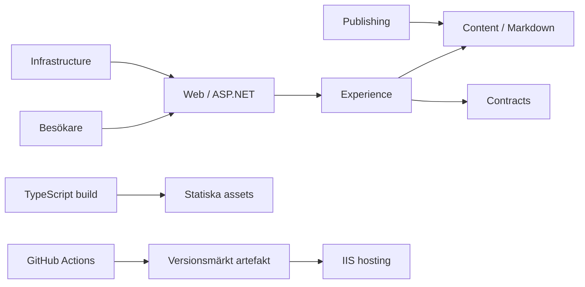
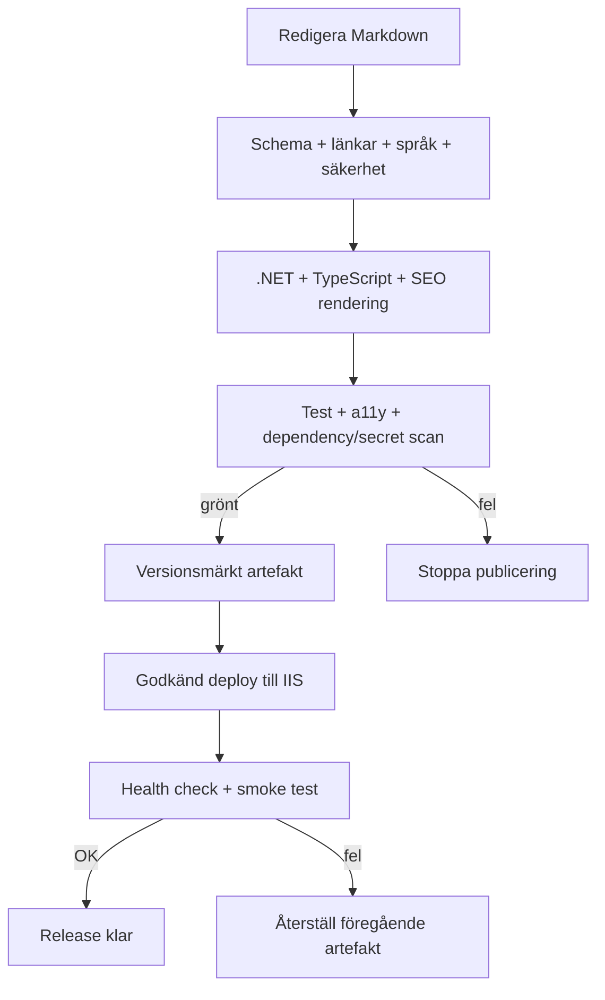

**PRODUKTKRAVSPECIFIKATION**
# Konsultportfolio
Personlig webbplats och öppen källkodsprodukt
Ett genomförbart kravunderlag för en tillgänglig, innehållsdriven konsultportfolio och återanvändbar open source-referensimplementation.
Version 1.0  |  27 oktober 2026  |  Svenska
Status: baslinje för planering och implementation
## Dokumentöversikt
| Fält | Värde |
| --- | --- |
| Syfte | Definiera mål, omfattning, krav, arkitektur, drift och release. |
| Läsare | Solo-maintainer, utvecklare som fork:ar projektet och tekniska granskare. |
| Beslutsgrund | ADR-011 B, ADR-013 B, ADR-014 B och ADR-015 B till ADR-018 B enligt tillgänglig konversation. |
| Spårbarhet | ADR-001–010 och ADR-012 behöver verifieras mot originaltext före implementation. |
| Prioritet | P0 = första release; P1 = hög prioritet efter baslinje; P2 = valfri förbättring. |
## Innehåll
- 1. Sammanfattning och mål
- 2. Målgrupper och användarfall
- 3. Omfattning
- 4. ADR och spårbarhet
- 5. Funktionella krav
- 6. Icke-funktionella krav
- 7. Innehåll
- 8. Arkitektur
- 9. CI/CD och IIS
- 10. Säkerhet, SEO, tillgänglighet och analys
- 11. Teman och easter eggs
- 12. Risker, antaganden och frågor
- 13. Releaseplan
- Bilaga A. Kravspårning
## 1. Sammanfattning och produktmål
Produkten är en personlig konsultportfolio och samtidigt en developer-first open source-referensimplementation. Besökaren ska förstå erbjudandet, granska verifierad erfarenhet och ta kontakt. Utvecklare ska kunna klona/forka, konfigurera eget innehåll och bygga med reproducerbar setup.
Arkitekturen är en .NET Modular Monolith med separata projekt för Web, Content, Experience, Publishing, Infrastructure och Contracts samt separat TypeScript-build. Leverans sker som vertikala slices. Ingen AI-integration; endast faktiskt tillgängliga språk visas; solo-maintainer ska kunna driva tjänsten.
### Mål
- Göra profil, erbjudande, verifierade exempel och kontakt begripliga.
- Ge innehållsägaren kontroll; inga obekräftade CV-fakta publiceras.
- Visa en konkret open source-implementation med repo, setup, exempeldata och oberoende CI.
- Leverera snabb, tillgänglig, indexerbar webbplats med publicering till IIS.
- Hålla driftbördan låg med automatiserade kontroller och rollback.
### Mätbara utfall
| Mått | Verifiering |
| --- | --- |
| Kontakt | Primär kontaktlänk på startsidan fungerar på mobil och tangentbord. |
| Innehåll | Meriter har godkänd källa; demo-data är tydligt märkt. |
| Tillgänglighet | Inga kritiska automatiska a11y-fel; manuell kontroll dokumenterad. |
| Leverans | Båda repon har grönt CI; IIS health check och rollback demonstrerade. |
| Underhåll | Maintainer kan uppdatera, bygga, publicera och återställa enligt runbook. |
## 2. Målgrupper och användarfall
- Potentiell kund/rekryterare bedömer kompetens och trovärdighet.
- Teknisk granskare granskar kod, beslut, kvalitet och drift.
- Utvecklare använder projektet som startpunkt via fork/template.
- Solo-maintainer uppdaterar innehåll och sköter release/säkerhet.
| ID | Användarfall |
| --- | --- |
| UC-01 | Besökare förstår roll, erbjudande och nästa steg från startsidan. |
| UC-02 | Besökare granskar kompetens och går till verifierade projekt. |
| UC-03 | Besökare använder fungerande e-post eller professionell profil. |
| UC-04 | Besökare byter endast till språkversion som finns publicerad. |
| UC-05 | Utvecklare forkar, följer README, redigerar innehåll och bygger lokalt. |
| UC-06 | Maintainer ändrar Markdown, granskar diff, kör CI och publicerar till IIS. |
| UC-07 | Maintainer återställer senast fungerande artefakt efter fel. |
| UC-08 | Besökare kan upptäcka frivillig easter egg utan att kärnflöde påverkas. |
## 3. Omfattning och principer
### Ingår
- Responsiv portfolio med profil, erbjudande, tjänster/kompetens, projekt och kontakt.
- Markdown med validerad front matter; publicera endast tillgängliga språk.
- Teman och diskreta easter eggs som inte hindrar läsbarhet/navigation.
- Två GitHub-repon, reproducerbar fork/template, skript, ADR-dokumentation och oberoende CI.
- IIS-hosting med versionsmärkt release, health check, loggning och rollback.
- Exempel-CV utan påhittade personuppgifter eller verkliga meriter.
### Ingår inte
- AI-generering, chat, rekommendationer eller profilmatchning.
- Automatisk översättning eller språkval till saknade översättningar.
- CMS-konton, flerredaktörsflöde eller generell databasadmin.
- Fabricerade meriter/arbetsgivare/resultat.
- Marknadsföringsautomation eller onödig persondatainsamling.
## 4. ADR-beslut och spårbarhet
| ADR | Beslut | Konsekvens |
| --- | --- | --- |
| 011 B | Solo-maintainer | Liten driftbörda, automatiserad CI, runbooks och rollback. |
| 013 B | Ingen AI-integration | Ingen modell/API, AI-funktion, promptlagring eller AI-databehandling. |
| 014 B | Endast tillgängliga språk | Visa bara publicerade språkversioner; dölj saknade översättningar. |
| 015 B | Modular Monolith: Web, Content, Experience, Publishing, Infrastructure, Contracts; separat TypeScript-build | Synliga modulgränser; inga mikrotjänster. |
| 016 B | Developer-first open source repo med fork/template, reproducerbar setup, exempel-CV, skript, ADR och oberoende CI | Dokumentation och byggbarhet är produktkrav. |
| 017 A | Personal Open Source Showcase | Visa personlig open source-implementation och dess beslut. |
| 018 B | Vertical Slice Delivery | Fungerande end-to-end-slices med verifierbart värde. |
| 001–010, 012 | Beslutstext ej åtkomlig i hämtad trådvy | Verifiera originaltext innan scope eller riktning låses. |
När ADR-001–010 och ADR-012 återfinns ska spårbarhet uppdateras och berörda krav märkas. Dokumentet tillskriver inte saknade ADR:er påhittade beslut.
## 5. Funktionella krav
Kriterier verifieras manuellt, automatiserat eller i CI. P0 ingår i första publika release. ID:n används i issues och ändringsförslag.
| ID | Krav | P | Verifierbart acceptanskriterium |
| --- | --- | --- | --- |
| FR-001 | Startsida | P0 | Visar introduktion, erbjudande och primär kontakt; vid 360 px inget horisontellt sidscroll; länken fungerar. |
| FR-002 | Profil | P0 | Endast godkänt innehåll; varje merit har spårbar källa; okända uppgifter visas inte som fakta. |
| FR-003 | Tjänster/kompetens | P0 | Redigerbara poster visas; tomma/opublicerade poster saknas i produktion. |
| FR-004 | Showcase | P0 | Projekt visar titel, sammanfattning och relevanta länkar med meningsfull text. |
| FR-005 | Kontakt | P0 | E-post/extern länk är semantisk och fungerar via tangentbord. |
| FR-006 | Språk | P0 | Meny listar endast publicerad språkversion för sidan; saknat språk döljs. |
| FR-007 | Markdown | P0 | Front matter valideras mot schema; fel stoppar bygge med begriplig förklaring. |
| FR-008 | Säker rendering | P0 | Script, event handlers och osäker HTML körs inte; URL-scheman whitelist-testas. |
| FR-009 | Teman | P1 | Ljust/mörkt tema; kontrast bibehålls; fel i klientkod lämnar läsbart innehåll. |
| FR-010 | Easter eggs | P1 | Frivillig kosmetisk interaktion; inga timers, fokusfällor eller navigationshinder. |
| FR-011 | Metadata | P0 | Unik titel, beskrivning, canonical och social metadata per publik sida. |
| FR-012 | Sitemap/robots | P0 | Sitemap innehåller enbart publicerade canonical URL:er; staging indexeras inte. |
| FR-013 | Strukturerad data | P1 | Endast godkända fält; valideras i releasepipeline. |
| FR-014 | README | P0 | Beskriver krav, setup, config, innehåll, bygg/test, drift, fork/template och licens. |
| FR-015 | Exempeldata | P0 | CV-exempel märks tydligt; fiktiva uppgifter presenteras inte som användarens fakta. |
| FR-016 | Oberoende CI | P0 | Varje repo kör egna valideringar utan att det andra repots CI först måste köras. |
| FR-017 | IIS-release | P0 | Versionsmärkt artefakt deployas; health check körs efter driftsättning. |
| FR-018 | Rollback | P0 | Runbook återställer tidigare artefakt utan ny kompilering; health check godkänns. |
| FR-019 | Analys | P1 | Minimalt dokumenterat event-schema; avstängt läge gör inga tredjepartsanrop. |
| FR-020 | 404/fel | P1 | Okänd URL visar användbar 404; stack trace/hemligheter exponeras inte. |
| FR-021 | Vertikal slice | P0 | Varje slice innehåller fungerande UI, innehåll, validering och publiceringsväg. |
| FR-022 | Ändringslogg | P1 | Release notes anger ändringar, innehållsmigrering och rollback-referens. |
## 6. Icke-funktionella krav
| ID | Område | P | Verifierbart acceptanskriterium |
| --- | --- | --- | --- |
| NFR-001 | Prestanda | P0 | 75:e percentilsmål: LCP ≤ 2,5 s, CLS ≤ 0,1, INP ≤ 200 ms när fältdata finns; labbtest per release. |
| NFR-002 | Tillgänglighet | P0 | WCAG 2.2 AA som mål; inga kritiska/allvarliga automatiska fel på centrala mallar; manuell tangentbords-/skärmläsarkontroll. |
| NFR-003 | Responsivitet | P0 | Fungerar vid 320, 360, 768, 1440 CSS px; innehåll bevaras vid 200 % förstoring. |
| NFR-004 | Säkerhet | P0 | TLS, säkra headers, minsta privilegium, inga secrets i repo/artefakt; scanning i CI. |
| NFR-005 | Integritet | P0 | Ingen besöksdata utan ändamål; samtycke vid behov; retention och leverantör dokumenteras. |
| NFR-006 | SEO | P0 | Semantiska rubriker/länkar; canonical, sitemap och robots kontrolleras automatiskt. |
| NFR-007 | Tillförlitlighet | P0 | Health endpoint visar drift utan intern diagnostik; deploy kontrollerar status. |
| NFR-008 | Underhåll | P0 | Modulansvar/beroenden dokumenterade; format, lint och build reproducerbara. |
| NFR-009 | Kompatibilitet | P0 | Senaste stabila Chromium, Firefox, Safari, Edge samt mobil Safari/Chrome testas. |
| NFR-010 | Språk | P0 | lang-attribut matchar innehåll; saknad översättning presenteras inte som lokaliserad. |
| NFR-011 | Observability | P1 | Strukturerade loggar utan persondata/hemligheter; fel kan kopplas till release-ID. |
| NFR-012 | Byggbarhet | P0 | Ren checkout bygger med låsta verktyg; lokalt och CI ger samma validering. |
## 7. Innehållsmodell
Markdown är mänskligt redigerbar källa. Validerare ansvarar för schema, språk, status, länkar och metadata; rendering escape:ar osäkert innehåll. Sektioner kan ordnas utan hårdkodade CV-fakta.
| Typ | Exempelfält | Regel |
| --- | --- | --- |
| Site settings | siteName, baseUrl, locales, theme | Per miljö; inga hemligheter publikt. |
| Profile | displayName, headline, summary, links | Platshållare i template; publicera efter redigering. |
| Experience | role, organization, dates, highlights | Fakta kräver underlag; demo märks tydligt. |
| Project | title, summary, technologies, links, alt | Verifierade projekt/länkar; alt beskriver funktion. |
| Service/skill | label, description, category, order | Frivilligt; inga automatiska kompetenspåståenden. |
| Page locale | locale, translationOf, status | Endast publicerad locale; sidor valideras. |
- Ingen CV-data skapas av PRD eller starter template.
- Exempel använder platshållare eller tydligt syntetisk data utan verklig identitet.
- Bygg stoppar brutna interna länkar, saknade obligatoriska fält och okända språk.
- Innehållsägaren godkänner kontaktuppgifter, bilder och externa länkar.
## 8. Arkitektur och teknisk design
Web är HTTP-/kompositionslager. Content äger Markdown och validering; Experience presentation och flöden; Publishing publiceringsregler; Infrastructure adaptrar; Contracts stabila gränssnitt. TypeScript byggs separat för klientfunktioner.

Beroenden går mot kontrakt och kärnmoduler, utan cirklar. Infrastruktur ligger bakom adaptrar. Navigation/innehåll fungerar utan JavaScript där rimligt.
### Föreslagen repostruktur
```
/src: Portfolio.Web, Content, Experience, Publishing, Infrastructure, Contracts
/client: separat TypeScript-build
/content: Markdown, språkmappar, schema
/docs/adr: ADR-001 ... ADR-018
/scripts: setup, validate, build, release
/tests: modul- och integrationstester
/.github/workflows: CI och release automation
```
### Markdown och publicering

## 9. Publicering och CI/CD
ADR-016 anger två GitHub-repon och oberoende CI. Förslag är applikationsrepo och innehållsrepo; exakt ägarskap och versionskoppling återstår. Artefakten låser båda revisionerna så rollback återger samma innehåll.
| Repo | Ansvar | CI-minimikrav |
| --- | --- | --- |
| portfolio-app | Moduler, TypeScript, tester, skript, ADR och deploymentdefinition | Ren restore/build, format/lint, tester, säkerhetsscanning, paketering. |
| portfolio-content | Markdown, språkversioner, schema; inga driftsecrets | Schema/länkar, språkstatus, metadata och sekretesskontroll. |
- PR kräver gröna checks; publicera från skyddad branch/tagg.
- Artefakt registrerar app commit, content commit, build-ID och icke-hemlig config.
- GitHub Actions har minsta deploymenträttighet; föredra kortlivade credentials.
- IIS-release använder atomiskt versionsbyte eller motsvarande; kör health/smoke check.
- Rollback återställer föregående artefakt och content-version.
- Staging är separerad och blockeras från indexering.
## 10. Säkerhet, SEO, tillgänglighet och analys
### Säkerhet
- Tvinga HTTPS; konfigurera HSTS efter verifierad TLS samt CSP, X-Content-Type-Options, Referrer-Policy och Permissions-Policy.
- Markdown får inte exekvera godtycklig HTML/JS; sanera länkar och URL-scheman.
- Inga secrets i klientbundle, repo, logg eller artefakt; dependency/secret scanning i CI.
- IIS får inte exponera stack traces, kataloglistning, .git eller miljövariabler.
- Kontaktformulär/backend kräver separat hotmodell och integritetsbeslut.
### SEO
- Unik title/description, canonical och social metadata per publik sida.
- Semantisk HTML, tydlig H1, crawlbara länkar, sitemap och robots per miljö.
- Staging noindex och helst autentiserat; sitemap listar endast publik URL.
- Strukturerad data använder endast bekräftade uppgifter.
### Tillgänglighet
- WCAG 2.2 AA som mål; landmarks, skip link, synligt fokus och logisk tabbordning.
- Kontrast i alla teman; färg används inte ensam för status.
- Respektera prefers-reduced-motion; inga blinkningar eller okontrollerad rörelse.
- Alt-text för relevanta bilder, tom alt för dekorativa; ikonknappar har namn.
- Språkbyte uppdaterar lang och visar bara tillgängliga versioner.
### Analys och integritet
Analys är P1 och kan utelämnas; standard avstängt/minimalt. Vid aktivering: dokumenterat verktyg, begränsat schema (sidvisning, kontakt- och projektlänk), inga formulärvärden, fingeravtryckning eller onödig identifiering. Beslut om samtycke, retention och leverantör krävs först.
## 11. Teman och easter eggs
Visuell riktning ska vara professionell och lättläst. Färger, typsnitt och illustrationer beslutas när varumärkesunderlag finns.
| Del | Krav |
| --- | --- |
| Ljust/mörkt | Systempreferens som utgångspunkt, valbar kontroll; verifiera kontrast i båda. |
| Rörelse | Diskret; reduceras vid prefers-reduced-motion. |
| Easter egg | Frivillig, kosmetisk, tangentbordstillgänglig showcase-detalj och lätt att ignorera. |
| Integritet | Ingen dold spårning, extern begäran eller persondata. |
| Verifiering | Kärninnehåll/navigation fungerar även utan aktivering. |
## 12. Risker, antaganden och öppna frågor
### Risker
| Risk | Påverkan | Motåtgärd |
| --- | --- | --- |
| Saknade ADR-001–010/012 ändrar riktning. | Hög | Hämta original och uppdatera spårbarhet. |
| Solo-maintainer blir flaskhals. | Hög | Automatisera, skriv runbook, prova rollback. |
| Två repo ger versionsglapp. | Medel | Lås revisioner i artefakt; dokumentera kompatibilitet. |
| Fel/känsliga profiluppgifter publiceras. | Hög | Manuell faktagranskning; inga syntetiska meriter. |
| Tema/JS försämrar tillgänglighet/prestanda. | Medel | Progressive enhancement, releasegrind, begränsad JS. |
| IIS/credentials okända. | Hög | Bekräfta krav; testa staging och rollback tidigt. |
| Analys ger integritetsproblem. | Medel | Håll avstängd tills ändamål och samtycke beslutats. |
### Antaganden
- Publik webbplats för en konsult; ägaren tillhandahåller identitet och verifierad CV-data.
- .NET/TypeScript-version väljs och låses under implementation; PRD antar inte versionsnummer.
- GitHub används för källkod/CI; IIS är vald hosting.
- Ingen CMS/databas initialt; Markdown är källa.
- Domän, språk, kontaktuppgifter, varumärke och analysleverantör saknas ännu.
### Öppna frågor
| ID | Fråga |
| --- | --- |
| OQ-01 | Kan originaltext för ADR-001–010 och ADR-012 hämtas och bekräftas? |
| OQ-02 | Vilka exakta GitHub-repon och hur kopplas app/content-version? |
| OQ-03 | Vilka språk är initialt färdigöversatta och klara? |
| OQ-04 | Vilka verifierade CV-, kompetens-, projekt- och kontaktuppgifter ska läggas in? |
| OQ-05 | Beslut: `https://hellmangroup.se` är standarddomän och hostingprovidern ansvarar för IIS samt TLS/certifikat; webbplatsen ska använda HTTPS. Staging-URL, nätverksåtkomst och runner-konfiguration behövs endast om app-repots valfria IIS-pipeline aktiveras. |
| OQ-06 | Vilken open source-licens och hur skiljs demo från personlig liveprofil? |
| OQ-07 | Ska analys vara avstängd eller aktiveras med leverantör/samtycke? |
| OQ-08 | Vilken visuell identitet, porträtt och bildrättigheter finns? |
| OQ-09 | Kontakt via e-postlänk eller formulär? Formulär kräver separat beslut. |
| OQ-10 | Vilka SLO, backup/retention och incidentansvar gäller för IIS? |
## 13. Releaseplan och definition av klart
Releaseplanen består av vertikala slices med fungerande flöde från innehåll till sida. Estimat lämnas öppna tills kapacitet och hosting är kända.
| Release | Slice | Exit-kriterier |
| --- | --- | --- |
| R0 Grund | Repo-template, setup, README/ADR, exempeldata, två oberoende CI. | Ren checkout bygger; exempel märkt; fel stoppas; scanning grön. |
| R1 Kärna | Startsida, profil, erbjudande, kontakt, Markdown, språkval, responsiv nav. | FR-001–008, NFR-002/003/010; innehåll godkänt; inga påhittade fakta. |
| R2 Showcase | Projekt, tema, easter eggs, SEO-bas. | FR-004, 009–015; metadata/sitemap och tangentbord verifierade. |
| R3 Drift | IIS staging/prod, versionsartefakt, health, logg, notes, rollback. | FR-016–018, NFR-004/007/011/012; deploy och rollback visade. |
| R4 Förbättring | Analys vid behov och prestandaförfining. | FR-019–022 prioriterade; analys först efter beslut; prestanda rapporterad. |
### Definition av klart för publik release
- Alla P0-krav verifierade.
- Profiluppgifter faktagranskade och godkända.
- Inga kritiska säkerhets-/a11y-fel kvar; avvikelser dokumenterade/tidsatta.
- Båda CI är gröna; artefakt anger app- och content-revisioner.
- Staging smoke test, IIS health check, SEO och rollback verifierade.
- README, driftguide, release notes och licens klara; staging indexeras inte.
## Bilaga A. Kravspårning
| Beslut | Kravreferenser |
| --- | --- |
| ADR-011 B solo-maintainer | NFR-007/008/011, FR-016–018, risk och runbook. |
| ADR-013 B utan AI | Omfattning; inga AI-funktioner eller dataflöden. |
| ADR-014 B tillgängliga språk | FR-006, NFR-010, innehållsmodell och releasekontroller. |
| ADR-015 B Modular Monolith | Diagram, projektlayout och modulansvar. |
| ADR-016 B developer-first repo | FR-014–016, setup, exempel-CV, två repo och CI. |
| ADR-017 A Personal Open Source Showcase | Mål, showcase-användarfall och FR-004. |
| ADR-018 B Vertical Slice Delivery | FR-021 och R0–R4-plan. |
| ADR-001–010, ADR-012 | Spårbarhetslucka; hämta beslut och mappa före implementation. |
