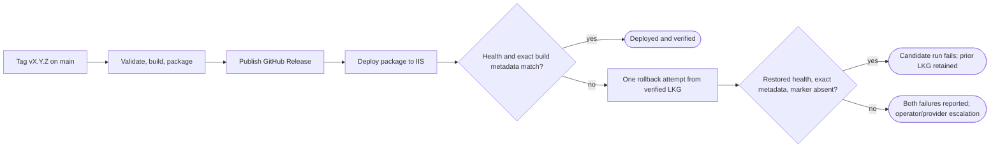

# IIS release pipeline

Last updated: 2026-11-03

Pushing a protected `vMAJOR.MINOR.PATCH` tag on a commit reachable from `main` starts the automated production release. The standard path is [`.github/workflows/release.yml`](../.github/workflows/release.yml): it validates, builds, and packages the app, publishes a GitHub Release, and only then deploys that package to the IIS site. There is no production reviewer gate in the approved release model.

**Published is not deployed.** The GitHub Release can be published before the production deployment starts. A published release or package is not evidence that production is running it; check the deploy job and its health/metadata verification in the workflow run.

## GitHub Environment

Release and manual recovery use the `production-msdeploy` environment. Content updates use a separate `production-content` environment in the private content repository; see [repositories.md](repositories.md). The release workflow is tag-triggered, and the manual recovery workflow is dispatched from `main`. The environment supplies deployment variables and secrets; it is not an IIS app-pool control plane. No production reviewer gate is required or intended for this release path.

| Name | Kind | Purpose |
| --- | --- | --- |
| `MSDEPLOY_SERVER_URL` | Variable | HTTPS WMSvc endpoint or hostname (port 8172 by default) |
| `MSDEPLOY_SITE_NAME` | Variable | IIS site name |
| `MSDEPLOY_CONTENT_PATH` | Variable | Web Deploy provider path, for example the site name or `<site>/<application>`, as exposed by the server's Web Deploy provider |
| `MSDEPLOY_CERTIFICATE_SHA256` | Variable | Fingerprint of the exact WMSvc certificate |
| `DEPLOY_USERNAME` | Variable | Web Deploy user |
| `DEPLOY_HEALTH_URL` | Variable | Canonical public HTTPS `/health` URL |
| `DEPLOY_PASSWORD` | Secret | Web Deploy password |

No personal access token is needed. `GITHUB_TOKEN` covers artifacts and releases.

The package targets .NET 10. The IIS server needs the .NET 10 Hosting Bundle, which provides the ASP.NET Core Module and runtime. See Microsoft's [IIS publishing guide](https://learn.microsoft.com/en-us/aspnet/core/tutorials/publish-to-iis?view=aspnetcore-10.0).

Before pushing a release tag, confirm:

- WMSvc access, site name, and provider path
- Certificate fingerprint and credentials
- Canonical HTTPS URL
- .NET 10 Hosting Bundle on the IIS server
- Release tag protection on `v*.*.*`

## Deployment and manual recovery

The tag-driven [release workflow](../.github/workflows/release.yml) remains the sole automatic deployment path for every `v*.*.*` tag, with no production reviewer gate. The [Manual production recovery workflow](../.github/workflows/manual-production-recovery.yml) remains the manual recovery/redeploy/rollback path. Both serialize through the shared workflow-level `production-deployment` concurrency group. Release publication still precedes automatic deployment. Deployment permissions and durable production-state writes are described below.

## Creating a release

The `VERSION` file at the repository root holds the version of the next (or current) release as `MAJOR.MINOR.PATCH`. A release is made by merging a pull request that changes **only** that file; do not tag by hand.

1. Open a PR that bumps `VERSION` using the release template: `https://github.com/<owner>/<repo>/compare/main...<branch>?template=release.md` (or pick `release.md` from the PR description templates). The bump must be exactly one patch, minor or major step after the highest existing `vX.Y.Z` tag.
2. The **Version guard** check fails the PR if any other file changes with `VERSION`, if the content is not strictly `MAJOR.MINOR.PATCH`, or if it is not a valid next version (`scripts/assert-version-bump.ps1`). Make *Version guard* a required status check in the `main` ruleset so this is enforced at merge.
3. After the merge, **Quality gates** run on the `main` commit. When they succeed, the **Tag release from VERSION** workflow creates tag `vX.Y.Z` at that exact commit through the API (it never moves an existing tag) and starts the release workflow on it. Tags created with `GITHUB_TOKEN` do not trigger the tag-push workflow, so the release workflow is started with `workflow_dispatch`; it rejects dispatches that are not on a `vMAJOR.MINOR.PATCH` tag.

If the tag was created but the release did not start, re-run the *Tag release from VERSION* run, or run `gh workflow run release.yml --ref vX.Y.Z`. Pushing a `v*.*.*` tag by hand still triggers the release workflow, but bypasses the guard and should be avoided.

Safety and verification:

- The shared helper `scripts/ensure-webdeploy.ps1` uses the Microsoft Web Deploy client. If it is missing, it installs the official MSI after checking its SHA-256 digest and signature.
- The WMSvc certificate fingerprint is checked before any credentials are used. Only that pinned certificate is trusted, and only for its expected internal hostname.
- The site uses the existing Web Deploy AppOffline lifecycle. Sync is limited to the configured content path, explicitly preserves `App_Data` and `.well-known`, and does not add a remote delete/readback API.
- IIS can keep DLLs such as `Portfolio.Content.dll` locked for a few seconds after `app_offline.htm` is written. The helper therefore re-runs the same idempotent sync, up to `FileInUseRetryAttempts` times (default 6, `FileInUseRetryDelaySeconds` default 10), only when Web Deploy reports `ERROR_FILE_IN_USE`. Web Deploy's own remote retries stay at zero, and any other error fails immediately and triggers the single rollback.
- Before sync, both workflows fail closed unless the `production-state` branch contains a valid `lkg-v1.json` and the exact immutable release asset is available, matches GitHub's published SHA-256 digest and recorded digest, and contains matching embedded metadata. The candidate release asset is additionally compared with the SHA-256 output of that run's package job. No `latest`, tag ordering, rebuilding, or short-retention Actions artifact is used for rollback.
- After sync, `/health`, exact `/build-metadata.json`, and an explicit `/app_offline.htm` observation must pass. The same conditions are required to consider the one rollback attempt successful.
- The runner does not delete the marker through an unestablished provider API. It relies on the current Web Deploy ContentPath/AppOffline lifecycle and verifies the marker endpoint after live restoration. If health, metadata, or marker observation fails, recovery is not claimed and the workflow fails.
- Persistent HTTP 503 after a redeploy requires operator/provider escalation to recycle or restart the IIS app pool. The workflows do not manage the app pool; do not claim a redeploy will recover it.

## Manual rollback steps

Manual recovery can only redeploy an existing release tag that was already deployed successfully. It never builds from `main` and has no manual-main mode.

1. Confirm the protected `production-state` branch contains a valid `lkg-v1.json` and the exact immutable package asset is available.
2. Dispatch **Manual production recovery** from `main`, set `confirm_production`, and enter the existing `vMAJOR.MINOR.PATCH` release in `rollback_release_tag` (required).
3. The workflow verifies tag reachability, the GitHub-published digest and downloaded package bytes, and embedded metadata. It also requires that the `production-state` history of `lkg-v1.json` contains a verified-live record for that exact tag **and** package digest; a release that was published but never deployed successfully (or whose bytes differ) is refused. The prior LKG asset is validated before production sync.
4. Confirm health, exact build metadata, and the `/app_offline.htm` marker observation pass. A successful manual rollback updates LKG to that actual live artifact using a non-force state-branch push.

Use `reconcile_pending` only to recover from a pending record left by a failed run; the chosen tag must still have been deployed successfully before.

## Bounded rollback and durable production state

On a candidate Web Deploy sync failure, failed health/build-metadata verification, or active-marker verification failure, the helper makes exactly one rollback attempt using the immutable package named by the last-known-good (`LKG`) record. It verifies restored health, exact metadata, and marker absence. A successful rollback does not make the candidate run successful and does not modify the prior LKG. A failed rollback is reported alongside the original deployment error; there is no second attempt. Persistent HTTP 503 is escalated to the operator/provider; no app-pool action is attempted.

The dedicated `production-state` branch holds versioned `lkg-v1.json`. It records the artifact actually verified live: source tag, source commit, app/content/build metadata, package SHA-256, exact immutable release tag and asset name, workflow/run/attempt, verification timestamp, and verification evidence. A tag is not considered live just because it was published. Successful manual rollback updates LKG to the rollback artifact. The branch history of `lkg-v1.json` is the record of which releases were ever verified live.

Both workflows' `deploy` jobs explicitly grant `contents: write` because the shared deployment runner writes the `production-state` branch directly. After validating the candidate and prior LKG packages, the runner durably commits `pending-v1.json` before the first production sync; a failed or ambiguous pending-state write prevents production mutation. After candidate health, exact metadata, and marker verification succeed, that same deploy job commits the new LKG record and clears pending. If the bounded rollback succeeds, the same job clears pending while retaining the prior LKG. The separate `publish-release` job also has `contents: write`, but only to publish the immutable GitHub Release asset; it does not write production state. IIS and the GitHub branch cannot be updated atomically. If the production site passes verification but the final state write fails or is ambiguous, the run fails distinctly and requires reconciliation; it does not automatically sync again. If a rollback succeeds, the candidate workflow remains failed and LKG remains the prior package.

**Initial state is an operator prerequisite.** Before enabling either production deployment, create the protected `production-state` branch with a valid `lkg-v1.json` describing the verified live artifact and confirm its exact GitHub Release asset/digest. Populate it from production deployment evidence, not the greatest/most recent tag. Missing branch, missing/malformed record, unavailable asset, digest mismatch, or embedded metadata mismatch fails closed before production sync.

**Changing the version line (for example restarting at `0.1.0`).** A release can only deploy while the LKG record's release and asset exist, because that package is the rollback target and is downloaded and digest-checked before the first sync. Deleting old tags and releases therefore blocks every deployment until the record points at an existing release. To reset safely: download the live package named in `lkg-v1.json`, verify its SHA-256 against `packageSha256`, publish it as a release under the new baseline tag (same bytes, asset named `cv-online-presenter-<tag>.zip`, tag on the recorded commit), then commit an updated `lkg-v1.json` to `production-state` (new `sourceTag`, `releaseTag` and `assetName`; unchanged digest, commit and metadata) before removing the old tags and releases. `VERSION` must then be a valid next version after the new baseline tag.

The existing ContentPath/AppOffline lifecycle is the only supported marker cleanup mechanism established here. The workflow performs no separate delete/readback call and no unconditional `finally` cleanup. Marker status is observed at `/app_offline.htm` only after restored health and metadata verification. A failed endpoint observation is a failed recovery. Runner loss, network interruption, WMSvc interruption, or provider behavior can prevent both restoration and confirmation/cleanup; no unconditional recovery or cleanup guarantee is made. The Web Deploy helper continues to preserve `App_Data` and `.well-known`. No IIS app-pool restart is performed.

For a token-provisioning incident, follow the [content provisioning incident runbook](content-releases.md#provisioning-incident-runbook). Do not tag an app release based only on app health: require a successful token-only synchronization and, after deployment, a successful authenticated content preview.
