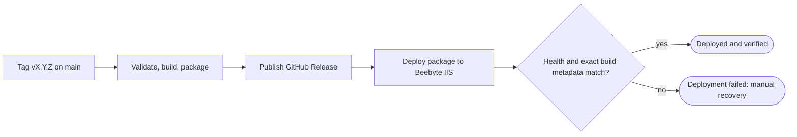

# Beebyte release pipeline

Last updated: 2026-11-02

Pushing a protected `vMAJOR.MINOR.PATCH` tag on a commit reachable from `main` starts the automated production release. The standard path is [`.github/workflows/release.yml`](../.github/workflows/release.yml): it validates, builds, and packages the app, publishes a GitHub Release, and only then deploys that package to the Beebyte IIS site. There is no production reviewer gate in the approved release model.

**Published is not deployed.** The GitHub Release can be published before the production deployment starts. A published release or package is not evidence that production is running it; check the deploy job and its health/metadata verification in the workflow run.

## GitHub Environment

Release and manual recovery use the `production-msdeploy` environment. Content updates use a separate `production-content` environment in the private content repository; see [repositories.md](repositories.md). The release workflow is tag-triggered, and the manual recovery workflow is dispatched from `main`. The environment supplies deployment variables and secrets; it is not an IIS app-pool control plane. No production reviewer gate is required or intended for this release path.

| Name | Kind | Purpose |
| --- | --- | --- |
| `MSDEPLOY_SERVER_URL` | Variable | HTTPS WMSvc endpoint or hostname (port 8172 by default) |
| `MSDEPLOY_SITE_NAME` | Variable | IIS site name |
| `MSDEPLOY_CONTENT_PATH` | Variable | Web Deploy provider path, `hellmangroup.se` for Beebyte (not `httpdocs`) |
| `MSDEPLOY_CERTIFICATE_SHA256` | Variable | Fingerprint of the exact WMSvc certificate |
| `DEPLOY_USERNAME` | Variable | Beebyte deployment user |
| `DEPLOY_HEALTH_URL` | Variable | Canonical public HTTPS `/health` URL |
| `DEPLOY_PASSWORD` | Secret | Beebyte deployment password |

No personal access token is needed. `GITHUB_TOKEN` covers artifacts and releases.

The package targets .NET 10. Beebyte needs the .NET 10 Hosting Bundle, which provides the ASP.NET Core Module and runtime. See Microsoft's [IIS publishing guide](https://learn.microsoft.com/en-us/aspnet/core/tutorials/publish-to-iis?view=aspnetcore-10.0).

Before pushing a release tag, confirm:

- WMSvc access, site name, and provider path
- Certificate fingerprint and credentials
- Canonical HTTPS URL
- .NET 10 Hosting Bundle on Beebyte
- Release tag protection on `v*.*.*`

## Deployment and manual recovery

The tag-driven [release workflow](../.github/workflows/release.yml) remains the standard automated deployment path. The [MSDeploy experiment workflow](../.github/workflows/msdeploy-experiment.yml) is the manual recovery, redeploy, and rollback path: dispatch it from `main`, confirm production, and optionally select an existing release tag. It does not publish a GitHub Release. There is no workflow split and no automatic rollback or recovery today; a failed deployment remains failed until an operator performs and verifies recovery.

Safety and verification:

- The shared helper `scripts/ensure-webdeploy.ps1` uses the Microsoft Web Deploy client. If it is missing, it installs the official MSI after checking its SHA-256 digest and signature.
- The WMSvc certificate fingerprint is checked before any credentials are used. Only that pinned certificate is trusted, and only for its expected internal hostname.
- The site uses an offline page during sync. The sync removes stale files, so a redeploy cannot leave newer binaries behind. `.well-known` is preserved.
- After sync, `/health` and `/build-metadata.json` must match the deployed artifact. A deployment is not considered restored until health and exact metadata are verified and the active root `app_offline.htm` marker is absent after restoration.
- Do not remove an active root `app_offline.htm` before restoration is verified. If verification or cleanup cannot complete, preserve the safe maintenance/offline state and escalate.
- Persistent HTTP 503 after a redeploy requires operator/provider escalation to recycle or restart the IIS app pool. The workflows do not manage the app pool; do not claim a redeploy will recover it.
- There is no automatic FTPS fallback. FTPS is a separate break-glass option, used only if WMSvc itself is unavailable.

## Manual rollback steps

1. Run **MSDeploy experiment** from `main`.
2. Set `confirm_production` to confirm.
3. Set `rollback_release_tag` to an existing release, such as `v1.2.3`.
4. The workflow verifies the GitHub Release asset's SHA-256 digest, then deploys that immutable package and checks health and exact metadata.
5. Confirm the active root `app_offline.htm` marker is absent after restoration, then record the tag, digest, and observed metadata in the release incident or exercise log.

Leave `rollback_release_tag` empty only for an intentional redeploy of `main`. If health or metadata does not verify, or a 503 persists, do not remove an active offline marker; preserve maintenance state and escalate. The workflow cannot recycle or restart the IIS app pool. FTPS is a separate break-glass option only if WMSvc itself is unavailable.

## Phase 2: accepted, deferred

Issue #56's bounded automatic-recovery phase is accepted but deferred. Keep the issue open until its prerequisites and implementation are complete. This is not current workflow behavior and must not be represented as an automatic-recovery guarantee. Implementation waits for provider preflight, the required identity and digest record, and safe failure-injection tests.

The exact proposed boundary is one automatic rollback attempt, and only after a sync failure or a health/metadata verification failure. It may proceed only when the identity of the prior **actually deployed** artifact has been recorded and its immutable package digest verifies. A GitHub Release being published is not proof it was deployed; the record must also handle a manual rollback and a published-but-not-deployed release.

Recovery counts as successful only when, after restoration, health passes, exact build metadata matches the restored artifact, and the active root `app_offline.htm` marker is absent. If rollback, cleanup, or verification cannot complete, the deployment remains failed: preserve maintenance/offline state and escalate to an operator. No unqualified recovery guarantee is possible when a runner, WMSvc, or network failure interrupts the attempt.

Required preflight before implementation:

- Confirm a Beebyte-supported way to delete and verify the remote root offline marker.
- Establish a trustworthy live-deployed tag-and-digest record that distinguishes actually deployed artifacts from merely published releases and correctly follows manual rollback.
- Establish whether Beebyte supports an app-pool restart API. Do not automate pool recycle/restart without explicit provider support; persistent 503 remains an operator/provider escalation.
- Add safe failure-injection tests for sync failure, health/metadata failure, rollback failure, marker cleanup/verification failure, and interrupted/unreachable runner or WMSvc conditions.

## Production deployment verification (2026-11-02)

Release `v1.0.10` from app commit `fb858d63b25e98058b3bd538b11d755c41951e96` passed full deployment and health/metadata verification in run `41362144486`; production `/health` returned HTTP 200. After that deploy, authenticated preview and activation run `41362455305` proved the `App_Data/content-releases` root and token remained usable. Immutable-package redeploy run `41362579683` also passed. Follow-up run `41362687186` previewed 0 added, 0 removed, and 0 changed content sections and reactivated `20261101-210215-1a6df58`. This verifies content persistence across an app redeploy. After the later 503 incident, the operator/provider recycled or restarted the IIS app pool; at 2026-11-02 11:44 UTC, `/health` returned HTTP 200 and static build metadata matched appRevision `fb858d63b25e98058b3bd538b11d755c41951e96`, contentRevision `56fc7b90625f841785dc54fc39ee0ed9d345b23b`, and buildId `41362144486`. This verifies app responsiveness and bundled build identity only: `contentRevision` identifies bundled template content, not the selected private runtime release. Active content-pointer persistence across recycle was not verified; see [content-releases.md](content-releases.md) for the evidence and remaining gap.

For a token-provisioning incident, follow the [content provisioning incident runbook](content-releases.md#provisioning-incident-runbook). Do not tag an app release based only on app health: require a successful token-only synchronization and, after deployment, a successful authenticated content preview.
