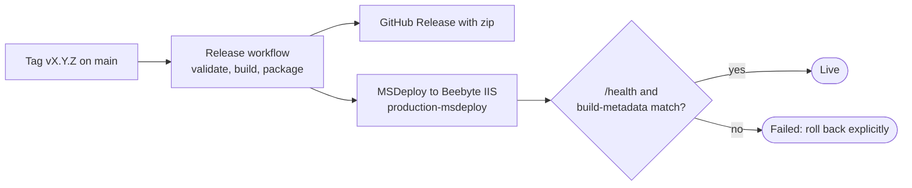

# Beebyte release pipeline

Pushing a protected version tag (`vMAJOR.MINOR.PATCH`) on a commit reachable from `main` starts the release. The same validated package is published as a GitHub Release and deployed to the single Beebyte IIS site.

## GitHub Environment

Release and rollback use the `production-msdeploy` environment. Content updates use a separate `production-content` environment in the private content repository, see [repositories.md](repositories.md). Deployment is allowed from `main` (rollback) and protected `v*.*.*` tags (releases). Add required reviewers if deployment needs approval.

| Name | Kind | Purpose |
| --- | --- | --- |
| `MSDEPLOY_SERVER_URL` | Variable | HTTPS WMSvc endpoint or hostname (port 8172 by default) |
| `MSDEPLOY_SITE_NAME` | Variable | IIS site name |
| `MSDEPLOY_CONTENT_PATH` | Variable | Web Deploy provider path, `hellmangroup.se` for Beebyte (not `httpdocs`) |
| `MSDEPLOY_CERTIFICATE_SHA256` | Variable | Fingerprint of the exact WMSvc certificate |
| `DEPLOY_USERNAME` | Variable | Beebyte deployment user |
| `DEPLOY_HEALTH_URL` | Variable | Canonical public HTTPS `/health` URL |
| `DEPLOY_PASSWORD` | Secret | Beebyte deployment password |

No personal access token is needed. `GITHUB_TOKEN` covers artifacts and releases.

The package targets .NET 10. Beebyte needs the .NET 10 Hosting Bundle, which provides the ASP.NET Core Module and runtime. See Microsoft's [IIS publishing guide](https://learn.microsoft.com/en-us/aspnet/core/tutorials/publish-to-iis?view=aspnetcore-10.0).

Before pushing a release tag, confirm:

- WMSvc access, site name, and provider path
- Certificate fingerprint and credentials
- Canonical HTTPS URL
- .NET 10 Hosting Bundle on Beebyte
- Release tag protection on `v*.*.*`

## Deployment and rollback

The **MSDeploy experiment** workflow handles redeployment and rollback. It runs from `main`, uses the same `production-msdeploy` environment and concurrency group, and never creates a GitHub Release.

Safety rules:

- The shared helper `scripts/ensure-webdeploy.ps1` uses the Microsoft Web Deploy client. If it is missing, it installs the official MSI after checking its SHA-256 digest and signature.
- The WMSvc certificate fingerprint is checked before any credentials are used. Only that pinned certificate is trusted, and only for its expected internal hostname.
- The site shows an offline page during sync. The sync removes stale files, so rollback cannot leave newer binaries behind. `.well-known` is preserved.
- After sync, `/health` and `/build-metadata.json` must match the deployed artifact.
- There is no automatic FTPS fallback. A failed check fails the deployment, and rollback is an explicit decision.

## Rollback steps

1. Run **MSDeploy experiment** from `main`.
2. Set `confirm_production` to confirm.
3. Set `rollback_release_tag` to an existing release, such as `v1.2.3`.
4. The workflow checks the release asset's GitHub SHA-256 digest, then runs the same deploy and checks as a release.

Leave `rollback_release_tag` empty only for an intentional redeploy of `main`. FTPS is a separate break-glass option, used only if WMSvc itself is unavailable.
