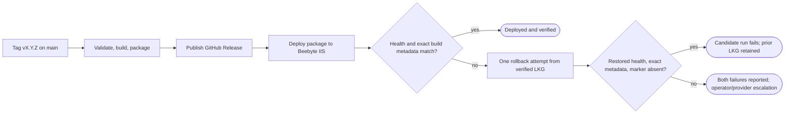

# Beebyte release pipeline

Last updated: 2026-11-03

Pushing a protected `vMAJOR.MINOR.PATCH` tag on a commit reachable from `main` starts the automated production release. The standard path is [`.github/workflows/release.yml`](../.github/workflows/release.yml): it validates, builds, and packages the app, publishes a GitHub Release, and only then deploys that package to the Beebyte IIS site. There is no production reviewer gate in the approved release model.

**Published is not deployed.** The GitHub Release can be published before the production deployment starts. A published release or package is not evidence that production is running it; check the deploy job and its health/metadata verification in the workflow run.

## GitHub Environment

Release uses the `production-msdeploy` environment. Content updates use a separate `production-content` environment in the private content repository; see [repositories.md](repositories.md). The release workflow is tag-triggered. The environment supplies deployment variables and secrets; it is not an IIS app-pool control plane. No production reviewer gate is required or intended for this release path.

| Name | Kind | Purpose |
| --- | --- | --- |
| `MSDEPLOY_SERVER_URL` | Variable | HTTPS WMSvc endpoint or hostname (port 8172 by default) |
| `MSDEPLOY_SITE_NAME` | Variable | IIS site name |
| `MSDEPLOY_CONTENT_PATH` | Variable | Web Deploy provider path, `hellmangroup.se` for Beebyte (not `httpdocs`) |
| `MSDEPLOY_CERTIFICATE_SHA256` | Variable | Fingerprint of the exact WMSvc certificate |
| `DEPLOY_USERNAME` | Variable | Beebyte deployment user |
| `DEPLOY_HEALTH_URL` | Variable | Canonical public HTTPS `/health` URL |
| `DEPLOY_PASSWORD` | Secret | Beebyte deployment password |

No personal access token is needed. `GITHUB_TOKEN` covers artifacts and releases.

The package targets .NET 10. Beebyte needs the .NET 10 Hosting Bundle, which provides the ASP.NET Core Module and runtime. See Microsoft's [IIS publishing guide](https://learn.microsoft.com/en-us/aspnet/core/tutorials/publish-to-iis?view=aspnetcore-10.0).

Before pushing a release tag, confirm:

- WMSvc access, site name, and provider path
- Certificate fingerprint and credentials
- Canonical HTTPS URL
- .NET 10 Hosting Bundle on Beebyte
- Release tag protection on `v*.*.*`

## Deployment

The tag-driven [release workflow](../.github/workflows/release.yml) is the only deployment path for the app, for every `v*.*.*` tag, with no production reviewer gate. There is no manual recovery or redeploy workflow; roll back by reverting on `main` and releasing a new version (see the [rollback runbook](rollback-runbook.md)). The workflow serializes through the workflow-level `production-deployment` concurrency group. Release publication still precedes automatic deployment. Deployment permissions and durable production-state writes are described below.

Safety and verification:

- The shared helper `scripts/ensure-webdeploy.ps1` uses the Microsoft Web Deploy client. If it is missing, it installs the official MSI after checking its SHA-256 digest and signature.
- The WMSvc certificate fingerprint is checked before any credentials are used. Only that pinned certificate is trusted, and only for its expected internal hostname.
- The site uses the existing Web Deploy AppOffline lifecycle. Sync is limited to the configured content path, explicitly preserves `App_Data` and `.well-known`, and does not add a remote delete/readback API.
- IIS can keep DLLs such as `Portfolio.Content.dll` locked for a few seconds after `app_offline.htm` is written. The helper therefore re-runs the same idempotent sync, up to `FileInUseRetryAttempts` times (default 6, `FileInUseRetryDelaySeconds` default 10), only when Web Deploy reports `ERROR_FILE_IN_USE`. Web Deploy's own remote retries stay at zero, and any other error fails immediately and triggers the single rollback.
- Before sync, the release workflow fails closed unless the `production-state` branch contains a valid `lkg-v1.json` and the exact immutable release asset is available, matches GitHub's published SHA-256 digest and recorded digest, and contains matching embedded metadata. The candidate release asset is additionally compared with the SHA-256 output of that run's package job. No `latest`, tag ordering, rebuilding, or short-retention Actions artifact is used for rollback.
- After sync, `/health`, exact `/build-metadata.json`, and an explicit `/app_offline.htm` observation must pass. The same conditions are required to consider the one rollback attempt successful.
- The runner does not delete the marker through an unestablished provider API. It relies on the current Web Deploy ContentPath/AppOffline lifecycle and verifies the marker endpoint after live restoration. If health, metadata, or marker observation fails, recovery is not claimed and the workflow fails.
- Persistent HTTP 503 after a redeploy requires operator/provider escalation to recycle or restart the IIS app pool. The workflows do not manage the app pool; do not claim a redeploy will recover it.
- There is no automatic FTPS fallback. FTPS is a separate break-glass option, used only if WMSvc itself is unavailable.

## Rolling back

There is no manual recovery workflow. Revert the change on `main` and release a new version; the release workflow verifies health, exact build metadata, and the `/app_offline.htm` marker observation before the new artifact becomes the LKG. If a run leaves `pending-v1.json` behind, follow "Reconciling a pending deployment" in the [rollback runbook](rollback-runbook.md).

## Bounded rollback and durable production state

On a candidate Web Deploy sync failure, failed health/build-metadata verification, or active-marker verification failure, the helper makes exactly one rollback attempt using the immutable package named by the last-known-good (`LKG`) record. It verifies restored health, exact metadata, and marker absence. A successful rollback does not make the candidate run successful and does not modify the prior LKG. A failed rollback is reported alongside the original deployment error; there is no second attempt. Persistent HTTP 503 is escalated to the operator/provider; no app-pool action is attempted.

The dedicated `production-state` branch holds versioned `lkg-v1.json`. It records the artifact actually verified live: source tag, source commit, app/content/build metadata, package SHA-256, exact immutable release tag and asset name, workflow/run/attempt, verification timestamp, and verification evidence. A tag is not considered live just because it was published.

The release workflow's `deploy` job explicitly grants `contents: write` because the shared deployment runner writes the `production-state` branch directly. After validating the candidate and prior LKG packages, the runner durably commits `pending-v1.json` before the first production sync; a failed or ambiguous pending-state write prevents production mutation. After candidate health, exact metadata, and marker verification succeed, that same deploy job commits the new LKG record and clears pending. If the bounded rollback succeeds, the same job clears pending while retaining the prior LKG. The separate `publish-release` job also has `contents: write`, but only to publish the immutable GitHub Release asset; it does not write production state. IIS and the GitHub branch cannot be updated atomically. If the production site passes verification but the final state write fails or is ambiguous, the run fails distinctly and requires reconciliation; it does not automatically sync again. If a rollback succeeds, the candidate workflow remains failed and LKG remains the prior package.

**Initial state is an operator prerequisite.** Before enabling either production deployment, create the protected `production-state` branch with a valid `lkg-v1.json` describing the verified live artifact and confirm its exact GitHub Release asset/digest. Populate it from production deployment evidence, not the greatest/most recent tag. Missing branch, missing/malformed record, unavailable asset, digest mismatch, or embedded metadata mismatch fails closed before production sync.

The existing ContentPath/AppOffline lifecycle is the only supported marker cleanup mechanism established here. The workflow performs no separate Beebyte delete/readback call and no unconditional `finally` cleanup. Marker status is observed at `/app_offline.htm` only after restored health and metadata verification. A failed endpoint observation is a failed recovery. Runner loss, network interruption, WMSvc interruption, or provider behavior can prevent both restoration and confirmation/cleanup; no unconditional recovery or cleanup guarantee is made. The Web Deploy helper continues to preserve `App_Data` and `.well-known`. No IIS app-pool restart is performed.

## Production deployment verification (2026-11-02)

Release `v1.0.10` from app commit `fb858d63b25e98058b3bd538b11d755c41951e96` passed full deployment and health/metadata verification in run `41362144486`; production `/health` returned HTTP 200. After that deploy, authenticated preview and activation run `41362455305` proved the `App_Data/content-releases` root and token remained usable. Immutable-package redeploy run `41362579683` also passed. Follow-up run `41362687186` previewed 0 added, 0 removed, and 0 changed content sections and reactivated `20261101-210215-1a6df58`. This verifies content persistence across an app redeploy. After the later 503 incident, the operator/provider recycled or restarted the IIS app pool; at 2026-11-02 11:44 UTC, `/health` returned HTTP 200 and static build metadata matched appRevision `fb858d63b25e98058b3bd538b11d755c41951e96`, contentRevision `56fc7b90625f841785dc54fc39ee0ed9d345b23b`, and buildId `41362144486`. This verifies app responsiveness and bundled build identity only: `contentRevision` identifies bundled template content, not the selected private runtime release. Active content-pointer persistence across recycle was not verified; see [content-releases.md](content-releases.md) for the evidence and remaining gap.

For a token-provisioning incident, follow the [content provisioning incident runbook](content-releases.md#provisioning-incident-runbook). Do not tag an app release based only on app health: require a successful token-only synchronization and, after deployment, a successful authenticated content preview.
