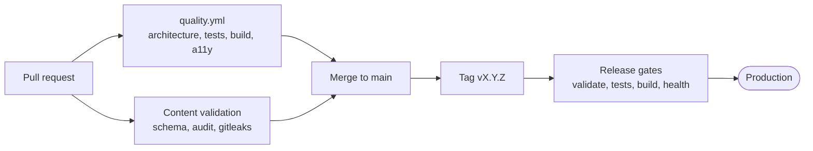

# Quality gates and ownership

| Scope | Owner | Gate |
| --- | --- | --- |
| Application | App repository | `dotnet test tests/Portfolio.Tests/Portfolio.Tests.csproj`, `npm --prefix client test`, module-boundary check, build, browser accessibility and security scans in `quality.yml` |
| Content | Private content repository | Schema and content validation in the content repo, review of claim provenance before merge. App CI validates only the public `content/` template. |
| Deployment | Release workflow and staging owner | IIS environment and runner readiness, HTTPS health check, release artifact smoke test, live rollback rehearsal |

Both `dotnet test` and the client tests are required before release. The browser matrix runs on pull requests only; pushes to `main` re-run the fast build/test/security job as a post-merge check. The release workflow does not repeat tests: it builds, validates content and packages the tagged commit. The `main` ruleset requires the status checks `build-and-security` and the three matrix jobs `browser-quality (chromium|firefox|webkit, windows-latest)`, with "require branches to be up to date". Do not rename the `browser-quality` job or change the matrix entries without updating the ruleset, otherwise the required checks never report and PRs stay blocked. The post-merge run on `main` stays as a cheap safety net for bypass pushes. A green build alone does not prove content provenance or staging readiness. Add focused tests to the owning suite when you change content classification, release selection, discovery, or the engines.
