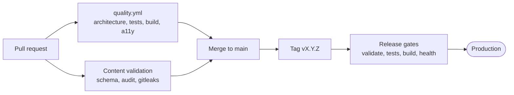

# Quality gates and ownership

| Scope | Owner | Gate |
| --- | --- | --- |
| Application | App repository | `dotnet test tests/Portfolio.Tests/Portfolio.Tests.csproj`, `npm --prefix client test`, module-boundary check, build, browser accessibility and security scans in `quality.yml` |
| Content | Public content repository | Schema and content validation, and review of claim provenance before a content commit is selected. App CI also validates the pinned submodule. |
| Deployment | Release workflow and staging owner | IIS environment and runner readiness, HTTPS health check, release artifact smoke test, live rollback rehearsal |

Both `dotnet test` and the client tests are required before release. A green build alone does not prove content provenance or staging readiness. Add focused tests to the owning suite when you change content classification, release selection, discovery, or the engines.
