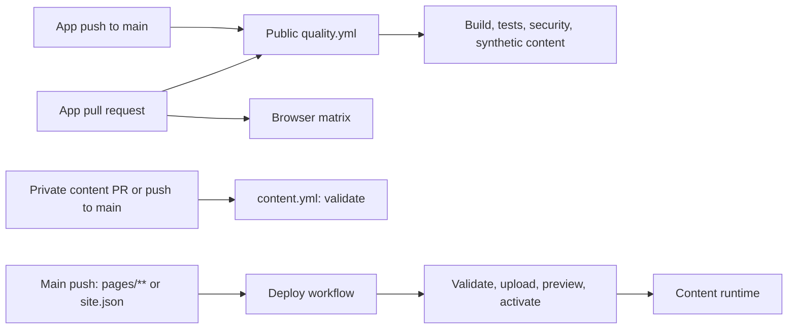

# Quality gates and ownership

Last updated: 2026-11-06

The checked-in workflows define the gates below; a workflow file alone does
not prove that a particular run or external repository ruleset is green.

## Public app workflow

`.github/workflows/quality.yml` runs on pull requests and pushes to `main`.
External Actions from GitHub (`actions/*`) use exact version tags (`vX.Y.Z`);
any other publisher must be pinned to a full commit SHA. Dependabot proposes
updates, and the workflow-contract tests enforce the rule.

| Job | When | Checks |
|---|---|---|
| `changes` | Pull request and `main` push | Classifies the changed files into `any` (anything but `VERSION`), `app` (code, content or config that is built or tested), `browser` (`app` minus .NET-only tests and the content validator) and `scripts`. Unexpected results run every gate. |
| `build-and-security` | Pull request and `main` push, unless only `VERSION` changed | Always: workflow-contract tests and the Gitleaks secret scan. Only when `app` is true: .NET and Node setup/restore; module-boundary check; `npm run test:content`; source-map validation, generated-output check, and Node content validation against the synthetic app tree; client build and tests; .NET build and tests; .NET content validation; npm audits; vulnerable transitive package scan. Workflow, PowerShell-script, deployment, template and documentation changes alone do not trigger the `app` steps. |
| `deployment-safety-tests` | Pull request and `main` push, only when `scripts/` or `.github/` changed | Windows tests for production-deployment state recovery, version-bump validation and app-pin resolution. |
| `browser-quality` | Pull request only | Playwright matrix for Chromium, Firefox, and WebKit on Windows; it depends on `build-and-security`. The job always starts so the required matrix check names report; its steps run only when `browser` is true. |

A job skipped with `if` counts as passed for required status checks. Matrix
jobs are the exception: a job-level skip leaves the expanded check names
pending, which is why `browser-quality` skips steps instead. `version-guard.yml`
deliberately has no path filter: it exits early when `VERSION` is unchanged, and
a filter could skip the guard on very large diffs.

The content commands in this app workflow use the public synthetic tree. They
do not read a private CV repository. The public job IDs and browser matrix are
visible in YAML; which statuses are required by a GitHub branch ruleset and
which environments require approval are external repository settings and must
be checked there.

## Private content validation workflow

The private caller validates pull requests and pushes to `main`. Its deploy
workflow runs on `main` changes to `content/pages/**` or `content/site.json`
and validates again before packaging. The caller pins reusable-workflow
references to an exact release tag such as `@v0.1.1`; keep it aligned with the
app release used for generation and recorded in provenance. This caller
configuration is not stored in the public repository.

The reusable `.github/workflows/validate-content.yml` requires
`app_repository`. Before checkout, it compares it with
`job.workflow_repository`, and derives the commit and release tag from
`job.workflow_sha` and `job.workflow_ref`; missing contexts, a non-tag ref, or
mismatches fail closed. These contexts are GitHub.com-only, so the reusable
workflow does not run successfully on GHES. It checks out that exact commit,
verifies it is reachable from that repository's `main`, that the tag resolves
to it, and that `VERSION` matches, then passes the version to
source validation and generated-output checking; `content:check` verifies
generated provenance. It also runs content-tooling tests and npm audit, scans
the caller repository with Gitleaks, then validates private content using the
Node.js and .NET validators. The deploy workflow's exact behavior is in
[content-releases.md](content-releases.md); the shared identity contract is in
[repositories.md](repositories.md#shared-content-workflow-pin).

## App release and manual recovery

`release.yml` runs for version-shaped tags, rejects tags outside
`vMAJOR.MINOR.PATCH`, and requires the tagged commit to be reachable from
`main`. It builds the client, validates the app's bundled content, publishes
the app, records the package SHA-256, and deploys through
`production-msdeploy`. It does **not** rerun the full Node or .NET test suites.

`manual-production-recovery.yml` can run only from `main` and requires an
explicit `confirm_production` input. A rollback download must be an existing
eligible tag asset whose SHA-256 matches GitHub's recorded digest. Production
state, package identity, and health/build metadata are verified by the
deployment script before state is marked last-known-good. See
[rollback-runbook.md](rollback-runbook.md).

Related references: [repository boundaries](repositories.md),
[source-map behavior](source-map.md), [Markdown content format](content.md),
and [content releases](content-releases.md).
