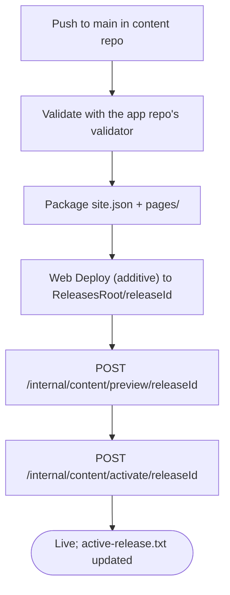

# Repository boundaries and content delivery

| Repository | Visibility | Responsibility | Validation |
| --- | --- | --- | --- |
| [`cv-online-presenter`](https://github.com/fredrik-hellmangroup/cv-online-presenter) | Public, MIT | .NET application, TypeScript client, deployment, and the [`content/`](../content/README.md) template with synthetic demo data | `Quality gates` workflow |
| [`cv-online-presenter-content`](https://github.com/fredrik-hellmangroup/cv-online-presenter-content) | **Private** | The real CV: `site.json`, `pages/`, source documents, provenance | `Content validation` and `Deploy content` workflows |

The two repositories are not linked by a submodule or a pinned commit. The app builds and tests against its own `content/` template. The real content reaches the live site as a **content release**: a folder `<ReleasesRoot>/<releaseId>/{site.json,pages/}` that the running app activates without an app redeploy. See [content-releases.md](content-releases.md).

Contact metadata and locale settings live in `site.json` of whichever content is active (`content/site.json` in the template). The template is synthetic and uses `demo@example.com`.

## What goes where

| Content | Public app repo | Private content repo |
| --- | --- | --- |
| Folder structure, schema, validator | Yes (`content/`, `tools/Portfolio.Content.Validator`) | Copied layout |
| Demo persona "Alex Exempel" | Yes | No |
| Real name, contact address, CV, projects | Never | Yes |
| Source documents (master CV, PRD) | Never (ignored via `.gitignore`) | Yes |

## Content deploy (private repo)

`releaseId` is `<UTC date>-<short sha>`. The deploy reuses `scripts/deploy-beebyte-iis.ps1 -ContentRelease`, which syncs into a new folder, never deletes, never writes `web.config` and never takes the site offline. The workflow checks out the public app repo at a pinned ref to get the validator and the deploy scripts.

### One-time setup

1. **Server.** Use `<site root>/App_Data/content-releases` as the releases folder. It is hidden from HTTP and the app deploy skips it, so it survives app releases; extra files elsewhere in the app folder are deleted. Make sure the app pool identity has modify rights on it, because the app writes `active-release.txt`. Set `Content__ReleasesRoot` (absolute physical path) and `Content__ActivationToken` as IIS or host-level environment variables, not only in `web.config`, since publish overwrites that file.
2. **Web Deploy user.** The deployment user must be able to write below the releases folder through Web Deploy. Verify this before the first run.
3. **GitHub environment `production-content`** in the private repo:

| Name | Kind | Purpose |
| --- | --- | --- |
| `MSDEPLOY_SERVER_URL` | Variable | HTTPS WMSvc endpoint, same as the app deploy |
| `MSDEPLOY_SITE_NAME` | Variable | IIS site name |
| `MSDEPLOY_CERTIFICATE_SHA256` | Variable | Pinned WMSvc certificate fingerprint |
| `DEPLOY_USERNAME` | Variable | Web Deploy user |
| `MSDEPLOY_CONTENT_RELEASES_PATH` | Variable | Web Deploy path of the releases folder, for example `hellmangroup.se/App_Data/content-releases` |
| `CONTENT_ACTIVATION_URL` | Variable | Public HTTPS base URL, for example `https://hellmangroup.se` |
| `APP_REPO_REF` | Variable | Tag or commit of the public app repo used for tooling |
| `DEPLOY_PASSWORD` | Secret | Web Deploy password |
| `CONTENT_ACTIVATION_TOKEN` | Secret | Must equal the server's `Content__ActivationToken` |

4. Protect `main` in the private repo and restrict `production-content` to `main`.

### Rollback

Run **Deploy content** manually with `activate_release_id` set to an earlier release id. This activates that folder again without uploading.
