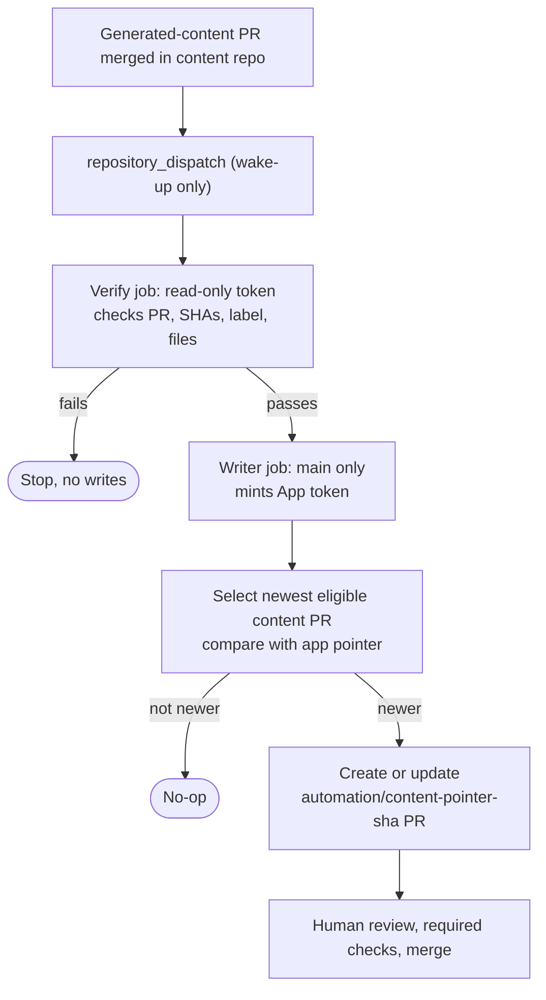

# Repository boundaries and version linkage

| Repository | Responsibility | License | Validation |
| --- | --- | --- | --- |
| [`cv-online-presenter`](https://github.com/fredrik-hellmangroup/cv-online-presenter) | .NET application, TypeScript client, web publishing and deployment | MIT | `Quality gates` workflow |
| [`cv-online-presenter-content`](https://github.com/fredrik-hellmangroup/cv-online-presenter-content) | Markdown pages, locale configuration, content schema and synthetic draft example | MIT | `Content validation` workflow |

The app pins the content repository as a submodule. The gitlink stores the exact content commit for each app revision, and `build-metadata.json` records both commit IDs. `git clone --recurse-submodules` reproduces that pair. The two CI workflows are independent.

Contact metadata and locale settings live in the content repository's `content/site.json` (from the app root: `content/content/site.json`). The example profile is synthetic and draft-only.

## Generated-content handoff

- The dispatch is only a wake-up. The newest eligible content PR wins, so an old event never creates an older PR.
- Verification runs first with a read-only token. The App token is minted only afterwards, and only on protected `main`.
- The content PR may touch only the generated files: the seven `content/pages/...` pages and `content/generated-provenance.json`. Any other path is rejected.
- The app PR changes only the `content` pointer.
- At most one open pointer PR is kept. Stale and superseded PRs are closed.
- A closed, unmerged PR stays closed. Reopen it only with a manual run that sets `reopen_closed=true` and the exact `app_pr_number`.
- Nothing merges, releases, or deploys automatically.

## Permissions

| Token | Scope | Used by |
| --- | --- | --- |
| `GITHUB_TOKEN` | Read contents and pull requests | Verify job |
| GitHub App token | Contents and pull requests read/write | Writer job, `generated-content-reconciler` environment (main only) |

- Store `APP_PR_APP_ID` and `APP_PR_APP_PRIVATE_KEY` only as secrets in the `generated-content-reconciler` environment. Do not create repository-level secrets with those names.
- Allow only protected `main` as the deployment branch for that environment.
- Protect app `main` with strict up-to-date checks, required checks, and human approval. The App gets no bypass or force-push rights on `main`.

## Manual recovery

1. Go to **Actions → Reconcile generated content PR → Run workflow**.
2. Set **Use workflow from** to `main`.
3. Enter the merged content PR number as `pr_number`.
4. Set `reopen_closed` and `app_pr_number` only to reopen one exact closed app PR. Set `mark_ready` only if that is intended.

## Troubleshooting

| Symptom | Likely cause | Action |
| --- | --- | --- |
| Verify job fails | Event does not match a merged, labeled content PR | Check the PR, label, and SHAs, then rerun |
| Writer job skipped | Run was not started from `main` | Rerun from `main` |
| Run fails with a closed PR URL | The candidate's app PR was closed unmerged | Reopen it manually, or resolve it by hand |
| Old `content-update-*` PR blocks | Legacy branch naming | Resolve the legacy PR before retrying that candidate |
