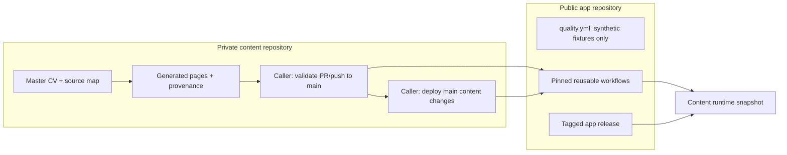
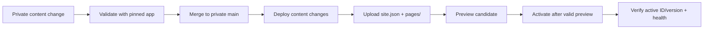

# Repository boundaries and content delivery

Last updated: 2026-11-06

## What belongs where

| Repository | Visibility | Owns |
|---|---|---|
| App (this repository) | Public | .NET app, TypeScript client, generator/validators, reusable workflows, synthetic content and examples |
| Content | Private | Master CV, real source map and CV section rules, site settings, generated pages/provenance, and caller workflows |

Keep all real names, contact data, CV facts, employer/client details, source
documents, and private provenance in the private repository. Public fixtures
and examples are synthetic. App CI uses those fixtures and never checks out
private CV material. The repositories are not joined by a submodule or content
pointer; content-only updates do not require app source changes.

The source map maps selected source evidence and page metadata to an output
allowlist. Generation and provenance stay in the private tree; the runtime
package contains only `site.json` and generated `pages/`.



## CI and release lanes

| Lane | Trigger | Scope |
|---|---|---|
| Public app CI | Pull request and push to `main` | Build, tests, security checks, and synthetic content validation; browser matrix on pull requests |
| Private content validation | Pull request and push to `main` | Validate private content with the pinned app tooling |
| Private content deployment | `main` changes to `content/pages/**` or `content/site.json` | Publish an additive content release, preview, then activate |
| App release | `vMAJOR.MINOR.PATCH` tag on `main` | Build and deploy the app separately from content |

The current private caller pins its reusable-workflow references and supplies
`app_sha`. Keep both aligned with the public app commit used by generation and
recorded in generated provenance. That pin/provenance agreement is the
caller's responsibility; public docs describe the contract, not private CV
content or private workflow source. See [quality gates](quality-gates.md) and
[content releases](content-releases.md) for lane and operational detail.

## Shared content workflow pin

The reusable workflows in `.github/workflows/validate-content.yml`,
`deploy-content.yml`, and `provision-activation-token.yml` are
`workflow_call` definitions. They require:

| Input | Requirement |
|---|---|
| `app_repository` | `owner/repository` matching `^[A-Za-z0-9-]+/[A-Za-z0-9._-]+$`; must identify the repository that supplied the reusable workflow |
| `app_sha` | Full 40-character lowercase commit SHA for the workflow source and, during validation, generated `appCommitSha` provenance |

Before any app checkout, each workflow compares both inputs with
`job.workflow_repository` and `job.workflow_sha`; missing values or mismatches
fail closed. A fork works when the caller loads the workflow from that fork
and supplies the same repository and source commit. An unrelated repository
does not pass the identity check. These contexts are available on GitHub.com,
not GHES, so the workflows require GitHub.com and fail closed on GHES.

The workflows check out the supplied repository at the supplied SHA, verify
that commit is reachable from its `main`, and verify checkout `HEAD`. The
caller must also pin its `uses` reference to that same full SHA: the identity
guard checks the resolved workflow source, not the caller-ref text. Validation
passes the SHA to `content:source:validate` and `content:check` to verify
provenance. `deploy-content.yml` invokes validation through its local nested
workflow, so both jobs use the same source commit. Checked-in external Actions
are pinned to full SHAs, with `contents: read` permissions and checkout
credentials disabled where configured.

## Content validation, delivery, and rollback

Validation checks out the caller's content commit and the app at the requested
SHA. It installs and audits app content tooling, runs synthetic tooling tests,
scans the caller repository with Gitleaks, validates source and generated
provenance, then runs the Node.js and .NET content validators. App CI's
separate synthetic-only checks are listed in [quality-gates.md](quality-gates.md).

On a normal deployment, the caller invokes the reusable deploy workflow from
`main`. It packages only `content/site.json` and `content/pages/`, creates a
new UTC timestamp/content-commit release ID, and uploads additively to
`<site>/App_Data/content-releases/<releaseId>`; it does not deploy the app.
The runtime previews the candidate, activates only after a valid preview, and
the workflow verifies active release identity/version and `/health`. Rollback
selects an existing release ID without upload; it still verifies workflow
identity, previews, activates, and performs the post-activation checks. See
[content-releases.md](content-releases.md) for exact workflow behavior,
environment names, and safeguards.



## App release and recovery

`release.yml` accepts `vMAJOR.MINOR.PATCH` tags, verifies the tagged commit is
reachable from `main`, validates synthetic content, computes a package
SHA-256, publishes an immutable asset, and deploys through
`production-msdeploy`. The deployment script verifies the digest and
production state, and updates last-known-good state only after health and
build-metadata checks succeed.

`manual-production-recovery.yml` requires invocation from `main` and explicit
`confirm_production`. It builds current `main` or downloads an existing
release asset and verifies its recorded digest before deployment. See the
[rollback runbook](rollback-runbook.md). Branch rules, environment approvals,
and secrets are GitHub settings, not facts inferred from workflow YAML.

## Generated-content validation

Editorial integration tests can read generated pages from a private worktree
without copying them into this repository:

```powershell
$env:EDITORIAL_CONTENT_PAGES = 'D:\work\private-portfolio-content\content\pages'
dotnet test tests/Portfolio.Tests/Portfolio.Tests.csproj --filter FullyQualifiedName~EditorialPageTests
Remove-Item Env:EDITORIAL_CONTENT_PAGES
```

For browser/a11y real-content mode, set `PLAYWRIGHT_CONTENT_MODE=real` and
`EDITORIAL_CONTENT_PAGES` to that same external directory, then run the
Chromium project in `tools/a11y`. The checked-in app CI remains synthetic;
never copy private content into the app checkout.

Related: [fork guide](fork-guide.md), [source map](source-map.md),
[Markdown format](content.md), [content releases](content-releases.md).
