# Repository boundaries and content delivery

Last updated: 2026-11-06

## What belongs where

| Repository | Visibility | Responsibility |
|---|---|---|
| Public app repository (this repo) | Public | .NET app, TypeScript client, content generator/validators, reusable workflows, and a synthetic `content/` template. |
| Private content repository | Private | Canonical CV source, real source map and CV section rules, site settings, generated pages, provenance, and the caller workflows that validate and release private content. |

Keep all real names, contact data, CV facts, employer/client details, source
documents, and private provenance in the private repository. Public
`content/` files and the documented examples are synthetic. The app builds and
tests against that template; normal app CI does not check out private content.

The repositories are not joined by a Git submodule or content-pointer PR.
A content-only update does not require an app source change. The runtime
content package contains `site.json` and `pages/` only; source documents,
source map, CV section rules, and generator provenance are not uploaded.

## Shared content workflow pin

The reusable workflows in `.github/workflows/validate-content.yml`,
`deploy-content.yml`, and `provision-activation-token.yml` are
`workflow_call` definitions. A caller must provide:

- `app_repository`, a string matching
  `^[A-Za-z0-9-]+/[A-Za-z0-9._-]+$`. It must identify the repository that
  supplied the reusable workflow.
- `app_sha`, a full 40-character lowercase commit SHA. It must identify the
  commit that supplied the reusable workflow and, for content validation, the
  app commit recorded in generated `appCommitSha` provenance.

Before any app checkout, each workflow compares `app_repository` and `app_sha`
with `job.workflow_repository` and `job.workflow_sha`. Missing context values
or either mismatch fail closed. This permits a fork when the caller uses the
workflow from that fork and supplies the same fork repository and source
commit; it does not permit passing an unrelated repository to a workflow
loaded from elsewhere. The job contexts are available on GitHub.com but not
GHES, so these workflows require GitHub.com and fail closed on GHES.

The workflows then check out that repository at the supplied SHA, verify it
is reachable from that repository's `main`, and verify checkout `HEAD`. The
caller should still pin its `uses` reference to the same full commit SHA; the
guard compares the resolved workflow source identity, not the text of the
caller's ref. Content validation passes the SHA to
`content:source:validate` and `content:check`, which verifies generated
provenance. `deploy-content.yml` calls validation through its local nested
workflow, so both jobs use the same workflow source commit. External Actions
are pinned to full commit SHAs, with `contents: read` permissions and checkout
credentials disabled where checked in.

**Caller migration note (last inspected 2026-11-05):** the private-content
caller inspected for this migration used the legacy `APP_REPO_REF=main` deploy
contract and did not invoke these reusable workflows or pass one `app_sha`
through generation and deployment. Its validation workflow checked out a
separate pinned app revision. This is a dated observation, not confirmation of
the current private caller state. The public reusable contract alone does not
establish that a private production caller is end-to-end SHA-pinned.

## Private content validation and release

The validation workflow checks out the caller's content commit and the app at
the requested SHA. It installs and audits the app's content tooling, runs
synthetic content-tooling tests, scans the caller repository with Gitleaks,
validates source and generated provenance, then runs the Node.js and .NET
content validators. The app SHA is checked both as a workflow checkout and as
generator provenance. See [quality-gates.md](quality-gates.md) for the public
app's separate synthetic-only gates.

After validation, the caller can invoke the reusable deploy workflow from
`main`. That workflow packages only `content/site.json` and
`content/pages/`, generates a new UTC timestamp/content-commit release ID,
and uploads additively to
`<site>/App_Data/content-releases/<releaseId>`. It does not update the app
package. The runtime previews the candidate, then activates it only after a
valid preview response; the workflow verifies the active release identity and
content version and checks `/health`. The exact operational contract,
required environment names, and rollback behavior are in
[content-releases.md](content-releases.md).

```mermaid
flowchart LR
    P["Private content change"] --> V["Caller invokes pinned validation workflow"]
    V --> M["Merge to private main"]
    M --> D["Caller invokes reusable deploy workflow"]
    D --> C["Package site.json + pages/"]
    C --> U["Additive upload to a new release folder"]
    U --> R["Authenticated preview"]
    R --> A["Activate only after preview succeeds"]
    A --> H["Verify active ID/version and health"]
```



Content rollback selects an existing `releaseId`; it does not upload content.
The deployment workflow still verifies its app repository and SHA, previews
the selected release, activates it, and performs the post-activation checks.

## App release and recovery

The app's `release.yml` is separate from content publication. It accepts tags
matching `vMAJOR.MINOR.PATCH`, verifies the tagged commit is reachable from
`main`, builds and validates the app's synthetic content, computes a package
SHA-256, publishes an immutable release asset, and deploys through the
`production-msdeploy` environment. Its deployment script verifies the package
digest and production state before sync and updates the last-known-good state
only after health and build metadata checks succeed.

`manual-production-recovery.yml` requires an invocation from `main` and an
explicit `confirm_production` input. It either builds the current main commit
or downloads an existing release asset and verifies its recorded digest
before deployment. The runtime state and recovery procedure are documented
in [rollback-runbook.md](rollback-runbook.md). GitHub environment approvals,
branch rules, and secret values are repository settings; they are not inferred
from the workflow YAML.

## Generated-content validation

The app's editorial integration tests can read generated pages from a private
worktree without copying them into this repository:

```powershell
$env:EDITORIAL_CONTENT_PAGES = 'D:\work\private-portfolio-content\content\pages'
dotnet test tests/Portfolio.Tests/Portfolio.Tests.csproj --filter FullyQualifiedName~EditorialPageTests
Remove-Item Env:EDITORIAL_CONTENT_PAGES
```

The test reads the directory in place and does not record page facts. For the
browser/a11y real-content mode, set `PLAYWRIGHT_CONTENT_MODE=real` and
`EDITORIAL_CONTENT_PAGES` to that same external directory, then run the
Chromium project in `tools/a11y`. Do not copy the files into the app checkout.
The checked-in app CI uses synthetic content; enabling private-content checks
in CI requires an explicit private workflow contract.

## Related documentation

- [Fork guide](fork-guide.md)
- [Source map and generation](source-map.md)
- [Markdown content format](content.md)
- [Content releases and activation](content-releases.md)
- [Quality gates](quality-gates.md)
