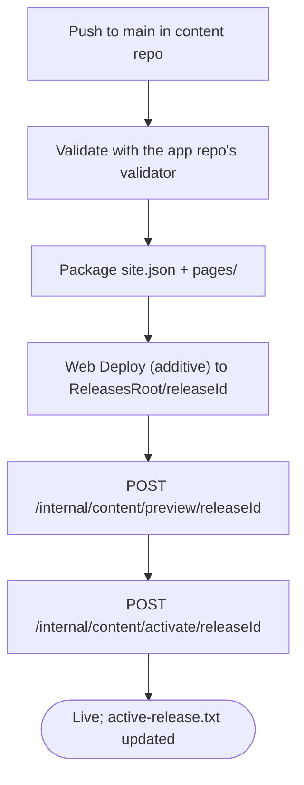
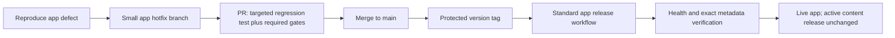
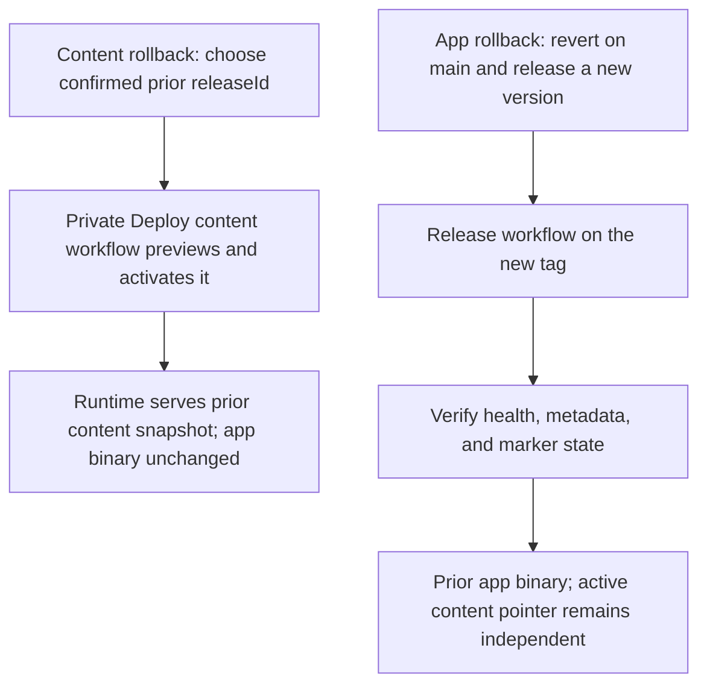

# Repository boundaries and content delivery

Last updated: 2026-11-03

| Repository | Visibility | Responsibility | Validation |
| --- | --- | --- | --- |
| [`cv-online-presenter`](https://github.com/fredrik-hellmangroup/cv-online-presenter) | Public, MIT | .NET application, TypeScript client, deployment, and the [`content/`](../content/README.md) template with synthetic demo data | `Quality gates` workflow |
| [`cv-online-presenter-content`](https://github.com/fredrik-hellmangroup/cv-online-presenter-content) | **Private** | The real CV: `site.json`, `pages/`, source documents, provenance | `Content validation` and `Deploy content` workflows |

The two repositories are not linked by a Git submodule, pinned content commit, or pointer-PR workflow. The app builds and tests against its own `content/` template. A content-only change does not require an app-repository pointer update or app PR; a design/code change belongs in the public app repository and is released separately. The real content reaches the live site as a **content release**: a folder `<ReleasesRoot>/<releaseId>/{site.json,pages/}` that the running app activates without an app redeploy. After activation, best-effort cleanup retains the active release and the 10 most recent eligible inactive releases; preserved uncertain directories can make the total exceed 11. See [content-releases.md](content-releases.md) for eligibility and safety details. Production assumes one Plesk worker and no overlapping worker during recycle; revisit coordination if web-garden or overlapping-process configuration changes.

Contact metadata and locale settings live in `site.json` of whichever content is active (`content/site.json` in the template). The template is synthetic and uses `demo@example.com`.

## What goes where

| Content | Public app repo | Private content repo |
| --- | --- | --- |
| Folder structure, schema, validator | Yes (`content/`, `tools/Portfolio.Content.Validator`) | Copied layout |
| Demo persona "Alex Exempel" | Yes | No |
| Real name, contact address, CV, projects | Never | Yes |
| Source documents (master CV, PRD) | Never (ignored via `.gitignore`) | Yes |

## Content deploy (private repo)



`releaseId` is `yyyyMMdd-HHmmss-<7 lowercase hex characters>`: the workflow formats the UTC timestamp with `ToString('yyyyMMdd-HHmmss')` and appends a hyphen plus the 7-character lowercase SHA (for example, `20261101-210215-1a6df58`). The deploy reuses `scripts/deploy-beebyte-iis.ps1 -ContentRelease`, which syncs into a new folder, never deletes, never writes `web.config` and never takes the site offline. The workflow checks out the public app repo at a pinned ref to get the validator and the deploy scripts.

### One-time setup

1. **Server.** Nothing to configure in IIS. The app defaults to `<site root>/App_Data/content-releases` (hidden from HTTP, skipped by the app deploy, so it survives app releases). Make sure the app pool identity has modify rights on it, because the app writes `active-release.txt`. Provision `App_Data/content-releases/activation-token.txt` through the reviewed content repository’s `Provision activation token` workflow, using the same value as the `CONTENT_ACTIVATION_TOKEN` secret (at least 32 characters). It is read on every request, so no restart is needed.
2. **Web Deploy user.** The deployment user must be able to write below the releases folder through Web Deploy. Verify this before the first run.
3. **GitHub environment `production-content`** in the private repo:

| Name | Kind | Purpose |
| --- | --- | --- |
| `MSDEPLOY_SERVER_URL` | Variable | HTTPS WMSvc endpoint, same as the app deploy |
| `MSDEPLOY_SITE_NAME` | Variable | IIS site name |
| `MSDEPLOY_CERTIFICATE_SHA256` | Variable | Pinned WMSvc certificate fingerprint |
| `DEPLOY_USERNAME` | Variable | Web Deploy user |
| `MSDEPLOY_CONTENT_RELEASES_PATH` | Variable | Web Deploy path of the releases folder, for example `hellmangroup.se/App_Data/content-releases` |
| `CONTENT_ACTIVATION_URL` | Variable | Public HTTPS base URL, for example `https://hellmangroup.se` |
| `APP_REPO_REF` | Variable | Required value `main` for these protected workflows; normal content uploads fail closed unless the public app repo ref is exactly `main` |
| `DEPLOY_PASSWORD` | Secret | Web Deploy password |
| `CONTENT_ACTIVATION_TOKEN` | Secret | Must equal the contents of `App_Data/content-releases/activation-token.txt` on the server |
| `CONTENT_ACTIVATION_TOKEN_NEXT` | Secret | Temporary staged-rotation/recovery secret only; remove it after successful rotation |

For rollback runs, `APP_REPO_REF` is not used because the app repository is not checked out. Keep token values out of documentation and logs. Protect `main` in the private repo and restrict `production-content` to `main`.

### Rollback

Run **Deploy content** manually with `activate_release_id` set to an earlier release id. This activates that folder again without uploading.


## Current architecture and routine workflows

The app repository contains the Static SSR application and synthetic content template. The private content repository contains source documents and generated `site.json`/`pages/`; CI validates the generated output using the app validator, and its deploy workflow uploads an immutable content release. At runtime the app serves one validated snapshot. Normal CV and editorial copy updates do not rebuild or redeploy the app. A design change is an app-source change and follows the app's pull-request and tagged-release pipeline. There is no shared submodule checkout, content pointer commit, or app PR for each content release.

The implemented page split is `/`, `/services`, `/projects`, and `/projects/{slug}` through `ContentPage` and generated Markdown; the generator owns their H1. `/cv` remains on `CvPresenter`/`CvHero`. See [architecture.md](architecture.md) for module and rendering boundaries.

### Normal CV update (content-only)

```mermaid
flowchart LR
    E["Edit source and generated CV in private content repo"] --> P["Content PR"]
    P --> C["CI: generate and validate output, provenance, app schema"]
    C --> M["Merge to protected main"]
    M --> D["Deploy workflow validates and packages release"]
    D --> U["Upload immutable ReleasesRoot/releaseId"]
    U --> V["Preview release against active snapshot"]
    V --> A["Activate release"]
    A --> S["Runtime loads the validated content snapshot"]
```



### Design change (app release)

```mermaid
flowchart LR
    B["Change app UI, styles, or rendering in public app repo"] --> P["App PR and quality gates"]
    P --> Q["Chromium, Firefox, WebKit browser matrix"]
    Q --> M["Merge to main"]
    M --> T["Create protected vMAJOR.MINOR.PATCH tag"]
    T --> R["Build and publish immutable app package"]
    R --> D["MSDeploy app release"]
    D --> H["Verify health and exact build metadata"]
    H --> S["App serves existing active content snapshot"]
```



### Hotfix



A hotfix uses the same protected app release path; it does not bypass review, tag protection, or deployment verification. If the defect is only in CV text, use the normal content update instead.

### Rollback



Use [rollback-runbook.md](rollback-runbook.md) for app package recovery and [content-releases.md](content-releases.md#rollback) for content release activation. Never use a Git submodule pointer or a newly rebuilt old commit as a substitute for the recorded release.

| Routine | Repository / trigger | Required validation | Production effect | Recovery |
| --- | --- | --- | --- | --- |
| CV, services, or project copy | Private content PR merged to protected `main` | Generator/provenance checks and app content validator | New content release previewed then activated; no app deploy | Reactivate a confirmed prior content `releaseId` |
| Design, component, or rendering change | Public app PR, then protected version tag | App quality gates and Chromium/Firefox/WebKit matrix | Immutable app package deployed and verified; content snapshot remains separate | Redeploy a confirmed immutable app package |
| App hotfix | Public app hotfix PR and normal protected version tag | Targeted regression plus all required gates; no bypass | Standard app deployment and verification | Same bounded app rollback procedure |
| Content rollback | Private content workflow manual release selection | Existing release and preview validation | Active snapshot pointer changes only | Stop before activation if preview fails |
| App rollback | Public app's release workflow on a new version tag (revert on `main`) | LKG/package digests, health, exact metadata, marker observation | App package changes; content root is preserved | One bounded automatic restore of the prior LKG; operator escalation if it fails |

## Generated-content validation

The public repository's CI intentionally tests only the synthetic `content/` fixtures; it must not check out private CV facts. The integration test has a path injection hook and loads generated files directly, without copying them into this repository:

```powershell
$env:EDITORIAL_CONTENT_PAGES = 'D:\path\to\private-content-worktree\content\pages'
dotnet test tests/Portfolio.Tests/Portfolio.Tests.csproj --filter FullyQualifiedName~EditorialPageTests
Remove-Item Env:EDITORIAL_CONTENT_PAGES
```

For browser/a11y checks against real generated content, use the real-content mode and point it at the private pages directory outside this checkout. This mode enables the generated-content home H1 assertion, injects `Content__PagesRoot` into the app's environment, starts a dedicated Playwright web server, and disables reuse of an existing server. Do not set `BASE_URL` or set `Content__PagesRoot` manually:

```powershell
$env:PLAYWRIGHT_CONTENT_MODE = 'real'
$env:EDITORIAL_CONTENT_PAGES = 'D:\path\to\private-content-worktree\content\pages'
bun run --cwd tools/a11y test -- --project=chromium
Remove-Item Env:PLAYWRIGHT_CONTENT_MODE, Env:EDITORIAL_CONTENT_PAGES
```

The checked-in CI does not have private repository access or a content-generator step, so its browser matrix cannot exercise personal generated content. The local hook above and `Content:PagesRoot` configuration are the durable boundary; enabling such checks in CI requires an explicit private-content workflow or cross-repository CI contract, not copied facts or weakened assertions.
