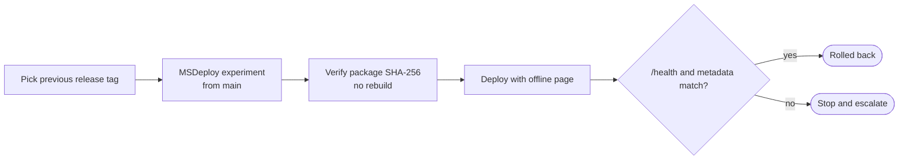

# Beebyte rollback runbook

Rollback redeploys an earlier immutable GitHub Release package through the same checks as a normal release. The legacy `rollback-iis.ps1` script is not used, because it needs local filesystem and app-pool access that Beebyte does not provide.

## Steps

1. Choose the previous immutable `cv-online-presenter-<tag>.zip` on GitHub Releases.
2. Run **MSDeploy experiment** from `main`.
3. Set `confirm_production` and enter the semantic tag in `rollback_release_tag`.
4. The workflow checks that the tag is reachable from `main`, downloads the package, and verifies its digest.
5. `/health` must pass, and the live `/build-metadata.json` must match the rollback artifact.
6. Record the tag and metadata in the release incident or exercise log.

Do not rebuild an old source tag when its release package exists. Never run FTPS automatically after an MSDeploy failure. The FTPS helper is break-glass only, for when WMSvc itself is unavailable. If you use it, record the exception and verify health and metadata afterward.

## Release notes

The tag workflow generates notes with commit summaries, content revision, migration review status, build provenance, and the previous release rollback reference. Review content and migration details before deployment. The first live rollback must run in an approved maintenance window before rollback readiness is claimed.
