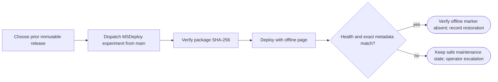

# Beebyte rollback runbook

Last updated: 2026-11-02

Rollback is currently a manual redeployment of an earlier immutable GitHub Release package through the same deployment and verification checks as a normal release. There is no automatic rollback or recovery today. The legacy `rollback-iis.ps1` script is not used, because it needs local filesystem and app-pool access that Beebyte does not provide.

## Manual rollback steps

1. Choose the previous immutable `cv-online-presenter-<tag>.zip` on GitHub Releases. A published release is not proof it was deployed; select a known-good artifact based on deployment evidence.
2. Run **MSDeploy experiment** from `main`.
3. Set `confirm_production` and enter the semantic tag in `rollback_release_tag`.
4. The workflow checks that the tag is reachable from `main`, downloads the package, and verifies its SHA-256 digest against the GitHub Release asset digest.
5. `/health` must pass and live `/build-metadata.json` must exactly match the rollback artifact.
6. After restoration is verified, confirm the active root `app_offline.htm` marker is absent, then record the deployed tag, digest, metadata, and verification in the release incident or exercise log.

Do not rebuild an old source tag when its release package exists. Never run FTPS automatically after an MSDeploy failure. The FTPS helper is break-glass only, for when WMSvc itself is unavailable. If you use it, record the exception and verify health, exact metadata, and offline-marker absence after restoration.

If health or metadata cannot be verified, or the site continues returning HTTP 503 after an immutable redeploy, do not remove an active root `app_offline.htm` marker. Preserve the safe maintenance/offline state and escalate. The v1.0.10 incident demonstrated that redeploying the immutable package did not recover the site; recovery required the operator/provider to recycle or restart the IIS app pool. The workflows do not manage the pool. Escalate persistent 503 to the operator/provider for that action; do not represent pool recycle/restart as automated recovery.

## Phase 2: accepted, deferred

Issue #56's bounded automatic rollback is accepted but deferred until provider preflight, artifact identity recording, and safe failure-injection tests are complete. This describes a future boundary, not current behavior.

The proposal is exactly one bounded automatic rollback attempt on a sync failure or a health/metadata verification failure, and only after the prior **actually deployed** artifact identity is recorded and its immutable package digest verifies. The record must correctly handle a manual rollback and distinguish a published-but-not-deployed release from the live deployment. A GitHub Release tag alone is insufficient.

Recovery is successful only when, after restoration, all three conditions are true: health passes, exact metadata matches the restored artifact, and the active root `app_offline.htm` marker is absent. If rollback, cleanup, or verification cannot complete, the deployment remains failed; preserve maintenance/offline state and escalate to an operator. There is no unqualified guarantee under runner, WMSvc, or network failure.

Preflight requirements:

- Confirm Beebyte-supported remote root-marker delete and verification operations.
- Establish a trustworthy live-deployed tag-and-digest record that handles manual rollback and published-but-not-deployed releases.
- Determine whether Beebyte provides a supported app-pool restart API. Do not automate pool recycle/restart absent explicit provider support; otherwise persistent 503 remains an operator/provider escalation.
- Add safe failure-injection tests for sync and health/metadata failures, failed rollback/cleanup/verification, and runner/WMSvc/network interruption.

## Release notes

The tag workflow generates notes with commit summaries, content revision, migration review status, build provenance, and the previous release rollback reference. Review content and migration details before deployment. The first live rollback must run in an approved maintenance window before rollback readiness is claimed.
