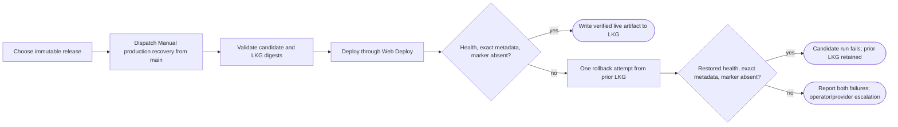

# Beebyte rollback runbook

Last updated: 2026-11-03

Production rollback is a manual redeployment of an earlier immutable GitHub Release package through the same production workflow, plus one bounded automatic recovery attempt if a candidate sync or post-sync verification fails. No local-filesystem/app-pool rollback script is used on the shared Beebyte host because it requires access to the local filesystem and app pool, which Beebyte does not provide.

## Manual rollback steps

1. Confirm the protected `production-state` branch has a valid `lkg-v1.json` and that its exact recorded immutable package is available. The workflow validates this prior LKG before any sync; never select a rollback based on tag ordering or `latest`.
2. Choose the desired immutable `cv-online-presenter-<tag>.zip` on GitHub Releases. A published release is not proof it was deployed; the workflow updates LKG only after verified live deployment.
3. Run **Manual production recovery** from `main`.
4. Set `confirm_production` and enter the existing `vMAJOR.MINOR.PATCH` tag in `rollback_release_tag`. The tag must have been deployed successfully before: the workflow checks the `production-state` history of `lkg-v1.json` for a verified-live record with that tag and exact package digest and refuses anything else.
5. The workflow checks the tag is reachable from `main`, verifies the downloaded bytes against the GitHub asset digest, verifies the embedded metadata, and validates the prior LKG asset before sync.
6. `/health`, exact live `/build-metadata.json`, and the active root marker check must pass. The successful manual rollback is then recorded as the actual live LKG using a non-force state-branch update.

Do not rebuild an old source tag when its release package exists. Never run FTPS automatically after an MSDeploy failure. The FTPS helper is break-glass only, for when WMSvc itself is unavailable. If you use it, record the exception and verify health, exact metadata, and offline-marker absence after restoration.

On a candidate sync, health, metadata, or marker-verification failure, the workflow makes exactly one sync to the prior LKG package and verifies health, exact metadata, and marker absence. It still reports the candidate run as failed. If restoration fails, both the original and recovery errors are reported and there is no retry. Do not manually remove a marker through unsupported APIs. Persistent HTTP 503 is operator/provider escalation; no app-pool restart is done by the workflows. The v1.0.10 incident showed an immutable redeploy may not recover a persistent 503.

## Durable LKG, recovery, and failure limits

`production-state` is a dedicated branch containing the versioned `lkg-v1.json` record. It describes the artifact actually verified live, not the latest published tag. Record fields are: source tag, source commit, app/content/build metadata, package SHA-256, exact immutable release tag and asset name, workflow/run/attempt evidence, UTC verification time, and health/metadata/marker evidence. No fallback to `latest`, tag order, rebuilding, or a short-retention Actions artifact is permitted.

Before either workflow syncs, it reads and validates the LKG record, downloads that exact GitHub Release asset, compares the GitHub-published digest with downloaded bytes and the record, and checks embedded metadata. Any missing/malformed record, unavailable asset, digest mismatch, or metadata mismatch fails closed. Bootstrap the protected branch from independently verified current production deployment evidence before enabling deployment workflows.

Manual recovery never builds or archives anything from `main`: it only redeploys an existing release tag whose exact package was already recorded as verified live. A manual rollback records the selected immutable release as the actual live artifact only after successful verification.

After candidate and prior LKG package identities are validated, but before the first production sync, the workflow commits `pending-v1.json` to `production-state` while preserving `lkg-v1.json`. The non-force push is a compare-and-swap; a failed/ambiguous pending write prevents any production mutation. On successful candidate verification, one non-force state commit replaces LKG and clears pending. After automatic rollback succeeds and live health, exact metadata, and marker absence are verified, a non-force commit clears pending while retaining the old LKG. Failed/ambiguous rollback or final state update leaves pending in place. Subsequent automatic tag deployments fail closed before sync while pending exists. A manual operator may explicitly set `reconcile_pending` on the **Manual production recovery** workflow to deploy/verify a chosen immutable artifact; stale LKG is never used for rollback in that recovery run, and pending clears only after the new candidate is verified and recorded. GitHub branch state and IIS cannot be changed atomically; ambiguous outcomes require operator reconciliation. The writer token is supplied only to the workflow deployment step, removed from the child MSDeploy process, and state updates use non-force pushes.

Cleanup is limited to the existing Web Deploy ContentPath/AppOffline lifecycle. There is no established remote marker delete/readback API, so the workflow does not claim or attempt separate deletion; after restored health and metadata pass, it checks `/app_offline.htm` for the offline marker. It does not use a `finally` cleanup. Runner loss, network interruption, or WMSvc interruption can prevent restoration or confirmation. No unconditional recovery/cleanup guarantee is possible. `App_Data` and `.well-known` are preserved by the existing sync exclusions. No app-pool restart is attempted.

## Release notes

The tag workflow generates notes with commit summaries, content revision, migration review status, build provenance, and the previous release rollback reference. Review content and migration details before deployment. The first live rollback must run in an approved maintenance window before rollback readiness is claimed.
