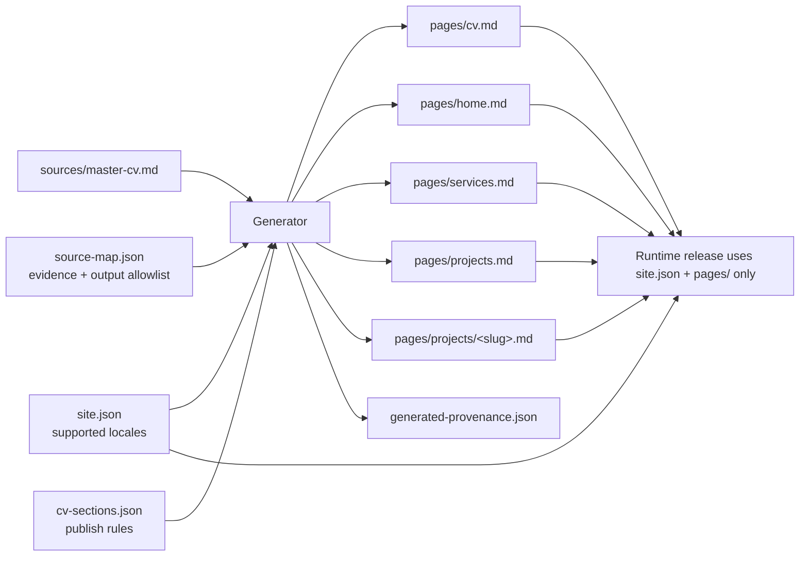

# Source map and generated content

Last updated: 2026-11-06

This guide documents the public app's current generator at
[`scripts/content/generate-content.mjs`](../scripts/content/generate-content.mjs),
its JSON schemas, and its synthetic test fixture. It uses fictional examples
only. Keep real CV material, personal/contact data, source maps, and generated
provenance in a **private** content repository.

The runtime input is `content/source-map.json`. The separate
[`source-map.example.json`](source-map.example.json) is a safe example, not a
runtime input. JSON does not support comments; an annotated excerpt appears
below in Markdown.

## Quick start: source to pages



| Input / output | Purpose |
|---|---|
| `sources/master-cv.md` | Canonical evidence source; real version stays private |
| `source-map.json` | Selects mapped source facts and defines the complete output allowlist |
| `cv-sections.json` | Controls which source sections appear in the generated CV |
| `site.json` | Supplies locales that mapped pages must use |
| `pages/` | Generated CV, home, services, projects index, and selected project details |
| `generated-provenance.json` | Records input, generator, and generated-page hashes, including the app pin when supplied |

The map is hand-maintained; generated pages and provenance are derived.
Create each seed page and its normalized bootstrap hash before the first
managed write. The runtime package omits the source, map, section rules, and
provenance. See [bootstrap and provenance](#bootstrap-and-provenance) for the
first-write contract and [adding a project](#adding-a-project) for the
project workflow.

## Files and responsibilities

| Path | Role |
|---|---|
| `content/sources/master-cv.md` | Canonical Markdown source. |
| `content/source-map.json` | Hand-maintained page metadata, source references, and output allowlist. |
| `content/cv-sections.json` | Hand-maintained CV section publication rules and optional structural-heading overrides. |
| `content/site.json` | Supplies `supportedLocales`, checked against each mapped page's locale. |
| `content/pages/...` | Generated output paths. The source map is the complete output allowlist. |
| `content/generated-provenance.json` | Generator-written input/output hashes and page list used to detect stale or edited output. |
| `content/schema/source-map.schema.json` | Format schema for the source map. |
| `content/schema/cv-sections.schema.json` | Format schema for CV section rules and heading overrides. |
| `content/schema/page.schema.json` | Format schema for generated page front matter. |
| `scripts/content/generate-content.mjs` | Generator, runtime validation, bootstrap checks, and provenance writer. |

The generator validates its inputs in JavaScript; it does **not** load or
execute the JSON Schemas. The schemas describe the intended format, but the
JavaScript checks are what generator commands enforce. Keep data valid against
both.

## Hand-written versus derived

The source map is editorial input, not a cache of generated output.

| Hand-written / maintained | Derived by the generator |
|---|---|
| `source`, `generatedPages`, page paths/types/titles/descriptions/locales/statuses, source references, `heroTagline`, optional service hero metadata, summaries, optional `links`, flat or grouped service competency mappings, optional project `presentation` settings, selected project cards, and an optional approved CV employment-line override. | CV/home/services/projects/project-detail Markdown bodies, source-derived project facts and technologies, selected project presentation fields, generated front matter `sourceSha256`, and provenance hashes. |
| `content/cv-sections.json` section rules and heading overrides. | The CV body with sections marked `publish: false` removed; an approved employment-line replacement is applied when configured. |
| `bootstrapOutputSha256` seed hashes in the source map. | `content/generated-provenance.json`, including hashes for the source, map, CV rules, generator, and generated pages. |

Page-specific behavior:

- **CV** — uses the canonical source, less unpublished sections. The optional
  approved employment-line override changes only the generated CV text.
- **Home** — derives the name H1 and following role paragraph from the source,
  then adds the hand-written `heroTagline`. The mapped title must be
  `<name> – <role>` with an en dash.
- **Services** — supports either the backward-compatible flat
  `competenceBlocks` mapping or nested `competenceGroups`; both use
  source-checked lines and the body includes a fixed `/cv` link. Grouped
  mappings generate group and item headings for the tabbed services view.
  Optional service hero metadata is emitted in front matter.
- **Projects index** — derives card titles from selected project H3 headings;
  mapped summaries and routes are hand-written and checked.
- **Project detail** — derives period, role, optional industry, intro,
  responsibilities, result, and technologies from the selected project
  source section. An optional project `presentation` mapping selects card
  order and which source facts to expose in front matter. The mapped `summary`
  is checked against the source result and remains distinct from the intro.

Generated front matter starts with mapped `title`, `description`, `locale`,
`status`, and `type`; includes optional service hero fields, `summary`, and
`links` when supplied; derives project `technologies` and selected
`period`/`role`/`industry` facts; emits project `presentation.order` as the
top-level `order` field; and adds `source`, optional `sourceSection`, and
`sourceSha256`. `source` is emitted as `sources/master-cv.md`.

## Version 1 source-map fields

The reference schema is
[`content/schema/source-map.schema.json`](../content/schema/source-map.schema.json).
The top-level object supports:

| Field | Runtime meaning and checks |
|---|---|
| `version` | Must be `1`. |
| `source` | Must be exactly `content/sources/master-cv.md`. |
| `generatedPages` | Non-empty array. It must include exactly one each of `content/pages/cv.md`, `home.md`, `services.md`, and `projects.md`; every other entry must be a project detail page. Paths must be unique case-insensitively. The projects index must also select at least one mapped project page. |
| `bootstrapOutputSha256` | Lowercase 64-character SHA-256 values keyed by **exactly** the paths in `generatedPages`; see [Bootstrap and provenance](#bootstrap-and-provenance). |
| `techReview` | Optional. `{ "ignored": ["SOLID", ...] }` lists assignment keywords you have reviewed and chose not to put in `site.json` `techGroups`. Only the [technology coverage report](#technology-coverage-report) reads it; the generator ignores it. |

Every page entry has these required fields:

| Field | Runtime meaning and checks |
|---|---|
| `path` | Output allowlist path. The four editorial paths are fixed. Project details use `content/pages/projects/<lowercase-slug>.md`. |
| `type` | `page` for the four editorial paths; `project` for project details. |
| `title` | Non-empty. Fixed titles are `CV`, `Kompetens`, and `Uppdrag` for CV, services, and projects. Home and project titles have additional source checks. |
| `description` | Non-empty and subject to page-specific evidence checks. |
| `locale` | Non-empty and listed by `content/site.json` in `supportedLocales`. |
| `status` | `draft` or `published`. A published generated page must contain exactly one Markdown H1. |

Additional page-specific fields are supported; requirements may depend on the
page type:

| Field | Runtime meaning and checks |
|---|---|
| `sourceSection` | Source reference copied to generated front matter when present. For project details it is **required** and must be `<configured projectHistory H2> / <exact project H3>`. For the CV, `Entire source` is a conventional label; the CV body uses the full source. |
| `sourceSections` | Array of exact H2 headings; each must resolve uniquely. Validation-only; not emitted to front matter. |
| `sourceHeading` | Required by the reference project schema. If supplied, it must exactly equal the H3 named by the second `sourceSection` segment. The generator infers it from `sourceSection` when omitted, although that map would not satisfy the reference schema. |
| `heroTagline` | Required on the home page. Its normalized Markdown-visible text must occur in the configured overview section; it is rendered in the home body. This remains separate from the optional services hero fields below. |
| `kicker`, `panelEyebrow`, `panelTitle` | Independently optional, services-page-only front-matter labels. If present, each must be a non-empty single-line string and occur, after whitespace normalization and case-insensitive comparison, in visible Markdown text somewhere in the canonical source. Code, raw HTML, and other non-visible Markdown are not evidence. |
| `summary` | Required on project details, copied to front matter, and checked against the source result. The project `description` must equal it. If supplied on another page, it is copied to front matter but does not become that page's body text. |
| `links` | Optional non-empty string. It is copied as a front-matter string; it is not required project metadata, a URL list, or a generated body link. |
| `presentation` | Optional project-only object; if present, it must contain `order`, `facts`, or both. `order` is an optional editorial project-card order, an integer from `0` through `2147483646`, emitted as top-level front matter `order`. The app reserves `2147483647` (`Int32.MaxValue`) as the unordered sentinel, so it is not a valid mapped order. `facts`, if present, is a non-empty unique array drawn from `period`, `role`, and `industry`; each selected value is extracted from source evidence and emitted as its own top-level front-matter field. An empty object, unknown properties/facts, and presentation on a non-project page are rejected. |
| `approvedCvPublicationText` | CV-only override with exactly one `employmentLine` object containing single-line `source` and `published` values, both beginning `- `. The source line must match exactly once in the full source and once outside code blocks in the configured employment section. |
| `competenceBlocks` | Backward-compatible flat services mapping. Each block contains a non-empty `title` and one or more `sourceLines`; lines are checked against visible source lines in the configured competence section, and the title must occur in that section. Use exactly one of `competenceBlocks` or `competenceGroups`, never both. |
| `competenceGroups` | Nested services mapping. Each group has a `title`, one or more `sourceLines`, and one or more `items`. Group and item titles resolve to the source heading hierarchy; every `sourceLines` entry is checked against the matching heading's direct body. Use exactly one of `competenceGroups` or `competenceBlocks`, never both. |
| `selectedProjects` | Used on the projects page. Each item contains `section`, `path`, and `summary`; the section is an H3 under the configured project-history H2, the path points to a mapped project route, and the summary is checked against that project's result section. The array must be non-empty. |

Nested shapes:

- `competenceBlocks[]`: `{ "title": "...", "sourceLines": ["..."] }`
- `competenceGroups[]`:
  `{ "title": "...", "sourceLines": ["..."], "items": [{ "title": "...", "sourceLines": ["..."] }] }`
- `selectedProjects[]`: `{ "section": "...", "path": "/projects/<slug>", "summary": "..." }`
- project `presentation`:
  `{ "order": 1, "facts": ["period", "role", "industry"] }`
- `approvedCvPublicationText.employmentLine`:
  `{ "source": "- ...", "published": "- ..." }`

The schema rejects undeclared fields, but the generator does not execute it.
In particular, runtime validation does not enforce the schema's `sourceHeading`
requirement; it infers that value from `sourceSection` when omitted. Include
`sourceHeading` to keep the map schema-valid, and do not rely on schema
validation alone or add extra properties to the map.

## Source evidence and project hierarchy

Evidence checks compare Markdown-visible text; they are not semantic review.
Whitespace is normalized for the substring checks. Inline code and raw HTML
are not visible evidence; code blocks are excluded where sections or exact
employment lines are scanned.

| Mapping value / output | Actual check |
|---|---|
| Canonical CV identity and home title | Source begins with a non-empty name H1, followed by a separate non-empty role paragraph. Home title equals `name – role` exactly. |
| `content/cv-sections.json` rules | A required configured H2 exists exactly once. An optional H2 may be absent, with an `INFO` message, but may not be duplicated. A required section cannot have `publish: false`. |
| Structural heading overrides | Only known keys and non-empty single-line values are accepted. Collision groups must be distinct after NFC normalization, trimming, and JavaScript `toLowerCase()` comparison: `overview`/`competenceAreas`/`projectHistory`/`employment`; `projectResult`/`projectKeywords`; and `projectResult`/`projectSummary`/`projectResponsibilities`/`projectTechnology`. |
| `sourceSections[]` | Each value identifies exactly one source H2. |
| Home `heroTagline` | Must occur in visible text under the configured overview H2. |
| Services `kicker`, `panelEyebrow`, `panelTitle` | Each supplied value must occur as a whitespace-normalized, case-insensitive substring in visible Markdown text anywhere in the canonical source. This is not restricted to the overview or competence section. |
| CV and home `description` | Each must occur in visible text under the configured overview H2. |
| Services `description` | Must occur in visible text under the configured competence-areas H2. |
| `competenceBlocks[].sourceLines[]` (legacy flat mapping) | Each line, after Markdown-visible rendering and trimming, exactly matches a visible line in the competence section outside code blocks. |
| `competenceBlocks[].title` (legacy flat mapping) | Must occur as a case-insensitive substring of visible text in the competence section. |
| `competenceGroups[].title` | Resolves to a group H3 under the configured competence-areas H2. Group titles must be unique after NFC normalization, trimming, and lowercasing. |
| `competenceGroups[].sourceLines[]` | Each line, after Markdown-visible rendering and trimming, exactly matches a visible source line in the direct body of that group H3, outside code blocks. |
| `competenceGroups[].items[].title` | Resolves to an item H4 under its mapped group H3. Item titles must be unique within that group after NFC normalization, trimming, and lowercasing. |
| `competenceGroups[].items[].sourceLines[]` | Each line, after Markdown-visible rendering and trimming, exactly matches a visible source line in the direct body of its item H4, outside code blocks. A nested-list item cannot be mapped independently. |
| Projects-index `description` | Must exactly equal the configured project-history H2 title. |
| `selectedProjects[].section` | Must resolve to one H3 **inside** the configured project-history H2. Its heading supplies the displayed card title. |
| `selectedProjects[].path` | Must equal the `/projects/<slug>` route of a mapped `type: "project"` page. |
| `selectedProjects[].summary` | Must occur in visible text in that selected project's configured result H4. |
| `presentation.order` | If present, must be an integer from `0` through `2147483646`; `2147483647` (`Int32.MaxValue`) is reserved by the app as the unordered sentinel. It has no source-evidence requirement and is emitted as front-matter `order`. |
| `presentation.facts[]` | Must be a non-empty unique selection of `period`, `role`, and/or `industry`. Each selected fact must have matching visible labeled source evidence before the project's configured result H4 and is emitted under its fact name in front matter. |
| Project detail `sourceSection` and `sourceHeading` | `sourceSection` has exactly two slash-separated parts: the configured project-history H2 title and the project H3 title. If present, `sourceHeading` must match that H3 exactly; the runtime infers it from `sourceSection` if omitted, while the reference schema requires it. |
| Project detail `title` | Must exactly equal the selected project H3. |
| Project detail `summary` and `description` | `summary` must occur in visible text in the project's result H4; `description` must exactly equal the mapped `summary`. |
| Project source body | Within the selected project H3, the source must provide visible `Period:` and `Roll:` values before the result H4, a non-empty intro before the first responsibility list item, at least one responsibility, a non-empty result section, and at least one technology under the configured keywords H4. `Bransch:` is required there only when `industry` is selected in `presentation.facts`. Technologies are split on commas. |
| Selected project facts in the body | Selected facts are emitted in front matter and omitted from the project body. `Period:` and `Roll:` are included as intro labels unless selected; a selected `Bransch:` line is also omitted. An unselected `Bransch:` line remains in the source-derived body. |
| CV employment-line override | `source` matches exactly once in the full source and once outside code blocks in the configured employment H2. That exact line is then replaced in the generated CV. |

## Grouped services and hero metadata

The services mapping must use exactly one form: the legacy flat
`competenceBlocks` array or the nested `competenceGroups` array. The flat form
remains supported for existing maps. For the grouped form, source H3 headings
under the configured competence-areas H2 name groups; source H4 headings under
each group name items. Group `sourceLines` must come from the group's direct
body before its H4 items; item `sourceLines` must come from the matching H4's
direct body. Lines are checked as visible Markdown text, outside code blocks,
and nested-list items cannot be mapped separately.

The generator writes each mapped group as an H2 and each item as an H3 on the
services page. The app can render those groups as tabs and their items within
each tab; see [page hero and editorial ownership](content.md#page-hero-and-editorial-ownership).

`kicker`, `panelEyebrow`, and `panelTitle` are optional service-page
front-matter fields. Each supplied value must be a non-empty single line and
must occur as a whitespace-normalized, case-insensitive substring of visible
Markdown text anywhere in the canonical source. This evidence check is not
limited to the overview or competence section. Code blocks, inline code, and
raw HTML do not provide visible evidence. Omitted fields are left out of
front matter. The home-page `heroTagline` remains required and has its separate
overview-section evidence check. The service-field check scans the whole
canonical source, including sections configured `publish: false`; matching
source text is evidence of existence, not approval to publish it. Confirm each
value is appropriate for display on the services page.

## Project presentation metadata

Each project page may opt in with a non-empty `presentation` object containing
`order`, `facts`, or both. It is allowed only on project entries. `order` is
an optional editorial project-card order from `0` through `2147483646`; it is
copied to top-level generated front matter as `order`. The app reserves
`2147483647` (`Int32.MaxValue`) for the unordered sentinel, so assigning it
would make an explicit order indistinguishable from an unordered card. No
source evidence is required for order.

`facts`, when supplied, must be a non-empty list with no duplicates, selected
from `period`, `role`, and `industry`. The generator extracts each requested
value from visible labeled text before the configured project result H4:

| `facts` value | Required source label |
|---|---|
| `period` | `Period:` |
| `role` | `Roll:` |
| `industry` | `Bransch:` |

Labels are matched with that spelling and capitalization; the first visible
matching line before the result H4 is used. Code blocks and inline code do not
provide evidence. Period and role are required for every project regardless
of `presentation`. Industry is required only when `industry` is selected.
Selected values are copied to top-level front matter fields with the same
names, not as a nested `presentation` object. Selected `Period:` and `Roll:`
lines are omitted from the body intro; a selected `Bransch:` line is omitted
there as well. If `industry` is not selected, a source `Bransch:` line remains
in the source-derived body.

The whole `presentation` object is opt-in: if omitted, legacy generated page
bytes remain unchanged. An object with only `order` adds the front-matter
order but leaves the legacy body intact.

Project selection follows the full source hierarchy:

```text
## <configured projectHistory heading>
### <project heading>
**Period:** 2024–2025
**Roll:** Tjänsteutvecklare
**Bransch:** Utbildning

Intro sentence before the responsibility list.
- A fictional responsibility.

#### <configured projectResult heading>
A fictional, source-backed result.

#### <configured projectKeywords heading>
TypeScript, PostgreSQL
```

For a project page, `sourceSection` must be the full value
`<configured projectHistory heading> / <project heading>` and `sourceHeading`
must be the exact child H3. The generator first resolves the unique configured
H2, then resolves the project H3 inside that section. A project H3 with the
same title elsewhere under a different H2 is not used as a substitute; a
missing project under the configured parent or duplicate H3s within that
parent are rejected. `selectedProjects[].section` is just the child H3 title;
it is still looked up under the configured parent. The app route remains the
separate one-level `/projects/<slug>` path.

## CV sections and configured headings

The reference configuration shape is
[`content/schema/cv-sections.schema.json`](../content/schema/cv-sections.schema.json).
`content/cv-sections.json` has `version: 1` and a non-empty `sections` array.
Each section has a unique non-empty H2 `heading` and boolean `required` and
`publish` values. `required: false` allows an absent section;
`publish: false` omits it from the generated CV. Required sections cannot be
unpublished.

The optional `headings` object overrides known structural keys only. Omitted
keys retain these defaults:

| Key | Default | Use |
|---|---|---|
| `overview` | `Översikt` | Source H2 for home tagline and CV/home descriptions. |
| `competenceAreas` | `Kompetensområden` | Source H2 for services evidence. |
| `projectHistory` | `Uppdragshistorik` | Parent H2 for project evidence; also the projects-page description. |
| `employment` | `Anställningar` | Source H2 for the CV employment-line override check. |
| `projectResult` | `Resultat` | Source H4 for project result evidence and body extraction. |
| `projectKeywords` | `Nyckelord` | Source H4 for project technologies. |
| `selectedProjects` | `Utvalda uppdrag` | Generated H2 on the projects index. |
| `projectSummary` | `Sammanfattning` | Generated H2 on project details. |
| `projectResponsibilities` | `Ansvar och genomförande` | Generated H2 on project details. |
| `projectTechnology` | `Teknik` | Generated H2 on project details. |

Unknown keys, empty values, line breaks, or collisions within the structural
groups above are rejected.

## Paths and links

- The canonical source path is fixed at `content/sources/master-cv.md`.
- The output allowlist includes exactly one each of
  `content/pages/cv.md`, `home.md`, `services.md`, and `projects.md`.
- Every other output is a project page under `content/pages/projects/`, with a
  lowercase ASCII slug made of letters or digits separated by single hyphens.
  Windows device names such as `con`, `aux`, `com1`, and `lpt1` are rejected.
- Paths are repository-relative, use `/`, contain no `.` or `..` path
  components, and are unique case-insensitively. `profile.md`, `contact.md`,
  and `demo-profile.md` are excluded. Symlinks in input, output, lock, and
  transaction paths are rejected.

The source-map `links` field is an optional front-matter string, not a list of
URLs. It does not create an anchor or validate a URL destination. Navigation
comes from other explicit fields or fixed output:

- project cards use `selectedProjects[].path`, checked against mapped project
  pages;
- services gets a fixed `/cv` link;
- project details get fixed `/projects` and `/cv` links.

Markdown-body links are separate and are checked by the content validators.

## Bootstrap and provenance

`bootstrapOutputSha256` is the set of initial-file baselines, not the current
generated-output manifest. Its keys must equal the complete `generatedPages`
path set, and every value must be 64 lowercase hexadecimal characters. Hashes
are SHA-256 of UTF-8 file text after CRLF/CR line endings are normalized to LF.

Although the schema description calls these hashes tool-written bootstrap
metadata, the generator only validates and reads them; there is no command that
creates or updates them. Before the first managed write:

1. Make sure a seed file exists at **every** mapped output path.
2. Hash each seed file using the line-ending normalization above.
3. Put the matching hash at that path in `bootstrapOutputSha256`.
4. Run `content:source:validate`, then `content:generate`.

`--validate-source` checks the map's hash shape and exact key set, but does not
check seed files. The first `--write` refuses a missing seed (`Bootstrap output
missing`) or a baseline mismatch (`Bootstrap output differs from recorded
baseline; refusing overwrite`). It does not create a missing first-generation
page.

After `content/generated-provenance.json` exists, a write verifies every
previously managed output against its prior output hash and refuses to remove
a managed path. A newly added path must already exist and have a matching
bootstrap hash; existing managed pages are checked against provenance, not
their original bootstrap hashes. Keep `bootstrapOutputSha256` keys aligned
with the complete current path list.

A successful write creates `content/generated-provenance.json` with source,
source-map, CV-section, and generator hashes; the ordered output path list;
hashes for all generated pages; and an integrity hash over the provenance
fields. `--check` recomputes expected output and verifies the files, inputs,
and provenance. Writes use a lock and transaction journal to recover an
interrupted generation instead of silently leaving partial output.

`--app-version <vX.Y.Z>` is optional for local generation, but required by the
reusable content workflow. It must be an exact release tag of the checked-out
app repository and must resolve to that checkout's `HEAD`. It records
`appVersion` and `appCommitSha` (the tag's commit) in provenance; `--check`
verifies the same pin, and `--write` refuses to drop a pin already present in
prior provenance. `--app-commit-sha <40-hex>` is the older commit-only form; when
both are passed they must identify the same commit.
The reusable workflow requires `app_repository` to match `job.workflow_repository`,
and takes the commit and release tag from `job.workflow_sha` and `job.workflow_ref`;
missing context values or mismatches fail closed. Those contexts are GitHub.com-only,
so GHES is unsupported. The workflow then checks out that source repository at
the commit, verifies it is reachable from that repository's `main`, that the
tag resolves to it, and that `VERSION` matches the tag. The caller must
reference the workflow with an exact release tag (`@vX.Y.Z`). `content:check`
verifies the generated provenance pin.
See [repositories.md](repositories.md#shared-content-workflow-pin).

## Adding a project

1. Add the project section under the configured project-history H2 in
   `content/sources/master-cv.md`. Give it a unique H3 within that parent.
   Include visible `Period:` and `Roll:` lines before the configured result
   H4; add a visible `Bransch:` line there if you plan to select the
   `industry` fact. Put the intro before the first responsibility list item;
   include at least one responsibility, a non-empty result H4, and at least
   one technology under the configured keywords H4. Separate technologies
   with commas.
2. Add a `type: "project"` page entry to `generatedPages`. Use a unique
   `content/pages/projects/<slug>.md` path. Set `sourceSection` to
   `<configured projectHistory heading> / <exact H3>`, `sourceHeading` and
   `title` to that exact H3, `summary` to a source-backed result sentence, and
   `description` exactly equal to `summary`. Choose a supported `locale` and
   `draft` or `published` status.
3. Optionally add a `presentation` object to the project entry. Set `order`
   to an integer from `0` through `2147483646` and/or set `facts` to a
   non-empty unique list drawn from `period`, `role`, and `industry`.
   `2147483647` (`Int32.MaxValue`) is reserved by the app as the unordered
   sentinel and cannot be assigned as an order. Each selected fact needs its
   matching source label before the result H4; selected values become
   top-level front matter and are omitted from the project body. Omitting
   `presentation` preserves legacy generated output.
4. If the project should appear on the projects index, add a
   `selectedProjects` item to the `content/pages/projects.md` entry. Its
   `section` is the exact child H3 (not the full `sourceSection`), its `path`
   is `/projects/<slug>`, and its `summary` must occur in that project's
   result H4. Keep at least one selected card.
5. Create the new seed output file before the first write that manages it. Add
   its normalized SHA-256 to `bootstrapOutputSha256`; keep that object keyed
   by every mapped output path. If provenance already exists, do not edit
   existing generated pages by hand.
6. From the app repository root, run source validation, generation, generation
   check, and both content validators. If provenance is pinned, pass the same
   `--app-version` to each generator command (the script below does this).

## Technology coverage report

`site.json` `techGroups` is maintained by hand. To see which assignment keywords (the `#### Nyckelord` lines in the CV) it does not cover:

```powershell
npm run content:tech:report -- --root D:\work\private-portfolio-content
```

The report lists every keyword that is in no `techGroups` group and not in `techReview.ignored` in `source-map.json`, with the number of assignments using it. Act on each one by adding it to a group in `site.json`, or to `techReview.ignored` to record that you decided to leave it out; reviewed keywords are not reported again. It also warns about spelling variants of one technology (`Microsoft X`/`X`, `X Core`/`X`, `X-API`/`X API`), entries that are both mapped and ignored, and (as INFO) ignored entries that no assignment uses any more.

By default the report only prints and exits 0. With `--strict` it exits 1 while unreviewed keywords, spelling variants or mapped-and-ignored entries remain; the reusable content workflow runs it that way. It is skipped when `site.json` has no `techGroups`. Editing `source-map.json` changes its hash, so run the generator with `--write` afterwards.

## Commands, `--root`, and errors

From the app repository root, with the checkout at the pinned release tag:

```powershell
.\scripts\validate-content.ps1 -ContentRoot 'D:\work\private-portfolio-content' -Generate
```

Manual equivalent:

```powershell
$ContentRoot = 'D:\work\private-portfolio-content'
$AppVersion = 'v0.1.1'

npm run content:source:validate -- --root $ContentRoot --app-version $AppVersion
npm run content:generate -- --root $ContentRoot --app-version $AppVersion
npm run content:check -- --root $ContentRoot --app-version $AppVersion
npm run content:validate -- --root $ContentRoot
dotnet run --project tools/Portfolio.Content.Validator -- --content "$ContentRoot\content\pages"
```

The script runs source validation, optional generation (`-Generate`), the
generated-output check and both content validators with `--app-version` set to
the exact tag at `HEAD` (or `-AppVersion`). Replace the path before execution. Without `--root`, the generator uses the current
working directory as the content root. With `--root <dir>`, it resolves that
existing directory to a canonical path and uses it for `content/...`, output,
lock, and transaction paths. The app repository path used to verify
`--app-version` is derived from the generator file, not from `--root`.

Direct invocation is also supported:

```powershell
node scripts/content/generate-content.mjs --validate-source
node scripts/content/generate-content.mjs --write --root D:\work\private-portfolio-content --app-version v0.1.1
node scripts/content/generate-content.mjs --check --root D:\work\private-portfolio-content --app-version v0.1.1
```

| Mode | Behavior |
|---|---|
| `--validate-source` | Loads and validates the map, locales, CV sections, source evidence, and would-be generated pages. Does not acquire the generation lock, read provenance, or verify seed/output files. |
| `--write` | Acquires the lock, recovers a pending transaction, reloads inputs, checks prior provenance or bootstrap baselines, and transactionally writes every mapped page plus provenance. |
| `--check` | Acquires the lock and verifies expected pages, input hashes, app pin (when supplied), and provenance. It fails if provenance is missing or a transaction journal is pending. |

All modes report failures to stderr and exit non-zero. Common errors include:

- invalid JSON, unsupported map version/source, unknown locale, invalid
  status, or a missing required page;
- missing or duplicate source headings; a project under the wrong H2, a
  project-heading collision within that H2, a grouped service heading outside
  the configured competence hierarchy, duplicate service group/item titles,
  mixed flat/grouped mappings, or a structural-heading collision;
- malformed CV identity; a description, tagline, competence, card summary, or
  project summary that fails its field-specific evidence check; raw HTML in
  generated Markdown;
- empty/unknown project `presentation` settings, an invalid `order` (including
  the reserved `Int32.MaxValue` sentinel), duplicate or unsupported facts, or
  missing labeled source evidence for a selected fact;
- unsafe, excluded, duplicate, reserved, or symlinked paths;
- missing/mismatched bootstrap files, missing/stale provenance, manually
  edited managed output, a removed managed path, or a mismatched app SHA;
- an existing generation lock or invalid/interrupted transaction journal.

If an error names `.cv-generation.lock`, verify its recorded PID and confirm
that no content-generation process is active for this workspace. Remove only
that exact lock file after verification; do not delete locks or journals
blindly.

## Annotated synthetic examples

[`source-map.example.json`](source-map.example.json) is a complete,
syntactically valid JSON example with four editorial pages and one project
page. Its services page demonstrates nested competency groups and optional
hero metadata. JSON has no comment syntax, so the file contains no comments.
The annotations below describe the fields after each JSON excerpt:

### Grouped services excerpt

```json
{
  "competenceGroups": [
    {
      "title": "Bygga",
      "sourceLines": ["Arkitektur, backend och integration."],
      "items": [
        {
          "title": "Lösningsarkitektur",
          "sourceLines": ["Teknisk riktning nära implementation."]
        }
      ]
    }
  ],
  "kicker": "Kompetens · syntetisk demo",
  "panelEyebrow": "Fyra delar i samma helhet",
  "panelTitle": "Kompetens med sammanhang."
}
```

In the matching fictional source, `### Bygga` is inside the configured
competence-areas H2 and `#### Lösningsarkitektur` is inside that group. Their
respective source lines must occur in those headings' direct visible bodies.
The generator emits `## Bygga` and `### Lösningsarkitektur` on the services
page. Each optional hero field must also occur in visible text somewhere in
the canonical source; these sample values have fictional evidence in the
synthetic fixture. Omit a field if there is no suitable source evidence.

A matching fictional source can place the labels elsewhere in the source:

```markdown
## Service hero evidence
- Kompetens · syntetisk demo
- Fyra delar i samma helhet
- Kompetens med sammanhang.
```

The evidence check uses the entire source, even if a section is excluded from
the generated CV. It does not decide whether a value is suitable for public
display.

### Project-detail excerpt

```json
{
  "path": "content/pages/projects/nordstjarna.md",
  "type": "project",
  "title": "Projekt Nordstjärna",
  "description": "Planeringen blev tydligare och återkommande uppgifter enklare att följa.",
  "locale": "sv-SE",
  "status": "draft",
  "summary": "Planeringen blev tydligare och återkommande uppgifter enklare att följa.",
  "links": "Inga externa länkar publicerade",
  "sourceSection": "Uppdragshistorik / Projekt Nordstjärna",
  "sourceHeading": "Projekt Nordstjärna",
  "presentation": {
    "order": 1,
    "facts": ["period", "role", "industry"]
  }
}
```

For these selected facts, the fictional source section needs visible
`Period:`, `Roll:`, and `Bransch:` labels before its configured result H4.

1. `path` is both the generated file and the basis for the app route
   `/projects/nordstjarna`; the seed file must exist before its first managed
   write.
2. `type`, `title`, `description`, `locale`, and `status` are hand-written
   mapping metadata. The title must match the child H3, the description must
   equal the mapped summary, and the locale must be supported by site settings.
3. `summary` is a hand-written, source-backed front-matter value. The body
   introduction is extracted from the source and is a separate value.
4. `links` is an optional front-matter string; it is not required and creates
   no external anchor or project navigation by itself.
5. `sourceSection` records both the configured parent H2 and project H3.
   `sourceHeading` must match the H3 and selects that heading under the parent.
6. `presentation` is optional. Its `order` becomes top-level front-matter
   `order`; each selected fact is extracted from its labeled source line and
   emitted as a top-level `period`, `role`, or `industry` field. Selected
   fact lines are not repeated in the generated body.

Before using the complete example, replace the fictional source text, service
group/item headings and lines, optional hero labels, project presentation
settings, locale as needed, paths, metadata, and **every bootstrap hash** with
values appropriate to the private content repository. Ensure service evidence
matches the corresponding source headings and each selected project fact has
its labeled source evidence before the result H4. Optional hero fields and
project presentation may be omitted. The example's zero hashes are
placeholders: they pass only the 64-hex shape check and will not match ordinary
seed files. Never copy real source material into this public example.
