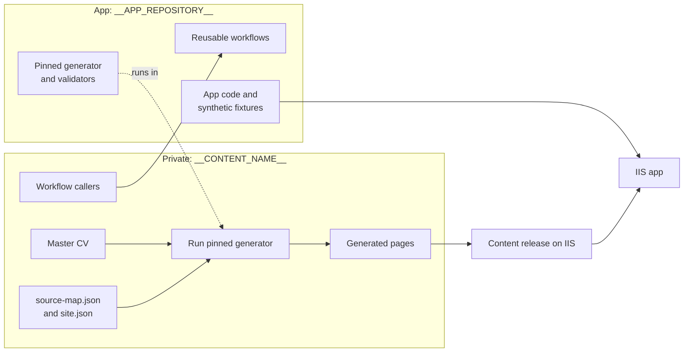
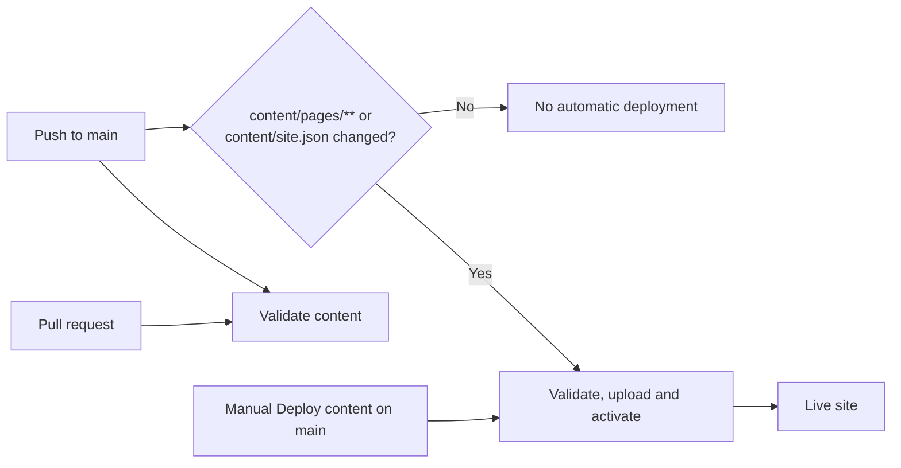

# __CONTENT_NAME__

This **private repository** is the source of the approved CV content. The app (`__APP_REPOSITORY__`) provides the generator, validators and the reusable GitHub workflows these callers use. It was created by `scripts/New-ContentRepository.ps1` from the app's synthetic template at release `__APP_VERSION__`.

## Before you publish anything

1. Replace the synthetic `content/sources/master-cv.md`, `content/source-map.json`, `content/cv-sections.json`, `content/site.json` and page metadata with your own. Follow the app's fork guide (`docs/fork-guide.md`) and `docs/source-map.md`.
2. Regenerate and validate (see below). Edit the source or source map, never generated pages.
3. Configure the private `production-content` environment: secrets `DEPLOY_PASSWORD`, `CONTENT_ACTIVATION_TOKEN`, `CONTENT_ACTIVATION_TOKEN_NEXT`; variables `MSDEPLOY_SERVER_URL`, `MSDEPLOY_SITE_NAME`, `MSDEPLOY_CERTIFICATE_SHA256`, `DEPLOY_USERNAME`, `MSDEPLOY_CONTENT_RELEASES_PATH`, `CONTENT_ACTIVATION_URL`. Details: `docs/content-releases.md` in the app.
4. In the app repository, protect `v*` tags with a ruleset that forbids updating and deleting them.

## Two repositories, one published site



| This private content repository | App repository |
| --- | --- |
| Master CV, source map, generated pages and generated provenance | App, shared tooling, reusable workflows and synthetic fixtures |
| Production deployment settings and caller workflows | No private CV content or production deployment secrets |

Only `content/site.json` and `content/pages/**` are deployed. The source CV, source map and generated provenance stay private.

## Master CV mapping at a glance

| Master CV structure | Mapping file | Generated page |
|---|---|---|
| Source sections selected for publication | `content/cv-sections.json` | `content/pages/cv.md` |
| Overview section and mapped tagline | `content/source-map.json` | `content/pages/home.md` |
| Competence headings and evidence lines | `content/source-map.json` | `content/pages/services.md` |
| Project-history heading, project sections, results and keywords | `content/source-map.json` | `content/pages/projects.md` and `content/pages/projects/<slug>.md` |

Edit the Master CV for source facts, the source map for page selection and source references, and the CV section rules for publication choices. Generated pages and `content/generated-provenance.json` are outputs: regenerate them instead of editing them by hand. Field contracts are in `docs/source-map.md` in the app.

## CI and deployment



- Validation runs on pull requests and pushes to `main`. It uses the app's reusable workflow at the exact release tag set in `.github/workflows/*.yml` (`@__APP_VERSION__` today) and receives no production secrets.
- A push deploys automatically only when `content/pages/**` or `content/site.json` changes. Documentation and workflow-only changes do not deploy.
- A maintainer can run **Deploy content** manually from `main`: leave `activate_release_id` empty to upload and activate current content, or supply an existing release ID to roll back without uploading.
- **Provision activation token** is manual on `main`; the default provisions the next token, while selecting the primary token is for recovery. Never expose production secrets to pull-request jobs or store them in the app repository. Environment approval is not approval to publish CV facts.

## Local generation and updating the pinned app release

Requires Node.js 24, npm, git and the .NET SDK selected by the app's `global.json`. The scripts live in the app repository (this repository holds no scripts); run them from an app checkout. They clone the app at the pinned release tag into a temporary folder, with automatic CRLF conversion disabled (its synthetic test fixtures require LF line endings), and remove it afterwards.

From the **app repository root**, with `<content>` set to this repository's path:

```powershell
.\scripts\Invoke-PinnedContentCheck.ps1 -ContentRoot <content>            # validate with the pinned release
.\scripts\Invoke-PinnedContentCheck.ps1 -ContentRoot <content> -Generate  # regenerate pages and provenance, then validate
```

To move to another app release, run `.\scripts\Update-AppPin.ps1 -ContentRoot <content> -To latest` (or `v0.*`, or an exact tag such as `__APP_VERSION__`; add `-WhatIf` to preview). It rewrites the caller workflows to that tag and regenerates provenance with it. Review the diff before opening a pull request.

<details>
<summary>Manual equivalent (no scripts)</summary>

```powershell
$AppVersion = '__APP_VERSION__'   # the tag in .github/workflows/*.yml
$AppRoot = Join-Path $env:TEMP "app-checkout-$AppVersion"
$ContentRoot = (Resolve-Path '.').Path
if (Test-Path $AppRoot) { throw 'Use a clean app checkout path or remove the existing checkout first.' }
git -c core.autocrlf=false clone https://github.com/__APP_REPOSITORY__.git $AppRoot
git -c core.autocrlf=false -C $AppRoot checkout --detach "refs/tags/$AppVersion"
Push-Location $AppRoot
npm ci
npm run test:content
npm run content:source:validate -- --root "$ContentRoot" --app-version "$AppVersion"
npm run content:generate -- --root "$ContentRoot" --app-version "$AppVersion"
npm run content:check -- --root "$ContentRoot" --app-version "$AppVersion"
npm run content:validate -- --root "$ContentRoot"
dotnet run --project tools/Portfolio.Content.Validator -- --content (Join-Path $ContentRoot 'content/pages')
Pop-Location
```

</details>

## Publication boundaries

- Publish only CV facts you have approved. Contact details, images and external profile links need separate approval: do not add them to `content/site.json` or pages without it.
- `content/pages/contact.md` and any demo pages are not generated from the CV; keep them reviewed by hand or remove them.
- Keep `GITHUB_TOKEN` read-only. Do not use `pull_request_target` or expose production credentials to pull-request jobs.
